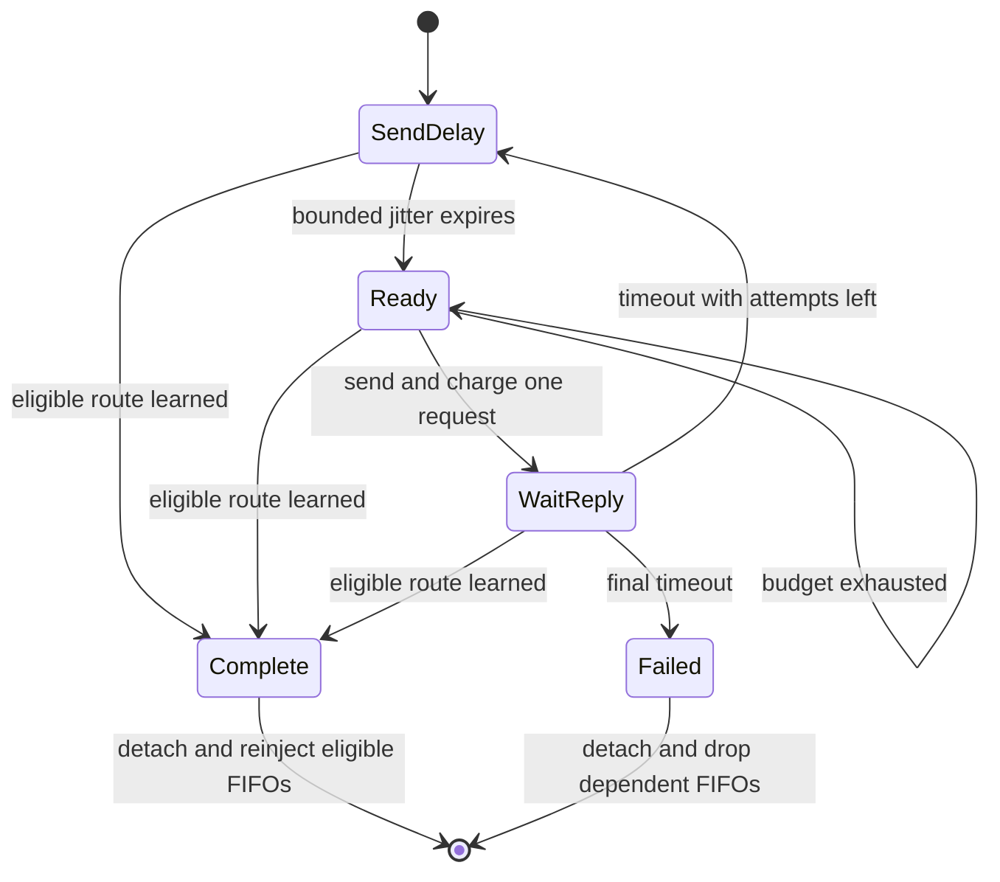

# Discovery scheduling and packet ownership

Two locally generated datagrams can require different routes while the node has only one
request slot left. Previously the second request returned at the rate check without a timer.
Its data remained queued indefinitely. A search now exists before admission and keeps its
place until the next one-second window. Requests acquire their ID and sequence at actual send.

IP owns each queued packet. AODV keeps borrowed pointers in a FIFO for its actual destination,
and maps that destination to its search target. Several external destinations can therefore
depend on one gateway search. Completion detaches all owners and cancels empty searches before
calling IP. Every released packet gets a fresh route selection and compatible output tags.
An incompatible caller-selected interface or next hop causes that packet alone to be dropped.

The same selection is used for new packets and queued packets. It expires owned routes lazily,
honors legitimate independent routes, and excludes the selected MANET interface's connected
subnet as proof of multihop reachability. That connected route describes address scope and exists
even when the configurator does not add static routes. It must not bypass discovery.

Recognized AODV UDP control traffic bypasses data admission. Unicast control specifies its
interface, source and immediate next hop. Ordinary transit data without a usable route takes
the RERR/drop path, rather than creating an originating search. Detailed transit sequence/error
semantics are assigned to the later error stage.

## Distinguishing scenarios

Each test uses the real UDP/IP hooks and AckingWirelessInterface. The peer observes requests
and delivered data. Original queued packets have a destructor counter. Inspection and radio
copies do not count as new IP obligations. No production path uses the test packet names.

| Fixture, prefixed Rfc3561 | Input and required observation | Parent cause and corrected action |
| --- | --- | --- |
| RateLimit | Two destinations, one request per second. Both packets arrive after two requests. | The second parent search has no wake-up. A ready FIFO preserves and admits it in the next window. |
| DeferredReply | The second destination gets a reply while waiting for the next budget window. Two packets arrive after one request. | The parent has no search record for the deferred request. The corrected callback releases its packet and cancels its admission. |
| ReplyDuringJitter | A direct-neighbor Hello arrives before a delayed request. One data packet arrives and no request escapes. | The parent Hello never completes the search and its delayed request remains scheduled. The corrected release removes the search timer. |
| IndependentRoute | A manual host route appears during jitter. One data packet arrives and no request is sent. | The parent sends without rechecking. The search wake-up now selects the eligible independent route. |
| NeighborCompletion | A stale reply for one destination independently refreshes an unaliased neighbor. Only that neighbor's queued packet is released. | The parent refresh does not complete the neighbor search. The corrected callback releases its FIFO while preserving the rejected destination's inactive sequence 20. |
| DiscoveryExhaustion | Two silent destinations, one request slot per second and zero additional retries. Both originals are destroyed with no data or application error. | The parent's second FIFO is stranded. Both corrected searches reach a terminal timeout and dispose through IP. |
| GatewayQueues | Two external destinations share one gateway reply. Both packets arrive after one request. | The parent completes a FIFO keyed by the gateway, while data is keyed by external destination. Explicit ownership releases both FIFOs. |
| GatewayFailure | The shared gateway never replies. Both originals are destroyed after one request. | The parent's gateway cancellation misses external FIFOs. The corrected failure walks every dependent owner. |
| OutputInterface_0 through _2 | Three queued packets, incompatible output interface first, middle or last. Exactly the other two arrive in FIFO order on the selected interface/MAC. | The parent reinjects without validating output constraints. Per-packet preparation rejects only the incompatible packet before reinjection. |
| OutputNextHop_0 through _2 | Same positions with an incompatible caller-selected next hop. | The parent emits to the wrong MAC. The same compatibility check prevents that emission and preserves the remaining FIFO. |
| TransitAdmission | A peer sends unknown-destination data to the DUT as next hop. It receives a RERR and observes no originating request. | The parent queues transit data as local discovery. The separate prerouting admission now returns DROP after error handling. |

The module cases AodvGatewayQueues and AodvTransitFailure repeat gateway exhaustion and transit
admission through the module runner. All newly failing parent assertions must be distinguished
from compilation or setup failures in the execution record.

## Limits and disposal policy

Dropping a queued datagram through the existing INetfilter interface deletes the packet without
an application Destination Unreachable indication. This retains the current IP disposal contract
and leaves RFC 3561 section 6.3's recommended application indication unmet. No synthetic socket
callback is introduced. The tests require destruction, no reinjection and no invented application
error. They do not prove application timeout behavior.

These are deterministic IPv4, direct-link fixtures. They do not establish IPv6 compatibility,
subnet repair, reboot holds, Wi-Fi failure attribution or multi-interface discovery. Interface
constraint tests deliberately retain one selected AODV interface, with a second interface only
as an incompatible caller constraint. The timing/backoff and parameter-validation stage follows
this ownership change. No existing test expectation or fingerprint baseline is replaced.
