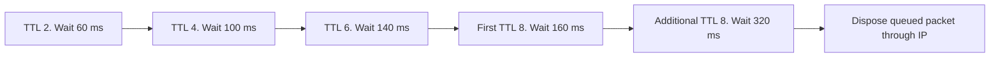

# Discovery timing and parameter bounds

This stage makes the schedule introduced with search ownership independently observable. It also
rejects configurations that cannot make bounded progress or represent their deadlines, and changes
the destination lifetime and blacklist defaults to cover the configured search.

## Wire observations

Each fixture sends one real UDP data packet into the DUT's local-out hook. A silent UDP peer
records RREQ hop limits, IDs, sequences and reception times. Every request has the same size and
uses the same deterministic radio path, so reception-time differences equal send-time differences.
The assertion tolerance is one microsecond. The packet destructor confirms terminal disposal.

| Rfc3561DiscoveryTiming fixture | Required TTL sequence | Consecutive reception intervals |
| --- | --- | --- |
| Rings | 2, 4, 6, 8, 8 | 0.06, 0.10, 0.14, 0.16 seconds |
| Jitter | 2, 4, 6, 8, 8 | 0.09, 0.13, 0.17, 0.19 seconds, including 30 ms per attempt |
| Retained | 5, 8, 8, starting from retained hop count 3 plus increment 2 | 0.12, 0.16 seconds. TTL 5 is above threshold 4 and remains the first ring. |
| Clamp | 8, 8, starting from retained hop count 200 | 0.16 seconds. The supplied initial TTL is clamped to diameter 8. |
| Diameter | 8 with zero additional retries | One network-wide attempt, followed by disposal. |

All five pass on the immediate parent, whose search-ownership change already introduced this
schedule. They are added coverage, not five new parent defect reproductions. Both versions must
reach the exact same assertions. Request IDs and originator sequences are 1 through the number
of actual sends. A retained known host supplies sequence 7, while a missing host keeps U set.

The jitter profile adds its sampled 30 ms before every send. It does not subtract jitter from
the reply interval. Rate admission remains covered by discovery-ownership.md.

## Parameter cases

The module fixtures are named AodvParameterValidation plus the suffix below. They use real AODV
initialization and, for JitterSample, a real application's first data packet. The small probe reads
the module's public parameters, without reaching into the routing implementation.

| Suffix | Input and required result |
| --- | --- |
| TtlZero, ThresholdZero, IncrementZero | Reject zero in the respective positive TTL field. |
| DiameterLarge, IncrementLarge | Reject 256 rather than narrowing to a wire TTL. |
| TtlOrder, ThresholdOrder | Reject start above threshold and threshold above diameter. |
| RetriesNegative, BufferNegative | Reject negative values with the owning field named. The parent already rejects these during unsigned conversion. |
| RequestRateZero, ErrorRateZero | Reject a rate of zero, which cannot provide search/error progress. |
| HelloLossZero | Reject zero explicitly. The parent already rejects its unencodable Hello lifetime. |
| Duration_nodeTraversalTime, Duration_activeRouteTimeout, Duration_deletePeriod, Duration_pathDiscoveryTime, Duration_nextHopWait, Duration_netTraversalTime, Duration_blacklistTimeout | Reject zero for each duration. Independent valid overrides keep the intended field responsible. |
| Duration_helloInterval | Reject zero explicitly. The parent already rejects its unencodable Hello lifetime. |
| JitterBound | Reject a negative maximum broadcast jitter. |
| PeriodicBound | Reject a maximum periodic jitter above half the Hello interval. |
| JitterSample | Reject a sampled 10 ms broadcast jitter above its declared 5 ms maximum. The parent already passes this check. |
| PeriodicSample | Reject a negative sampled periodic jitter when Hello is enabled. |
| HelloActive | Reject active timeout equal to the two-second Hello-loss interval. |
| Deletion | Reject a deletion interval below the active timeout. |
| AdvertisementMinimum | Reject six seconds when twice the path-discovery interval requires 11.2 seconds. |
| RetryOverflow | Reject 62 additional retries whose exponential schedule cannot fit simulation time, even with an explicit short blacklist override. |
| TraversalOverflow | Reject an unrepresentable traversal interval with the field named. The parent already fails during SimTime conversion. |
| Port | Reject 65536 explicitly. The parent's socket bind already rejects it. |
| Default | Observe blacklist 22.595 seconds and destination lifetime 11.2 seconds. The parent defaults are 5.6 and six seconds. |
| ZeroRetries | Observe positive blacklist 5.785 seconds with zero additional retries. The parent's default is zero. |
| Override | Preserve an explicit positive blacklist of 1.234 seconds. Passing parent control. |
| RetainedBound | Start/threshold/increment 1, diameter 255, zero additional retries and jitter. Observe the conservative 40.96-second bound, covering the 36.64-second TTL-201-plus-network search counterexample. |
| Boundaries | TTL start/threshold/diameter 1, increment 255, buffer/retries/jitter zero. Accept a maximum periodic jitter and sample of half the Hello interval and deletion equal to active timeout. Observe blacklist 0.16 seconds. |

Thirty fixtures require rejection, five require acceptance. Of the thirty, the parent already
rejects six under a different diagnostic and already passes JitterSample. These six diagnostic
changes do not demonstrate a newly accepted invalid configuration. The other 23 reach normal
initialization on the parent and fail the required rejection. Four accepted configurations expose
the incorrect default; Override already passes. The executed parent totals are therefore two
passes and 33 assertion/expected-output failures, with those distinct causes recorded separately.

JitterSample checks the fatal runtime diagnostic only. The existing IP path may report an
undisposed in-progress datagram when a netfilter callback throws, before IP registers a queue
obligation. It does not establish clean lifecycle disposal; normal exhaustion and stop/crash use
their dedicated fixtures. Initialization-rejection cases additionally prohibit undisposed objects.

## Bound and limits

Let R be 1 + floor((threshold - 1) / increment). The blacklist default is the maximum of the
retained-hop initial-ring bound and all threshold-ring waits, plus the geometric sum of all
network-wide waits, plus bounded jitter for every possible attempt. This is a conservative model
bound, not an RFC-prescribed equality. Explicit positive overrides remain user-selected durations.
The bound describes an unthrottled search and supplies no finite latency guarantee under unbounded
rate-limit workload.

Configured arithmetic is checked before scheduling. Volatile jitter samples are checked when
used. Destination/Hello duration encoding continues to be covered by the four earlier lifetime
rejection fixtures. These cases establish the selected IPv4 schedule and parameter profile, not
IPv6 parity, link validation, recovery or local repair. The later repair stage adds its own
enabled-parameter constraints. No previous expectation is weakened.
