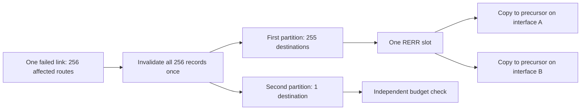

# Representable route-error partitions

RERR's destination count occupies one byte. A failed link can invalidate more than 255 local
routes at once, so outgoing error construction must partition the complete affected list before
admission. Each partition preserves its destination counters and receives one logical budget
decision. Every required precursor/interface copy of an admitted partition is sent.

The Rfc3561ErrorCapacity fixtures use a real failed data transmission after learning the failed
neighbor through one-hop UDP control. Public route setup supplies 1, 255 or 256 dependent records
and qualified precursors on two separate interfaces. Two independent UnitDisk media avoid
collisions between copies. Their interfaces use different IPv4 subnets. Transmission duration
limits permit the maximum-size error.

On reception, the actual production serializer writes the emitted header. The fixture checks
the count octet, serialized size and decoded destinations/counters. It also checks all affected
local records are invalid with exactly one counter increment. No private factory is called.

| Suffix | Immediate parent 5e143cc73e | Corrected result |
| --- | --- | --- |
| One | Pass: one encoded record reaches both recipients. | Pass unchanged. |
| Maximum | Pass: 255 encoded records reach both recipients. | Pass unchanged. |
| Partition | Fail: one 256-record header cannot have a valid count octet. | Two representable partitions reach both recipients with all 256 distinct records. |
| Budget | Same 256-record failure before admission can be checked. | Budget 1 delivers all 255 records of the first partition to both interfaces and none of the second; every local record is still invalidated. |

This public precursor setup isolates partitioning and budget fan-out before selected-interface
learning is implemented in stage 9. It does not prove how two selected interfaces learn those
precursors. The serializer itself retains its existing wire layout and record order. The factory
asserts the representable range; callers partition rather than silently truncating.

Execution logs, commands and limits are in
[the model results](../../../doc/project/evidence/model/aodv/results.md).
