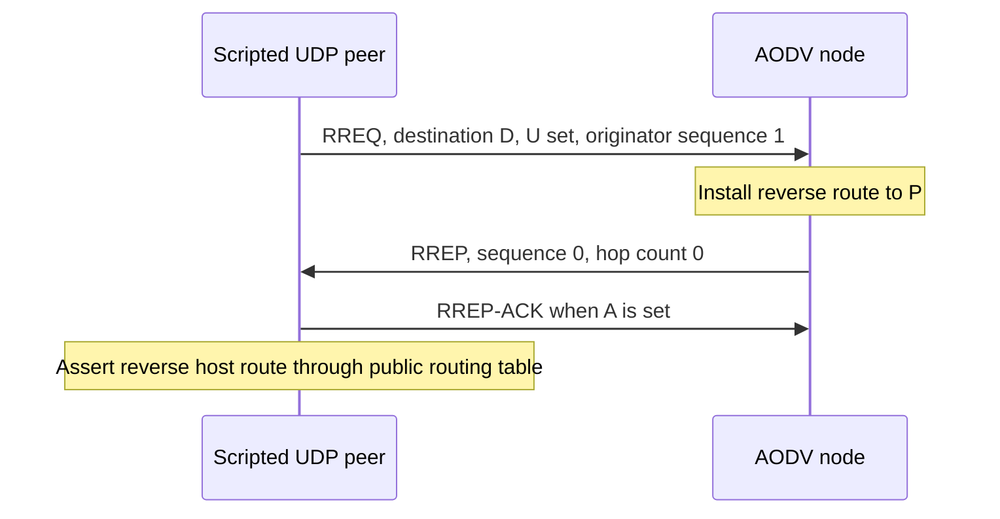

# AODV fixture controls

The `Rfc3561Control.test` peer sends an RREQ through its real UDP socket and the wireless IPv4
path to an unmodified AODV node. The request has U set and originator sequence 1. The node must
install the peer's one-hop reverse host route and reply with its initial destination sequence 0.
The peer acknowledges an A-flagged reply through UDP.
The test inspects route ownership, next hop, hop count, active state and sequence validity through
the routing table. It supplies no substitute AODV dispatch or route-selection implementation.

This is a passing preparation control, with the same expectation on its parent and this commit.
It demonstrates the fixture's control receive/send path and public state observations. It does
not establish stale-reply rejection, queued data release, loss attribution, repair or lifecycle
correctness. Execution evidence belongs in the model results record. Mermaid rendering passed in the series-wide [implementation record](../../../doc/project/evidence/model/aodv/remaining-features-results.md).
