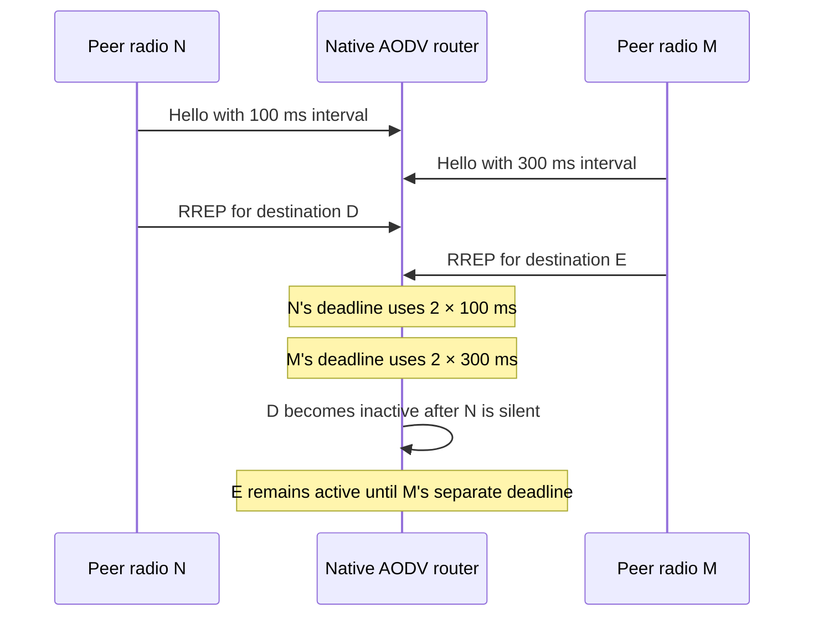

# Hello Interval extension

RFC 3561 sections 9 and 9.1 define the trailing Type/Length/Data records and the Type 1, Length 4 Hello Interval value. These C1 checks exercise the native AODV UDP/IP receive and send paths. The receiver must keep each already observed neighbor's interval separately, use it when incoming traffic renews a deadline and reject malformed extensions before they can change bindings, route state or liveness.

Most protocol fixtures use one real AODV router and one scripted peer host with two radios; Rounding and Bounds add a second real router. The peer's radios have different IP and MAC identities, representing neighbors N and M; they are not two independently forwarding routers. Both radios share a unit-disk medium with the router. Fixed positions, 100 Mbit/s AckingMac links, native IPv4/UDP, GlobalArp, seed 0, run 0, explicit picosecond simulation resolution and zero AODV jitter keep the deadlines deterministic. The explicit resolution also fixes the simulation-time overflow boundary in Bounds. Radio reception adds a small delay, so route checks are separated from deadlines by explicit margins. Hello loss is observed through the dependent route's active flag and once-incremented failure sequence, rather than a private timer.



Every protocol filename below has prefix `Rfc3561HelloIntervalExtension` and suffix `.test`. Each is a separate fixture using `AodvHelloIntervalPeer.h`.

| Case | Trigger and required observation |
| --- | --- |
| DifferentIntervals | N advertises 100 ms and M advertises 300 ms. Their learned dependent routes expire independently: D is inactive while E remains active, then E becomes inactive after its longer deadline. |
| LegacyFallback | A Hello without extensions arms N using the DUT's configured 100 ms interval. The dependent path expires under that fallback, preserving legacy peer support. |
| DataRefresh | N advertises 300 ms, then sends real UDP data at 0.5 s. The dependent path remains active beyond the old deadline and expires only after the data-renewed deadline. This checks that data refresh uses N's stored interval rather than the receiver's local 100 ms setting. |
| Rounding | Two native DUTs have configured periods of 0.75 ms and 1.5 ms. Observe their actual UDP sends before radio contention. The appended bytes at offsets 20–25 must be `01 04 00 00 00 01` and `01 04 00 00 00 02`, and the advertised lifetime must cover two encoded intervals. Consecutive local sends retain their configured periods rather than being rounded to 1 ms or 2 ms. |
| Bounds | A UINT32_MAX interval is accepted on the first DUT where the derived deadline fits simulation time. A second DUT with a larger allowed-loss multiplier rejects the same input before creating sender state because its deadline cannot fit. |
| Malformed | After a valid binding and armed deadline, send serialized truncated, zero-valued, mandatory-unknown, Type 0 and duplicate Type 1 records with a newer advertised sequence. The sender sequence remains unchanged and its dependent route expires on the original deadline. This catches an invalid packet refreshing liveness in the earlier IP hook even if later AODV parsing rejects it. |
| UnknownExtensions | A serialized skippable Type 55 record precedes a valid Hello interval. Then an RREQ containing that record is relayed. The record bytes survive forwarding, the Hello is accepted, and the accepted control renews the existing observation deadline. |
| Forwarding | Learn a reverse route from one radio, then inject a serialized ordinary RREP with a skippable record through the other. The forwarded reply uses the learned reverse next hop, increments the hop count and preserves the extension bytes. |
| Restart | Stop and restart only the AODV module using its public lifecycle operations and completion callback. Require graceful stop completion before starting, then learn a legacy Hello and a dependent path during recovery. The path expires using the new fallback interval; the pre-stop longer interval must not survive. The test overrides the declared lifecycle values to a 1 s stop timeout and zero extra time, and verifies normal deletion after its short retention period. |

The malformed, unknown-extension and ordinary-reply forwarding cases carry serialized `BytesChunk` UDP payloads. They therefore exercise receive-side decoding as well as field-level validation. The rounding case also serializes observed native output and checks the known six extension bytes independently of the production decoder; a serializer round trip alone would not supply that oracle.

The module family `AodvHelloIntervalValidation{Zero,EncodedIntervalOverflow,LifetimeOverflow}.test` checks startup rejection with Hello transmission enabled. Zero is an existing rejection control. The two overflow cases test the interval and derived-lifetime representation limits. They explicitly bound `deletePeriod` so its derived default cannot fail first and hide the intended encoding check. `AodvAdvertisementLifetimeInvalid_3.test` retains its rejection role by testing a genuine overflow, rather than treating the now-supported 999 us interval as invalid. `AodvHelloIntervalValidationSubMillisecond.test` supplies an active route through the public native table, observes native Hello UDP output and requires 999 us to produce encoded 1 ms. This fixture establishes initialization and timer-to-wire encoding; the public table setup is not route-learning evidence.

The unit case `AodvExtensions.test` checks exact Type 1 byte order, empty and skippable records, duplicates, truncation, invalid lengths, zero, reserved Type 0 and unsupported mandatory records. It supplements the production-path fixtures and does not establish that AODV invokes the parser.

## Comparison and evidence limits

The source parent has fixed-format RREQ/RREP definitions, emits no Hello Interval extension and uses the receiver's local interval for arming and renewal. The new wire-byte and heterogeneous-deadline assertions express the missing behavior. These are source-grounded expected differences. The new fixture accesses the new message fields, so running it unchanged on the parent would first encounter an API/fixture compilation gap; that is not a reproduced runtime protocol failure. No exact parent/commit comparison has been executed for these fixtures.

The tests do not establish RFC-wide conformance, an independent IPv6 wire format, statistical timer accuracy, arbitrary MAC metadata support or integration of external extension types. Unknown Type 55 is a selected skippable-record control, not a registered new AODV feature. The chosen duplicate and mandatory-unknown rejection policy is recorded by the implementation plan.

## Executed verification

The recorded debug working-tree verification ran on 2026-11-14 with a fresh matching INET debug library and protocol support library, after the native-expiry API and subnet introspection changes. The protocol pass also follows the production NED lifecycle-parameter declaration fix and tests the actual asynchronous completion contract. Protocol/module fixtures use General, run 0 and seed 0; the unit cases use no random draws.

| Selection | Outcome | Exit status | Retained raw output |
| --- | --- | --- | --- |
| Nine extension cases plus existing HelloLossSilent and HelloLossOutgoing controls | 11 PASS | 0 | `/tmp/aodv-hello-debug8-protocol-run.log` |
| Four interval-validation cases plus changed AdvertisementLifetimeInvalid_3 control | 5 PASS | 0 | `/tmp/aodv-hello-debug8-module-run.log` |
| AodvExtensions helper unit plus RouteExpiry and AodvSubnetIntrospection integration units | 3 PASS | 0 | `/tmp/aodv-hello-debug8-unit-run.log` |

Underlying runner commands from `/home/miguel/workspace/inet-aodv` were:

```sh
opp_run_protocol_tests --load . -p inet -m debug --no-build --no-concurrent -w '^tests/protocol/aodv$' -f 'Rfc3561(HelloIntervalExtension[A-Za-z0-9_]+|HelloLoss(Silent|Outgoing))\.test$' --log-file /tmp/aodv-hello-debug8-protocol-driver.log --result-file /tmp/aodv-hello-debug8-protocol-result.json
opp_run_module_tests --load . -p inet -m debug --no-build --no-concurrent -f '(AodvHelloIntervalValidation[A-Za-z0-9_]+|AodvAdvertisementLifetimeInvalid_3)\.test$' --log-file /tmp/aodv-hello-debug8-module-driver.log --result-file /tmp/aodv-hello-debug8-module-result.json
opp_run_unit_tests --load . -p inet -m debug --no-build --no-concurrent -f '(AodvExtensions|RouteExpiry|AodvSubnetIntrospection)\.test$' --log-file /tmp/aodv-hello-debug8-unit-driver.log --result-file /tmp/aodv-hello-debug8-unit-result.json
```

Each runner command executed inside `flock /tmp/inet-aodv-test-runner.lock`; the shell retained that lock while copying generated work before another category could clear it. Local diagnostic snapshots are `/tmp/aodv-hello-debug8-protocol-work.NvtHUV/work`, `/tmp/aodv-hello-debug8-module-work.L52ryE/work` and `/tmp/aodv-hello-debug8-unit-work.R6Syg9/work`. These are local execution artifacts, not repository test inputs. The library SHA-256 is `94959d33c3a6a4b7457ce1dde67c073b8ca5c806e155b1df1c5e300837a58d04`, recorded in `/tmp/aodv-hello-debug8-library.sha256`. Earlier unlocked attempts that lost shared work directories are setup failures and are excluded from the final result counts.

`RouteExpiry.test` checks the virtual `IRoute::getNativeExpiryTime()` contract for IPv4, IPv6 and NextHop routes: zero means no native deadline, while a finite IPv6 deadline is exposed unchanged and can be reset. `AodvSubnetIntrospection.test` checks exact independent IPv4/IPv6 announcement wire vectors, decoding raw bytes through the registered dissector, and the registered printer's source, type and prefix/eligibility/sequence fields. These checks cover both eligible/known-sequence and unavailable/unknown-sequence states. They do not establish production outgoing protocol-tag assignment or subnet election behavior; those require the separate subnet fixtures.

No fingerprint expectations changed. Exact parent executions and release-mode behavior checks remain unverified. Mermaid rendering passed in the series-wide [implementation record](../../../doc/project/evidence/model/aodv/remaining-features-results.md).

Static authoring checks passed on 2026-11-14: `clang++ -std=c++17 -fsyntax-only -Isrc -I"$OMNETPP_ROOT/include"` accepted the shared peer header and extracted module/unit C++ bodies against the regenerated message headers. `opp_nedtool validate` accepted every extracted NED fixture. These checks do not load `libINET_dbg` or execute a simulation, and therefore do not establish runtime correctness.
