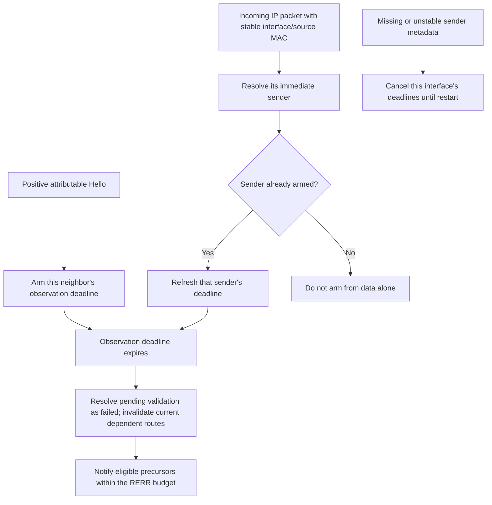

# Hello observations and neighbor loss

Route-use leases and neighbor observations answer different questions. Forwarding data can extend
a route lease, but it supplies no evidence that its next hop is still transmitting. The loss
detector therefore keeps a separate deadline for each neighbor/interface.

The same prerouting observation path handles IPv4 and IPv6 packet objects. Selected executions
here establish IPv4 profiles; IPv6 runtime compatibility remains assigned to the later bounded
compatibility cases. The detector uses existing indication tags and has no dependency on a
concrete MAC or radio class.

Stable one-hop control bindings supply the inverse interface/MAC lookup. Valid metadata from an
unlearned sender changes no deadline. An attributable positive Hello can arm its sender even when
its advertised sequence is stale; route acceptance still preserves fresher information. Zero
duration cannot arm a new deadline. Data and other one-hop control refresh only already armed
neighbors. Outgoing traffic does not refresh observation state.

A packet whose sender cannot be attributed could have come from any armed neighbor. Missing
metadata therefore disables the detector for the entire selected interface and cancels its
deadlines, rather than allowing a live neighbor to expire falsely. Rebinding and shared MAC
claims also disable it. Later good traffic cannot restore the observation contract; restart
clears the disable flags. Ordinary Hello route processing and uniquely attributable MAC feedback
remain available. Full restart assertions belong to stage 8.

## Distinguishing cases

All names below have prefix Rfc3561HelloLoss and suffix .test.

| Suffixes | Stimulus and required observation | Immediate parent 381667c9d0 |
| --- | --- | --- |
| Silent, DcfSilent, EthernetSilent | Stop observations while the destination still has a long usable lease. The neighbor and dependent route must expire as a link loss. | Dependent route remains active at 0.35 s. |
| Outgoing | Send data through the neighbor without hearing IP traffic back. Route-use lease extension cannot postpone link loss. | Route remains active at 0.35 s. |
| Data, DcfData, EthernetData | Receive data with original IP source S through immediate MAC sender N. N's deadline moves, then expires after silence. | Remains active at 0.6 s instead of invalidating. |
| Source | Arm S and N separately, then replay data sourced by S through N. N remains live at 0.35 s while S is inactive at sequence 101. | S remains active. |
| OtherControl | An unsolicited ACK refreshes the armed immediate sender without reactivating route state. | No subsequent Hello-loss invalidation. |
| StaleHello | A stale positive Hello refreshes observation while preserving fresher sequence 10. | No subsequent Hello-loss invalidation. |
| NoPrecursor | Silence invalidates a neighbor and its dependent record, but neither has precursors. Emit no unnecessary RERR. | Route remains active. |
| UnknownSender | Receive usable metadata for an unlearned MAC. It must neither refresh N nor disable N's detector. | Route remains active. |
| Validation | Keep validation outstanding past Hello loss. A late ACK cannot undo the resulting blacklist; a later request receives no second reply. | Produces a second validation reply. |
| NoArm, ZeroAlone, Disabled | Data alone, zero-duration Hello, and disabled Hello monitoring do not arm a detector. | Passing controls. |
| MissingData, MissingInitial | Remove source MAC metadata from an owned incoming packet. Cancel/avoid deadlines and keep detection disabled after a later valid Hello. | Passing controls. |
| MissingInterface, UnknownInterface | Remove or invalidate InterfaceInd in an owned completed UDP indication after arming. Cancel deadlines; later valid Hello does not re-enable them. | Passing controls. |
| Rebinding, Ambiguous | Change N's MAC or claim one MAC with another control IP. Disable the interface's detector. | Passing controls. |
| EthernetRefreshFirst | At the exact deadline, the incoming data event was queued first. Refresh postpones loss. | Fails the eventual loss assertion at 0.6 s. |
| EthernetTimeoutBeforeRefresh | At the exact deadline, timeout was queued first. Later data cannot undo invalidation. | Route remains active at 0.35 s. |
| EthernetMissingFirst | Missing metadata is processed first at the exact deadline. Cancel observation without invalidation. | Passing control. |
| EthernetTimeoutBeforeMissing | Timeout is processed first; later metadata loss cannot undo its route action. | Route remains active at 0.35 s. |

The exact-time cases calibrate Ethernet serialization using a real control packet. A test IPv4
adapter owns the incoming data packet before IP hooks and schedules its final ingress at the
measured deadline. Sending it early or late controls event insertion order without changing
production timer priority. The cases assert equal measured ingress/deadline times.

The simple wire fixtures use the existing nonlocal-source request flag to replay an original
IP source through a scripted peer. The two AodvHelloForwarded module fixtures additionally use
three real nodes: S emits data over Ethernet to N, then N forwards it over AckingMac or independent
nonaggregating DCF to the DUT. S has separately sent its own one-hop Hello. At DUT ingress, the
fixture asserts IP source S and source MAC N. S's deadline expires while N's is refreshed.
These two cases fail the parent's S-inactive assertion and pass after correction.

All dependent-route errors in these cases contain one destination at sequence 21, retain TTL 1
and reach the qualified precursor. Precursors are seeded through the public table to isolate
observation from already tested reply propagation. Existing protocol/module regressions and exact
commands are in [the model results](../../../doc/project/evidence/model/aodv/results.md).

Direct AckingMac, independent DCF and Ethernet are tested metadata profiles. Infrastructure/WDS,
aggregation and custom bridging require their own immediate-sender evidence. No type whitelist
is introduced. Full lifecycle cleanup, selected-interface observation, subnet learning, IPv6
runtime compatibility and repair remain assigned to later stages.
