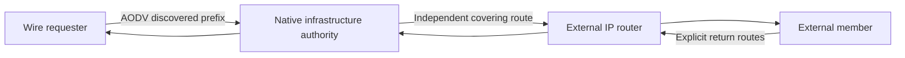
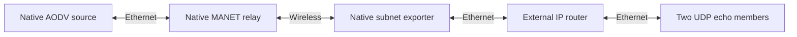

# Infrastructure subnet exports

These C10 tests connect the native AODV infrastructure router to a real external router, then to two external Ethernet hosts. The exported prefix is behind that router, distinct from the directly attached subnet tests. Public native routes configure external reachability and return paths; the test never substitutes an external routing algorithm. All 14 infrastructure cases and four initialization cases passed in the matching final debug build.



| Case suffix | Required observation |
| --- | --- |
| `ExternalIpv4`, `ExternalIpv6` | Authoritative prefix reply and actual delivery to two external members through a native covering route. |
| `NativeReturn` | A native AODV source discovers through a native MANET relay and exporter, installs the aggregate and exchanges UDP echoes with two external members through a separate IP router. |
| `ExternalIpv6Expiry` | A finite native IPv6 covering route expires without a route mutation; its saved precursor receives withdrawal before a new probe, and later request/data cannot use the expired export. |
| `PrimaryDownUnavailableExport` | With the independent export route absent and primary MANET interface down, real transit enters the surviving secondary interface; the bounded check requires no member delivery, AODV control emission or crash. |
| `TwoGateways` | Two native infrastructure candidates use the common-network election. A stopped lower candidate is replaced by the higher candidate, which delivers data through its independent route. |
| `ExternalRouteWithdraw` | Removing the only native covering route causes a saved-precursor prefix RERR and suppresses later replies. |
| `LateRoute` | A well-formed export starts dormant, then begins answering when an independent route appears, without restart. |
| `CoveringReplacement` | Deleting one covering route while another remains causes no false RERR. |
| `InPlaceUpdate` | Real IPv6 advertised-prefix update emits its deleted/added notification pair; the coalesced owner keeps the export available and emits no RERR solely because of that pair. This case asserts control behavior, not member delivery via the artificial on-link update. |
| `ReturnPath` | Native UDP echo replies cross the external router and AODV gateway back to the source socket. |
| `NoRecursiveExport` | An AODV-owned covering route, followed by a route on the wrong output interface, cannot authorize export. The configuration remains dormant rather than failing startup. |
| `OverlappingPrefixes` | An explicit `/25` inside a `/24` is advertised for its member; both members receive actual data. |
| `LegacyGateway` | The existing configured-gateway control remains usable when both new XML lists are `<subnets/>`. |

`AodvExternalSubnetsValidation{Case}.test` separately rejects nonempty legacy-gateway conflicts, duplicate exports, unknown interfaces and invalid prefixes. A temporarily absent covering route is tested as dormancy, not misclassified as invalid configuration.

`NativeReturn` provides the complete originating production path. The source and relay originate/forward real RREQs, the exporter replies, and the source installs an active aggregate before sending to the second member. Both native member echo applications must return their packets to the originating source socket. Public static routes configure the independent external network and its return path; GlobalArp isolates MANET discovery and data forwarding from address-resolution timing.



IPv6 fixtures configure their directly connected wired routes through the public native routing-table API. Automatic shortest-path configuration stays disabled so it cannot silently supply an alternate external covering route after the route under test is withdrawn or expires.

`PrimaryDownUnavailableExport` uses GlobalArp to address the surviving radio explicitly; its ingress assertion checks that the actual packet entered that secondary interface. Address-resolution failure is covered separately by the subnet-authority cases.

After a fresh matching debug build, run from the checkout root:

```sh
flock /tmp/inet-aodv-test-runner.lock opp_run_protocol_tests --load . -p inet -m debug --no-build --no-concurrent -w '^tests/protocol/aodv$' -f 'Rfc3561InfrastructureGateway.*\.test$'
flock /tmp/inet-aodv-test-runner.lock opp_run_module_tests --load . -p inet -m debug --no-build --no-concurrent -f 'AodvExternalSubnetsValidation.*\.test$'
```

All runs are General/run 0/seed 0, fixed topology and zero AODV jitter. Candidate cases retain the bounded common-network assumptions in [subnet-election.md](subnet-election.md). These tests configure public routes directly; they do not establish behavior of OSPF/BGP or another external route producer. The parent lacks the new external export parameters, so no incompatible-fixture startup failure is presented as a runtime parent defect.

On 2026-11-14, all 14 infrastructure cases passed within the combined 37/37 protocol selection, and all four external-export rejection cases passed within the 12/12 initialization selection (both runner exits 0). This includes the full native end-to-end echo path. Exact commands, selected paths and matching before/after library/helper hashes are in `/tmp/aodv-subnet-owned-protocol-record.json`. Raw logs are `/tmp/aodv-subnet-owned-protocol-{protocol,module}.log`, with matching `-artifacts` directories. The common debug library SHA-256 is `bcb9f5d13fa867ddca91b87c45121fe280c38c2a6042d8fc4b830e7d777e1011`.
