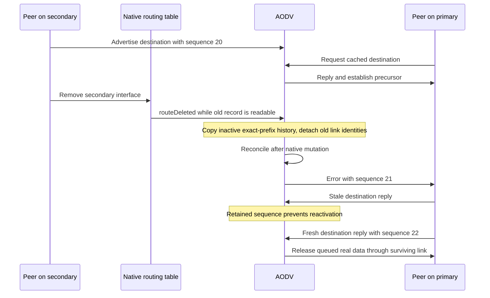

# Live secondary-interface changes

Plan C6: **Aodv: handle live secondary-interface changes**.

The C6 fixtures use two independent native UDP/IP links. A scripted peer advertises destination `10.0.0.99` with sequence 20 through the DUT's secondary radio; the native IPv6 case uses `2001:db8:9::99`. Where a precursor is needed, a real cached RREQ/RREP exchange on the primary link establishes it. The peer then changes the secondary interface using its public API. Real source applications generate tracked packets, and the peer observes their reception at IP after the actual MAC exchange. The source/output checks observe each DUT MAC's real dequeue signal before encapsulation, including the MAC of a newly constructed NIC. Native IPv4 does not emit its base class's `packetSentToLower` signal on this path, so subscribing only to that IP signal would leave a negative output assertion untested.



The fixtures exercise the following paths in `AodvLiveInterfacePeer.h`:

| Case | Direct observation |
| --- | --- |
| `SecondaryDown` | The route through the down interface is invalidated; queued demand later leaves through the primary. |
| `DeleteDuringJitter` | A forwarded request is prepared before physical interface deletion. No control packet may leave with the deleted secondary's source after deletion. |
| `AddressChange` | The interface retains its ID but changes address while forwarding waits for jitter. Prepared old-source output must be rejected. |
| `RecreateName` | Delete the NIC module through the interface table, construct a new NIC in the same configured vector slot, reconnect its public gates, build and initialize it, and assign a usable address. Its interface ID must differ from the deleted NIC's ID. A real own-address RREQ must receive its reply through this reconstructed NIC. |
| `PendingAck` | A one-hop reply is deliberately left unacknowledged, then its link goes down before validation expiry. A later request after link return must receive a reply rather than meet an obsolete blacklist. |
| `QueuedDiscovery` | Data enters discovery before the link change. The search continues on a surviving link and releases all eligible packets after learning a reply. |
| `DeletedHistoryStaleReply` | Native route deletion cannot erase its sequence floor. A stale reply is rejected and the emitted request carries retained sequence 21. |
| `DeletedHostBlocksAggregate` | A known removed host still blocks its covering AODV aggregate. Another member uses that aggregate. A temporary manual host route carries data without consuming AODV history; removing it exposes the original block again. |
| `DownHostBlocksAggregate` | Apply the same data-timing and manual-route assertions while the inactive host remains in the native table with a null interface after secondary down. |
| `ReaddressHostBlocksAggregate` | Repeat that native retained-host boundary after secondary address reassignment. Neither down nor readdress may make the known host look unknown to a covering aggregate. |
| `ExpiredHistory` | Idle expiry before physical removal preserves sequence 20 without a second failure increment. An equal-sequence reply can reactivate the host. |
| `UnaffectedLink` | Removing a different selected link preserves the primary route and its actual data path. |
| `Ipv6Membership` | Native IPv6 down/up removes and restores the selected secondary's socket membership. A real multicast RREQ on the returned link must receive a reply there. |
| `Repair` | The first transit packet encounters MAC failure and starts local repair; that packet is already lost at MAC. Inject a second tracked transit packet under the existing owner, delete the secondary, and assert one native queued obligation. A fresh reply through the primary must release that packet. Assert one delivery, disposal of both originals, terminal repair state, surviving output ID and empty native hook queue. |
| `DeferredSiblingRepair` | MAC loss starts repair for A and makes sibling B eligible for deferred repair. Secondary down must clear B's deferred eligibility before real transit B arrives. Require one bounded no-route error for B, successful A release through the primary, three original disposals and no native queued obligation. |
| `DownUpBeforeDelayedReply` | Prepare a forwarded sequence-20 RREP on the secondary, take that link down and restore the same ID/address before its jitter expires. A later fresh sequence-22 request must yield exactly one secondary reply, with sequence 22. This distinguishes cancellation from merely rechecking the returned link's current identity. |

On the pre-C6 source, native-table deletion can remove the only owned freshness record before AODV handles the interface event; stale replacement information can then create a new active route. Address reassignment also leaves prepared packets with their old source. The new owner captures a fresh detached route-factory record with null interface, preserves exact-key inactive knowledge, and promotes that record only after accepting a usable update. It defers error emission until native table iteration ends and checks the prepared source again at actual send. Active native routes remain the only forwarding candidates.

`AodvInterfaceChangeLifecycle.test` in the module suite stops AODV immediately after changing the secondary link, restarts it, then repeats with crash/start. It checks cancellation of pending reconciliation and the existing recovery hold, with terminal tracked-packet disposal. Every source original must be destroyed exactly once; lower-layer inspection copies do not increment the source-original counter.

Three companion module fixtures isolate boundaries. `AodvInterfaceChangeSendFirst` and `AodvInterfaceChangeChangeFirst` schedule deletion at the forwarded request's exact jitter expiry, using opposite event priorities. The first order permits its already-valid send; the second must discard the prepared secondary send. `AodvInterfaceChangeHistoryExpiry` rejects sequence 20 while the deleted route retains sequence 21, waits beyond the delete period without pending demand, then accepts sequence 1 and forwards one tracked packet. These tests use the public table and actual UDP path; they do not inspect AODV's private history map.

Final verification ran on 2026-11-14 from the checkout root in debug mode, General/run 0/seed 0, with fixed positions. The combined protocol selection passed all 25 cases, including all 16 C6 cases; the four C6 module cases also passed. Both runners exited 0. The helpers' SHA256 values were identical before and after execution. The matching INET debug library SHA256 was `bcb9f5d13fa867ddca91b87c45121fe280c38c2a6042d8fc4b830e7d777e1011`.

```sh
flock /tmp/inet-aodv-test-runner.lock opp_run_protocol_tests --load . -p inet -m debug --no-build --no-concurrent -w '^tests/protocol/(aodv|udp)$' -f '(Rfc3561(InterfaceChange|PrimaryIdentityChange)[A-Za-z0-9_]+|MulticastInterfaceRemoval)\.test$'
flock /tmp/inet-aodv-test-runner.lock opp_run_module_tests --load . -p inet -m debug --no-build --no-concurrent -f 'AodvInterfaceChange[A-Za-z0-9_]+\.test$'
```

Raw logs, exact commands, source snapshots, per-case stdout/stderr and library/helper hashes are in `/home/miguel/workspace/ai-logs/executions/aodv-live-owned-protocol-bcb9f5d13fa8/`, with the shared run record in `record.json`. The repair cases print their terminal counts: ordinary repair delivered one packet and disposed 2/2 originals; deferred sibling repair delivered one and disposed 3/3 originals. Both report an empty native hook queue.

Exact-parent executions were not run; the before-change failure explanations are derived from source. Mermaid rendering passed in the series-wide [implementation record](../../../doc/project/evidence/model/aodv/remaining-features-results.md). This selection establishes the listed cases at seed 0 rather than a statistical or complete-suite result.
