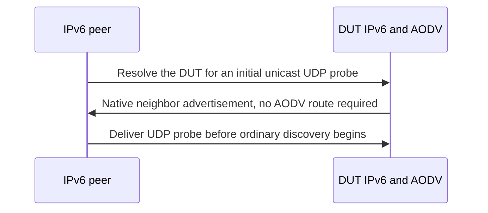

# Native IPv6 neighbor discovery

Native ND is link control. A unicast neighbor advertisement cannot wait behind
the AODV search it must enable. Inspect the typed IPv6/ND header on a packet copy
before generic transport dissection and let ND pass independently of data routing.

AodvIpv6Compatibility sends that probe at 0.01 seconds and requires delivery by
0.08, before ordinary discovery at 0.16. The peer has a normal manual route; the
DUT has not learned an AODV peer route. On the parent, an unexpected AODV request
appears during this ND exchange and the fixture fails. With ND admission the
probe arrives and the later discovery/freshness/encoding assertions also pass.
The basic fixture without the initial probe passed both versions and is a control.

The initial fixture deliberately makes no ACK-count claim. Link validation adds
the four-ACK assertion in its own PR. Multicast socket membership and its separate
Incoming fixture enter in the following commit. Neither wire encoding nor the
single-interface IPv6 profile changes. Exact split execution is in the PR evidence.
