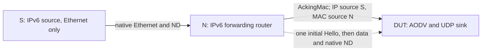

# Native IPv6 compatibility

These fixtures exercise the existing single-interface IPv6 profile through native
IPv6, UDP, neighbor discovery and AckingMac. They preserve the custom IPv6 control
encoding. Explicit multi-interface selection and received subnet routes remain
IPv4 features; these checks do not claim IPv6 feature parity or RFC conformance.

## Receive defect and correction

`Incoming` sends a multicast RREQ for the DUT itself. The immediate parent
`edecd5e6ce` enables UDP broadcast but does not join the IPv6 control multicast
group. Its UDP socket never receives the request, so no reply arrives. Joining
the address type's existing broadcast group (`ff01::1`) on every start fixes both
initial reception and reception after restart. No control type or serializer is
changed.

```mermaid
sequenceDiagram
    participant P as IPv6 wire peer
    participant U as DUT UDP socket
    participant A as AODV
    A->>U: Bind port 654 and join ff01::1 on selected interface
    P->>U: Multicast RREQ for DUT
    U->>A: Deliver request with ingress metadata
    A->>P: Unicast destination RREP
    Note over U,A: Stop/crash clears socket state; start joins again
```

## Case assertions

Each basename below has both `Rfc3561Ipv6<Name>.test` in this protocol suite and
`AodvIpv6<Name>.test` in the module suite. All use General/run 0/seed 0.

| Name | Conditions and required observation | Immediate parent |
| --- | --- | --- |
| Incoming | Native multicast request reaches the DUT; reverse state and one self reply appear. | Runtime failure: missing reply. |
| IncomingRestart | Crash/start, learn during recovery, then receive multicast again; two replies, later sequence floor 50. | Runtime failure: missing initial reply. |
| RateLimit | Two local destinations with one RREQ per second; second request waits for budget, both queues release. | Passing control. |
| DeferredReply | Reply for a READY search before budget admission releases data and cancels the obsolete send. | Passing control. |
| Restart | Data during restart hold learns a route but cannot leave until the hold ends; no redundant discovery. | Passing control. |
| CrashReady | Crash disposes an admitted search and a READY search; new demand after restart has no ghost retry. | Passing control. |
| StopQueued | Asynchronous stop disposes the same queued obligations; start accepts fresh traffic. | Passing control. |
| HelloForwarding | Five packets from S arrive via N with IP source S and MAC source N; N and its dependent route stay active, then expire after all attributable traffic stops. | Passing control. |

The last case uses three real nodes:



S sends at 0.18 through 0.58 seconds. At 0.7 seconds all five packets have
arrived and both learned routes are active, well beyond the initial Hello's
0.2-second observation interval. The observer records every frame from N;
native Router Solicitations count as valid incoming activity too. At 0.95 seconds
the last such reception is more than 0.2 seconds old: N advances 20 to 21 and the
dependent destination advances 100 to 101. S gains no AODV neighbor record. There
are no discovery requests or error floods without precursors. The peer's periodic
router advertisements are disabled through public interface configuration.

Initial fixture checks that equated the final data reception with the final
neighbor reception failed because a native Router Solicitation arrived later.
That is legitimate liveness evidence, so the final assertions measure actual
incoming activity rather than suppress neighbor discovery.

The earlier `AodvIpv6Compatibility.test` covers native discovery, stale/wrapping
and half-range replies, ACKs and data. Native repair success/timeout cases in
[local-repair.md](local-repair.md) cover RREQ/RREP/RERR encoding and alternate
next-hop forwarding. These tests inspect actual packet fields and public route
state; they do not invoke AODV handlers or copy its selection algorithm.

Exact commands, paired results and broader regressions are recorded in
[the model results](../../../doc/project/evidence/model/aodv/results.md).
