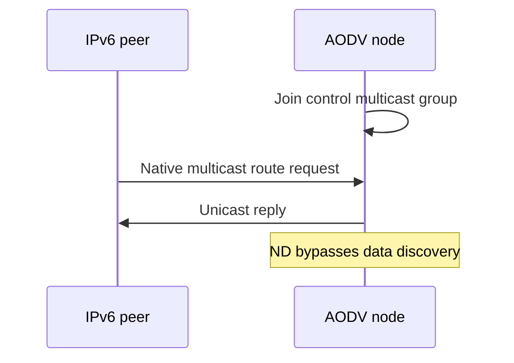

# Native IPv6 compatibility

These single-interface fixtures use real IPv6, UDP, neighbor discovery and AckingMac. Control encoding is unchanged. Explicit interface selection and received subnet routes are separate IPv4 features.

AODV joins its existing ff01::1 control group at every socket start. Typed neighbor-discovery messages pass independently of data searches, so an advertisement cannot wait for the route it must establish.

| Case | Input, mechanism and required observation |
| --- | --- |
| Incoming | Send a native multicast RREQ for the node. Require reverse state and a self reply. Without group membership the socket receives no request. |
| RateLimit | Queue two destinations under one request per second. Require both data deliveries, separate request IDs and matching ACKs after actual admission. |
| DeferredReply | Learn a READY destination before admission. Require two data deliveries after one request, matching ACKs and no obsolete later send. |

Each named case has protocol and module variants with prefixes Rfc3561Ipv6 and AodvIpv6. They use General/run 0/seed 0 and public routes or wire observations, never direct AODV handlers.

AodvIpv6Compatibility additionally exercises serial freshness and RREQ/ACK decoding. Its ACK assertions require the link-validation correction, so this control is introduced with that correction.

The original combined-series parent comparisons remain recorded in the model results. Fresh execution of the split revisions is recorded in the split verification log and PR description. Passing controls are not claimed as newly reproduced defects. Local repair coverage belongs to the later repair PR. No IPv6 feature-parity or exhaustive conformance claim follows.

The native basic fixture first sends one unicast UDP probe from the peer to the node at 0.01 seconds, before normal discovery starts at 0.16 seconds. Native ND must deliver it by 0.08 seconds without starting AODV discovery for a neighbor advertisement. The peer has an ordinary manual route; the DUT has not learned an AODV peer route. This exercises link control independently of AODV reply learning. The basic fixture also requires four matching ACKs after the link-validation correction.
