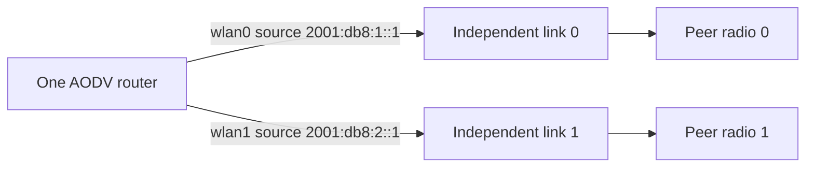

# Selected IPv6 interfaces

The explicit-interface mode gives one native IPv6 AODV instance two participating links. It keeps a single originator address, request-ID stream and logical request budget while choosing source and output from the actual selected link. Joining the control multicast group only on the primary interface would leave a secondary request unheard.

The fixture has two independent radio media. DUT `wlan0` and peer `wlan0` share `2001:db8:1::/64`; their second radios share `2001:db8:2::/64`. The DUT's primary identity remains `2001:db8:1::1`. Native IPv6, UDP and ND carry every exchange. No static/default/direct forwarding routes are generated. Run 0 uses seed 0 and zero AODV jitter.



Every case below is `Rfc3561Ipv6Interfaces<Case>.test`.

| Case | Production-path assertion |
| --- | --- |
| DiscoveryFanout | One actual demand emits a request on each medium with the same originator, ID and originator sequence. An answer on the secondary link installs that output and releases the datagram. |
| IngressReply | A request received on the secondary link for its selected local address produces a reply on that same link with the secondary source address. |
| AckIsolation | A-flagged replies from two different links produce one ACK on each corresponding input interface. |
| ErrorPrecursors | A secondary request learns a real precursor for a route advertised on the primary link. An ordinary primary-link error invalidates that route and reaches the learned secondary precursor. |
| HelloIsolation | Both links begin with positive Hellos and dependent routes. At 0.15 s both neighbors must retain the valid sequence supplied by those Hellos, then only the peer's primary interface goes down. The DUT interface stays up. The second link continues sending Hellos. Primary-dependent state expires through Hello loss while secondary-dependent state stays active. |
| RateBudget | Two actual demands at one logical RREQ per second produce two physical copies per request. The second pair waits for the next budget window, and both data obligations complete without error. |
| RestartMembership | Native requests on both links receive replies before crash and after restart/recovery. A new socket must join both multicast groups again. |

`AodvIpv6InterfacesValidation<Case>.test` adds startup cases. `MixedFamilies` uses public interface protocol-data APIs before actual routing startup to give only the secondary a preferred IPv4 identity; it must reach AODV's same-family diagnostic. `DuplicateAddresses`, `Unspecified`, `LinkLocalOnly` and `Tentative` exercise the corresponding selected-identity checks. The tentative case supplies one routable address whose DAD has not completed, so it distinguishes usable identity from mere address presence. `ImplicitLinkLocalOnly` and `ImplicitTentative` repeat those invalid-identity cases with the default implicit interface selection. `StartAfterDownInit` initializes the DUT down, starts it through the public lifecycle controller and requires requests/replies on both links. The test-only setup does not call the validation function itself.

The pre-feature parent rejects explicit IPv6 selection during startup. That is an absent configuration capability, not a paired runtime assertion failure. Once C4 admits the configuration, every case must reach its wire and route assertions. Existing `Rfc3561Ipv6IncomingRestart`, `Rfc3561Ipv6RateLimit` and IPv4 `Rfc3561InterfacesDiscovery` remain controls.

```sh
flock /tmp/inet-aodv-test-runner.lock opp_run_protocol_tests --load . -p inet -m debug --no-build --no-concurrent -w '^tests/protocol/aodv$' -f 'Rfc3561(Ipv6Interfaces[A-Za-z0-9_]+|Ipv6IncomingRestart|Ipv6RateLimit|InterfacesDiscovery)\.test$'
flock /tmp/inet-aodv-test-runner.lock opp_run_module_tests --load . -p inet -m debug --no-build --no-concurrent -f 'AodvIpv6InterfacesValidation[A-Za-z0-9_]+\.test$'
```

Execution status: **PASS**, matching debug build 8, General/run 0/seed 0. All seven protocol cases and three existing controls passed in the clean 35-case affected selection, exit 0, `/tmp/aodv-c345-clean-build8.log`. `HelloIsolation` reported primary dependent inactive and secondary dependent active. All eight startup module cases passed alongside three local-repair lifecycle controls: exit 0, 11/11 PASS in `/tmp/aodv-c345-final-module-build8.log`. Generated outputs were copied under the runner lock to the corresponding `-artifacts` directories. The diagram rendered successfully in `/home/miguel/workspace/ai-logs/executions/aodv-diagrams-20261114/results.json`. Identical parent execution remains **NOT_RUN**.

Native router discovery is also valid neighbor-liveness evidence. AckingMac can wake a radio previously put in OFF mode when native traffic is queued, so radio mode alone cannot guarantee silence. Taking only the peer interface down prevents that background egress while preserving the DUT's own interface and Hello-loss machinery. The recorded diagnostic Router Solicitation and radio wakeup are expected provider behavior, not an AODV defect.

The shared fixture header passed standalone C++ syntax checking. These cases use unique global identities and do not establish dual-stack address selection or live IPv4-to-IPv6 switching. They also do not claim byte interoperability with a separately specified IPv6 AODV implementation.
