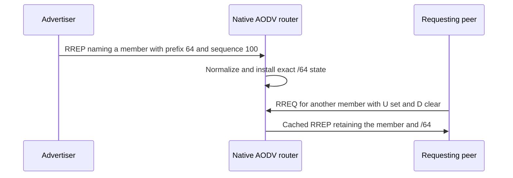
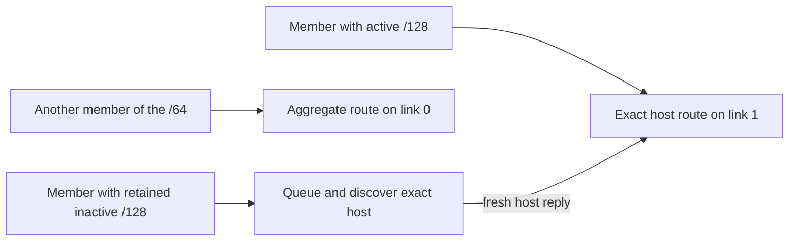

# Native IPv6 subnet routes

A nonzero prefix in the existing IPv6 RREP encoding must identify an aggregate rather than a `/128` host route. The route and its sequence history belong to the normalized exact prefix. Installing that aggregate should let a second member use it without another discovery, while a retained known host can still block that host's use of the aggregate.

These C5 cases use two native IPv6 links, scripted UDP control and actual data forwarding. The peer serializes its control through the production serializer and sends the resulting byte chunk as the UDP payload. It independently checks the RREP type byte, 44-byte base size and seven-bit prefix field before transmission; the DUT must decode those bytes through its native receive path. The public native table supplies route-state observations; actual peer ingress and destination MAC establish the data output. Run 0 uses seed 0, zero AODV jitter, fixed positions and native ND.



The file family is `Rfc3561Ipv6Subnet<Case>.test`.



The independent host and aggregate sequence counters are compared only within their own exact prefix. A retained inactive host remains the selected constraint for that host instead of silently falling through to the aggregate.

| Case | Setup and required result |
| --- | --- |
| Learn64 | A `/64` RREP names `2001:db8:8::99`. Both that member and `::100` are emitted through its learned next hop without an originating RREQ. |
| Prefix127 | A `/127` advertisement covers the exact `::100`/`::101` pair; both members forward. |
| Host128 | Prefix Size zero installs only a host, using the existing host encoding. This is a control for unchanged behavior. |
| IndependentCounters | Aggregate sequence 100 and exact-host sequence 5 coexist on different links. Longest-prefix forwarding chooses the host for its member without comparing independent counters. |
| InactiveHostBlock | An expired known host blocks the active aggregate for that member. Another member forwards. A later sequence-6 exact-host reply releases the original queued member before its search expires. |
| CachedReply | A reverse request on a different link receives a cached RREP naming the requested member and retaining prefix 64 and aggregate sequence 100. |
| RelayPrefix | A real reverse RREQ path is learned, then an incoming `/64` RREP is forwarded to that originator with its prefix intact and hop count advanced. |
| ErrorAmbiguity | `/64` and `/65` records have the same normalized wire address and next-hop link. A single address-only RERR cannot identify one prefix, so both counters and active states remain unchanged. |
| Repair | A real failed next-hop transmission starts aggregate repair. A subsequent transit member waits, then a fresh alternate-link `/64` reply permits data emission through the resolved alternate MAC. |
| IcmpMember | A quoted native ICMPv6 Address Unreachable for one member reaches the UDP source. The aggregate stays active with sequence 100 and forwards another member afterwards. |
| TwoLinks | A member first uses the aggregate on link 0. A fresher aggregate arrives on link 1; a second member uses link 1. Actual receive interfaces and destination MACs establish the path change. |

On the C4 parent, an advertised nonzero IPv6 prefix is interpreted as a host. Its missing normalized `/64` route is the expected first failure for most cases; that first failure does not separately reproduce all later assertions. `Host128` is added coverage/control. The same `/0` bit pattern is a valid host marker on the wire, so configuration rejection of exported default routes belongs to C8 rather than to a malformed-wire declaration here.

```sh
flock /tmp/inet-aodv-test-runner.lock opp_run_protocol_tests --load . -p inet -m debug --no-build --no-concurrent -w '^tests/protocol/aodv$' -f 'Rfc3561(Ipv6Subnet[A-Za-z0-9_]+|Subnet(Basic|Counters|KnownBlock))\.test$'
```

Execution status: **PASS**, matching debug build after the protocol ownership audit, General/run 0/seed 0. Library SHA256: `bcb9f5d13fa867ddca91b87c45121fe280c38c2a6042d8fc4b830e7d777e1011`; build log: `/tmp/aodv-owned-protocol-debug-build.log`. All eleven C5 cases and three IPv4 subnet controls passed in the 35-case affected selection, exit 0, `/tmp/aodv-c345-owned-protocol.log`. This includes the pre-reply blocking and actual two-output assertions. Generated output was copied under the runner lock to `/tmp/aodv-c345-owned-protocol-artifacts`.

The fixture header passed standalone C++ syntax checking. Both diagrams rendered successfully in `/home/miguel/workspace/ai-logs/executions/aodv-diagrams-20261114/results.json`. Identical parent execution remains **NOT_RUN**. These checks establish the bounded native encoding and host-only RREQ-floor profile; they do not implement authoritative subnet-router election or resolve counter-domain recovery by themselves.
