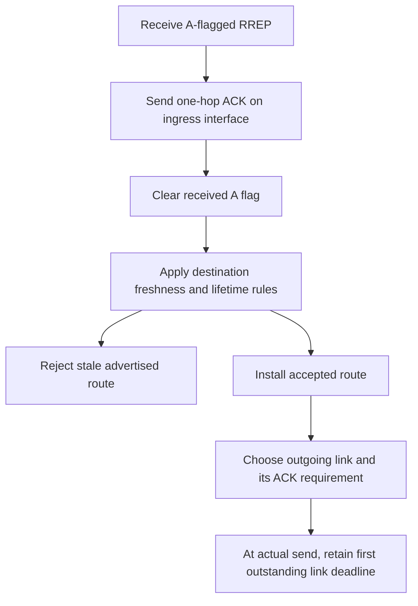
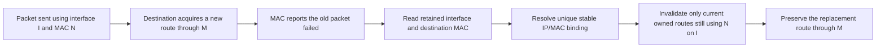

# Link validation and failed-transmission attribution

A reply can be stale as routing information and still require acknowledgment as a received
one-hop message. Conversely, an ACK for one neighbor cannot finish another neighbor's validation.
This stage separates those decisions and replaces the single failed-next-hop variable with
neighbor/interface deadlines. Repeated replies on one link retain its first outstanding deadline.
Locally generated direct replies retain the existing ACK-request rule. Forwarded replies retain
their established cleared-A policy. Confirmed MAC failure blacklists either kind independently
of A, without adding new ACK requests to the default forwarded-reply traffic.

## Distinguishing ACK cases

Fixture names below have prefix Rfc3561ReplyAck and suffix .test. Inputs reach the real IP/UDP
handler. Peer assertions observe emitted control, public route state and whether subsequent
requests receive a reply. No test reads the private ACK or blacklist maps.

| Suffix | Scenario and required observation | Immediate parent |
| --- | --- | --- |
| OriginatorAck | Final requester receives accepted, stale and zero-lifetime A-flagged replies. All three produce an ACK with TTL 1. Accepted sequence 20 remains selected. | Returns at the originator or freshness check before ACK, failing the first ACK observation. |
| RejectedAck | Establish reverse state and forward sequence 20 once, then receive stale 19 with A set. Emit one ACK without forwarding stale information. | Drops the stale reply without its required ACK. |
| DirectInactiveAck | Invalidate the direct sender's known route to sequence 21, then receive its stale direct reply at 20 with A set. Emit one ACK while preserving inactive 21. | Emits no ACK. The correction also proves control bypass when the sender's data route is unusable. |
| IndependentAck | Two links await validation. ACK only the first. The second times out and rejects later requests, even after its late ACK. The first still answers. | One ACK cancels the shared timer, leaving the second link unvalidated and unblacklisted. |
| SharedAckDeadline | Send another reply on the same link before its first deadline. A request after that first deadline remains blocked. | Repeated replies postpone the global timer and admit another request. |
| UnsolicitedAck | Keep validation pending on another link, then send an unsolicited ACK from an inactive route. Its route stays inactive and the other validation still times out. | Reactivates the inactive route and cancels the unrelated timer. |
| FailedReplyAck | Turn off the peer receiver during an A-flagged reply. Observe the real failed MAC packet, then send a late ACK and another request. No reply may escape the resulting blacklist. | Failure leaves the pending timer/blacklist outcome vulnerable to the late ACK, and another request receives a reply. |
| FailedReplyNoAck | Fail a gratuitous reply without A on another peer link. The real failed packet must have A clear and the expected output MAC. A late ACK cannot make a later request admissible. | No ACK timer exists to blacklist that link, so its later request gets a reply. |
| CustomPort | Repeat FailedReplyNoAck on configured UDP port 60654. The same real failure must blacklist the peer without relying on a global UDP-port dissector registration. | Same missing no-A failure blacklisting. |
| FailedReplyIndependent | Keep another peer's validation pending while an A-flagged reply fails. Its independent validation must still time out after the failed link's late ACK. | The late ACK cancels the one global timer, so the other peer gets an extra reply. |
| AckFirstAtDeadline | Deliver ACK to AODV exactly at its deadline with the ACK event first. A later request receives a reply. | Passing control. |
| TimeoutFirstAtDeadline | Deliver at the same exact deadline with timeout first. The late ACK cannot remove the blacklist, and the later request receives no reply. | Passing control. |

The two deadline cases use full-duplex Ethernet, real IPv4 and UDP, and measured serialization
latencies. A test-only channel between completed UDP delivery and AODV's socketIn schedules the
final ACK delivery event before or after the request creates its timer. It delays both requests
and ACKs equally, preserving the exact deadline equality. No private timer priority is changed.
The scripts intentionally prearrange the ACK send time to test event order, not natural round-trip
latency. Cable propagation alone was insufficient because zero-delay receive-pipeline events can
still enter the event set after the timer. The final fixtures assert the physical ingress times,
equal final delivery time and the resulting externally observable blacklist behavior.

Rfc3561ControlIngressMissing and Rfc3561ControlIngressUnknown additionally pass a real completed
UDP request through a test adapter that removes InterfaceInd or supplies a nonexistent interface
ID. The adapter owns the indication when changing its tags. AODV must ignore the request without
learning a route, replying or guessing its primary interface. The parent processes both requests
and fails the absent-route/reply assertion. The unknown-ID path uses a nonthrowing interface
lookup so invalid metadata does not turn the required ignore action into a runtime error.

## Attributing the actual failed link

One-hop control reception learns interface-qualified IP/MAC bindings. They outlive route expiry
and deletion. A changed IP/MAC association or a MAC claimed by another IP permanently quarantines
every affected MAC for this operational interval. Missing/ambiguous metadata supplies no peer.

The failed packet is borrowed. Production code reads it during the signal callback and retains
only the resolved link key. It never retransmits or retains that packet. A new route lookup for
the packet's final destination cannot identify its old attempted next hop.

Fixture names below have prefix Rfc3561FailedLink. All disable Hello and observe an actual failed
MAC transmission. A second data packet uses the replacement route successfully. Two source apps
use different UDP source ports, avoiding socket-binding setup artifacts.

| Suffix | Required observation and parent cause |
| --- | --- |
| Replacement | A data packet is in flight through N when a real UDP reply installs D through M. D remains active at 21 through M, while another route still using N becomes inactive at 31. The parent looks up D's current path, invalidating M and D instead. |
| Dcf | Repeat through independent IEEE 802.11 DCF, QoS disabled, no aggregation or fragmentation, fixed 1 Mbps and retry-limit failure. The replacement is installed through the public table at the first real MAC send, after the attempted link was selected. The failed IBSS header has neither DS bit, has Retry set and names N as receiver. Retained InterfaceReq/MacAddressReq match that attempt. The parent invalidates D's replacement. |
| NoBinding | Seed initial routes through the public table without receiving any control from N. The later M reply is real. The failure must leave D and the route through N unchanged because N has no binding. The parent guesses M from D's current route. |
| MissingOutput | A test queue strips InterfaceReq before MAC admission. Observe the missing tag on the real failed packet and leave peer-specific state unchanged. The parent still guesses from D's current route. |
| Ambiguous | Two IP senders on one ingress interface claim the same MAC. Both receivers are turned off for the failed attempt, then M returns for successful replacement data. The failure must affect neither current path. The parent guesses M and invalidates D. |
| Rebinding | N changes its observed MAC, then an independent M update arrives before the old-MAC failure. Both old and replacement MAC associations remain quarantined. No path is invalidated from that ambiguous failure. The parent guesses M. |
| ExpiredNeighbor | Both learned neighbor host records are deleted before the old transmission fails. Their stable binding must remain usable: D survives through M, and the dependent N route is invalidated exactly once. The parent finds no usable owned neighbor record for its guessed M and misses the dependent N failure. |

The three module cases AodvTransitFailureInFlight, AodvTransitFailureDcf and
AodvTransitFailureMetadata repeat the replacement, DCF and missing-output scenarios.

The AckingMac and nonaggregating independent DCF profiles establish retained tags and immediate-
peer meaning in their actual paths. They are evidence profiles, not a production type whitelist.
Ethernet deadline tests establish UDP/control delivery there, not Ethernet link-failure feedback.
Aggregation, infrastructure bridging/WDS and custom metadata semantics require separate evidence.
Binding cleanup on restart and data-refreshed Hello loss are assigned to later lifecycle/liveness
stages. The current failure fan-out is restricted to owned matching links; complete precursor,
RERR partition/admission and N-flag rules remain assigned to the error stages.

The no-A failure additionally distinguishes a control-classification defect: raw Chunk::peek
does not use Packet's unspecified-length convention. The corrected classifier bounds the control
peek by the UDP payload length. It inspects a temporary copy, never mutating the borrowed failed
packet. Known non-AODV UDP ports take a metadata-only fast path. Reserved malformed control cannot
be admitted as data after a later header parse fails.
