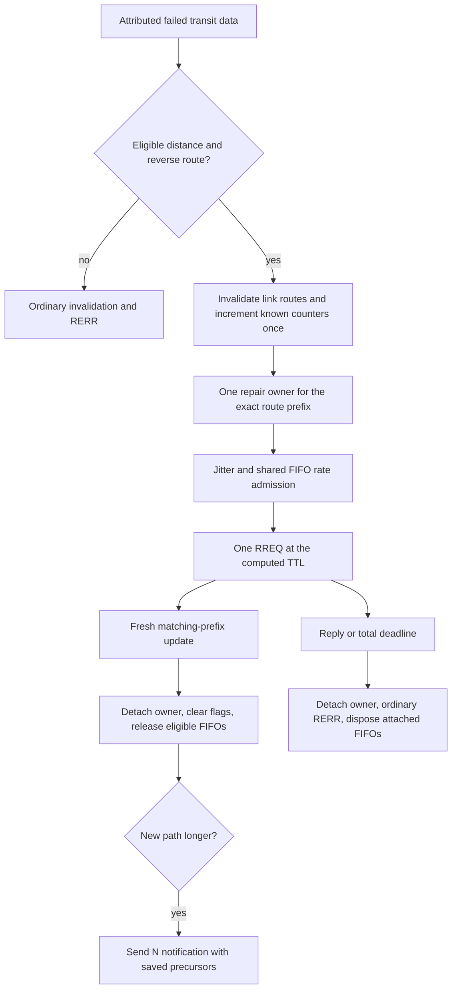
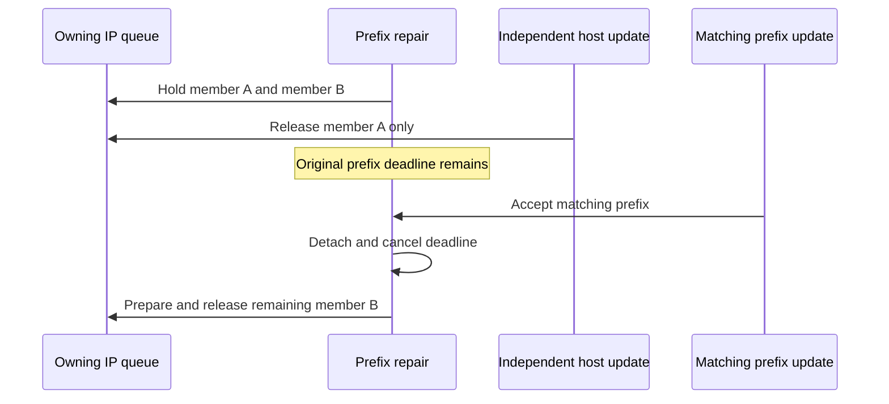

# Bounded local repair

This stage implements plan row 11 in Aodv's existing failure, discovery and IP
queue paths. RFC 3561 section 6.12 permits local repair; this model selects one
attempt and a finite total deadline. The default remains useLocalRepair=false.

Only failed transit data can initiate repair. The failed MAC-owned packet is
inspected during its signal callback and is never retained, queued or retransmitted.
Subsequent eligible transit data and local data can join the owned prefix's FIFOs.
An existing originating search keeps its purpose and takes precedence over a new
repair for the same retained prefix.

## Policy and owners

Search keys contain the full address family/address/prefix; originating and repair
purposes share scheduling infrastructure without converting into each other.
Each repair keeps its first wire target, old hop count, precursor obligations and
creation-time total deadline. The route record remains the only sequence store.

maxRepairTTL defaults to floor(0.3*netDiameter), with range zero through netDiameter.
Zero disables eligibility. With an active reverse distance available, the repair
TTL is max(old destination distance, ceil(source distance/2)) + localAddTTL.
Unavailable distances and values above netDiameter/255 decline optional repair.
A single reply wait starts at actual send. Creation time plus pathDiscoveryTime
also bounds SEND_DELAY and budget-starved READY. Neither member arrivals nor
independent member recovery extends either bound.

Host repair exports its current known post-invalidation floor, or U with numeric
zero if unknown. Aggregate repair uses U=1,D=1 and keeps its incremented counter
locally. A matching prefix must still satisfy that retained counter. One accepted
host, RREQ-originator, one-hop or Hello update can finish host repair. An independent
host update cannot finish aggregate repair, even after every member has left.

Other eligible routes on the failed link become inactive and repairable until
activeRouteTimeout; they start no proactive request. Later transit demand can start
their own transaction. Expiry clears only their deferred flag. A completed repair
does not consume another prefix's deadline or notification.

## Fixtures

All names below have prefix Rfc3561LocalRepair and suffix .test. Except the two
explicit IPv6 variants, they use IPv4 General/run 0/seed 0, fixed positions, zero
jitter and AckingMac/UnitDisk. Scripted N, S and alternate R use distinct physical
radios/MACs. A source RREQ supplies the reverse distance, an RREP supplies the old
forward distance, then N's radio is turned off. The 5 ms MAC timeout supplies the
real failed-frame signal. No Aodv handler or private timer is invoked by a fixture.

| Case | Assertion |
| --- | --- |
| Off | Default-off failed transit invalidates and notifies without a repair RREQ. |
| ExplicitOff | Explicit false preserves the same ordinary path. |
| Distance | Old distance above the default maximum declines repair. |
| SourceMissing | No usable reverse distance declines repair. |
| TtlTooLarge | A computed TTL above netDiameter declines repair without clamping. |
| ZeroMaximum | Explicit zero disables eligibility. |
| HostSuccess | One TTL-5 host request carries floor 21; fresh reply releases subsequent transit/local data once. |
| Longer | A longer accepted path stays active and sends one N entry; no later ordinary error appears. |
| Failure | One attempt times out, clears flags and disposes both attached kinds of packet without another increment. |
| Stale | Unchanged pre-break sequence 20 cannot satisfy retained 21 and times out. |
| AggregateSuccess | Two members share one U=1,D=1 request, matching /24 success, and one prefix owner. |
| AggregateFailure | Both members are disposed with one canonical prefix error at 21. |
| IndependentHost | /32 sequence 5 releases only its own FIFO during /24 repair; prefix timeout preserves that host and drops the other member. |
| EmptySuccess | Independent /32 recovery empties the owner; later matching /24 success still cancels its deadline and sends the applicable N notification. |
| EmptyFailure | An empty owner retains its notification obligation and expires once without disposing already released data. |
| OriginatingFirst | A local search for another deferred host keeps its purpose; later transit drops with the ordinary error, while the local FIFO recovers normally. |
| OriginatingFirstAggregate | An originating member search blocks optional repair for another member of its same retained aggregate. |
| UnknownHostMember | An aggregate releases an unknown-host repair's FIFO but cannot finish its host owner; timeout reports numeric zero and preserves the aggregate. |
| UnknownHostSuccess | After that independent release, a committed RREQ-originator host update finishes the empty owner. |
| HelloSuccess | A real third source supplies transit data; the destination router's fresh Hello completes host repair. |
| NeighborSuccess | The same topology completes repair through a committed one-hop observation; normal later idle expiry remains allowed. |
| RateStarved | Another originating request consumes the window; total expiry disposes repair before any repair transmission. |
| JitterStarved | Jitter longer than the total bound cannot transmit a repair; notification retains its own declared jitter. |
| Crash | Whole-node crash clears repair ownership and actual IP queues. |
| Restart | Crash/start leaves no old repair event or notification. |
| Shutdown | Public asynchronous shutdown completes and empties the IP queue. |
| RateStop | Stop during READY cancels the total deadline and queued admission. |
| JitterStop | Stop during SEND_DELAY cancels the unsent repair. |
| OutputConstraint | Incompatible local next-hop constraint drops only that packet; compatible transit still recovers. |
| SecondFailure | A second real loss saves the newly repaired metric, increments once to 22, computes TTL 4, and generates the new longer-path N obligation. |
| Deferred | Another host on the broken link starts repair only on later transit demand; the first success preserves the second owner. |
| DeferredAggregate | The same deferred-demand ownership uses exact aggregate keys and U/D fields. |
| DeferredDeadline | An unrequested deferred route loses its flag; later transit uses ordinary failure handling. |
| ReplyFirst | A completed UDP reply delivered exactly at the wait deadline first cancels the losing timer and releases data. |
| TimeoutFirst | Reverse event insertion order disposes data and notifies once; the later same-time reply can learn a route without reviving the dead transaction. |
| FailedControlAck | An A-flagged failed RREP still blacklists its actual link and creates no repair/deferred flags or discovery. |
| FailedControlNoAck | The same exclusion and failure attribution hold for an unflagged failed RREP. |
| Ipv6HostSuccess | Native IPv6/UDP, ND and prerouting reach a real MAC failure and successful host repair. |
| Ipv6Failure | Native IPv6 timeout clears repair and emits the unchanged custom IPv6 error encoding. |

The two native IPv6 modes use the same family-independent repair owner. IPv6
RREQ/RREP/ACK/data also run in AodvIpv6Compatibility.test; repair success/failure
repeat in AodvIpv6RepairHostSuccess/Failure.test. Seven module repetitions cover
crash, restart, asynchronous shutdown, rate/jitter stop and rate/jitter total bounds.
Two module cases reject maxRepairTTL below zero and above netDiameter.

## Packet ownership and exact ties

AodvRepairIpv4 owns raw incoming input before native IP invokes prerouting. It
copies headers/tags into a tracked packet subclass, then runs the real IPv4 path.
Inspection/transmission clones are plain Packets. Final assertions require every
tracked transit original destroyed once and the owning IP hook queue empty.
Local source originals have independent destructor counts. Actual wire delivery
uses packet tree identity to avoid counting copies as new obligations. This
instrumentation strengthens disposal proof without replacing production admission,
queueing, reinjection, MAC failure or terminal cleanup.

The tie filter owns a completed UDP packet generated before the failure and keeps
its native socket/ingress metadata. At linkBroken, the fixture schedules its actual
AODV socket delivery at failure time plus the TTL-5 wait. ReplyFirst queues that
delivery before the zero-jitter send callback creates the wait timer. TimeoutFirst
queues it one nanosecond later, after that timer exists, at the identical absolute
delivery time. Normal OMNeT++ event insertion order supplies both outcomes. No
private timer priority or direct handler call is used.

## IPv6 boundary

The native profile uses stable addresses on one selected AODV interface. Explicit
multi-interface selection and subnet reception remain IPv4 features. Scripted
source output is supplied at the source IPv6 local-out hook, so native ND resolves
the requested link before transmission; the DUT uses its unchanged IPv6/IP path.
A probe primes ND before N is turned off. IPv6 ND identity must bypass AODV data
discovery, otherwise a unicast NA itself waits for the route that ND must establish.

The existing IPv6 local-out path can emit a pinned unicast IP packet as link
broadcast, including local-out reinjection. The fixture preserves that behavior,
deduplicates observations and requires the resolved alternate next-hop MAC for
repaired transit. IPv4 supplies the tracked owning-IP transit disposal proof;
IPv6 supplies native runtime route/data/error and shared-state coverage, rather
than an IPv4 replay. Custom IPv6 message types and lengths remain unchanged;
RREP and received RERR round trips are explicitly checked.

## Parent comparison and limits

The immediate parent is 497d3cb7e5. Off/ExplicitOff, the four eligibility declines
and both failed-control variants are passing controls. Enabled IPv4 cases usually
fail first at the missing beingRepaired assertion; SecondFailure first fails its
first-success assertion. The later terminal, FIFO and notification checks are
corrected-path coverage, not separately reproduced parent failures. Native IPv6
parents stop earlier with missing route state because ND is queued behind discovery.
That is recorded separately from the missing IPv4 repair mechanism.

The model retains its host-only aggregate floor convention and stable unambiguous
RERR identity assumption. It does not infer shared counters across prefixes,
upgrade an originating search into repair, or force deletion to escape continuing
known-host blocking. The selected tests do not establish exhaustive RFC conformance.
Executed commands, setup corrections, exact counts, builds and artifact paths are
in the model results.
