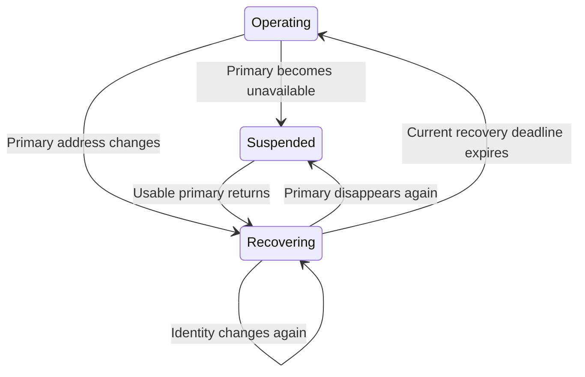

# Recovery after primary-identity changes

Plan C7: **Aodv: recover after primary-identity changes**.

C7 treats loss or replacement of the configured primary identity as a new recovery epoch. The primary name remains configured. AODV-dependent demand is dropped while the primary is unavailable; usable independent forwarding remains eligible. Once the primary is usable, the existing recovery timer holds local demand before advertisements and discovery resume. A repeated change cancels old demand and starts a new deadline instead of permitting old completion work to escape.

The real UDP/IP fixtures share `AodvLiveInterfacePeer.h`. They learn a destination through the secondary radio, mutate the primary via its public interface or family-specific address API, and send three tracked data originals across the transition. The peer observes emitted UDP source addresses, actual received data and the time at which each datagram arrives. A valid destination reply during the hold can restore state, but it must not release data before the current deadline.

During each suspended or recovering interval, the observer at each DUT MAC's real dequeue rejects AODV RREQ/RREP output, including RREP-encoded Hello messages. Each case sends an own-address RREQ during recovery to require suppression of a new destination reply. `LearnDuringHold` enables the Hello timer so the negative hold assertion covers real scheduled Hello work. Each case requests an ACK on its fresh reply and requires the peer to receive that ACK while recovery still holds data. Every source application must receive zero error indications when old or suspended demand is disposed. Error packets remain permitted by the output assertion; these fixtures do not independently force a positive RERR emission during a hold.

| Case | Required result |
| --- | --- |
| `PrimaryDown` | Demand while down is disposed silently. Later hold-time demand waits until the primary has returned and recovery expires. |
| `ReaddressIpv4` | No packet uses the old primary source after reassignment, and no data escapes the hold. |
| `ReaddressIpv6` | Native IPv6 address removal and assignment trigger recovery; no AODV UDP output retains the old source and tracked data waits for the current hold. Native ND traffic is outside this AODV source assertion. |
| `ReturnDuringHold` | A second down/up interrupts the first hold, cancels its queued demand and establishes a later deadline. |
| `RepeatedChange` | A second address change discards the prior epoch's queued packet and holds new demand against the current deadline. |
| `LearnDuringHold` | The destination record can become active during recovery while the observed data count remains zero. |
| `OldDelayedReply` | A reply naming the old originator can be learned according to normal control rules, but it cannot bypass the new recovery deadline or restore old-source transmission. |
| `AllLinksDown` | Neither old nor newly arriving demand remains stranded while all links are unavailable. Normal recovery resumes after the configured links return. |

Without C7, primary changes have no recovery owner. A route through an unaffected secondary may continue transmitting data while the primary is down or immediately after reassignment. The new path clears old owned work using the existing generation and cleanup code, keeps the wildcard UDP binding for same-family changes, and reuses the existing recovery timer. Native ND and non-AODV routes are independent of this demand hold.

The scoped selector is `Rfc3561PrimaryIdentityChange[A-Za-z0-9_]+\.test`. Final verification on 2026-11-14 executed all eight C7 cases as part of the combined 25-case command recorded in [interface-changes.md](interface-changes.md); every case passed and the runner exited 0. Mode was debug, General/run 0/seed 0, with fixed positions. The matching INET library SHA256 was `bcb9f5d13fa867ddca91b87c45121fe280c38c2a6042d8fc4b830e7d777e1011`, and the shared helpers were unchanged across the run.

Exact commands, hashes, raw logs and each case's inputs/stdout/stderr are in `/home/miguel/workspace/ai-logs/executions/aodv-live-owned-protocol-bcb9f5d13fa8/`, with the shared run record in `record.json`. Exact-parent executions remain unverified; the before-change explanations are source-derived. The positive ACK stimulus establishes permitted recovery control output, while a positive hold-time RERR stimulus remains outside this set.

Mermaid rendering passed in the series-wide [implementation record](../../../doc/project/evidence/model/aodv/remaining-features-results.md).
