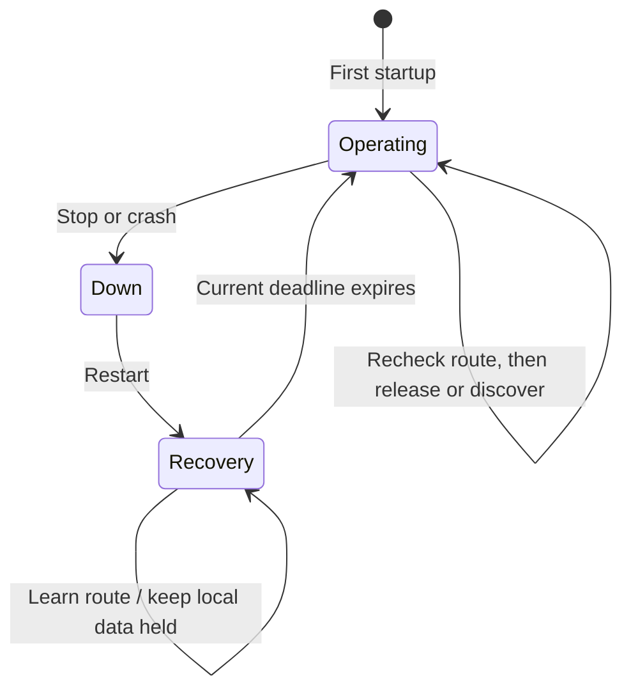

# Restart recovery and lifecycle ownership

Initial startup and restart are distinct, including a restart at time zero. Restart begins a
deletePeriod recovery hold. Incoming control can restore state, but discovery, route-reply
advertisements, forwarded control and Hello output wait. One-hop RREP-ACK and budget-admitted
RERR remain permitted. Sending either permitted output never extends recovery.



Local data enters a RECOVERY_WAIT search before the usable-route fast path. These searches own
their packets through the existing actual-destination FIFO and share one scheduled recovery
wake-up. On expiry, recheck the learned path before sending any request. Extending the deadline
moves that shared event, so an old wake-up cannot release data.

At an exact deadline the event processed first decides: transit first extends the hold; wake-up
first ends it, and subsequent transit follows ordinary forwarding/error rules. The two fixtures
schedule actual IP ingress at the exact deadline in an owning IPv4 adapter. Neither alters
production event priority.

Stop/crash cancels search, recovery, rate, expiry, neighbor, ACK, blacklist and delayed-control
events. It clears attribution bindings/quarantine and observation-disable flags, drops queued
packets through IP's identity-based disposal API and removes only this AODV instance's routes.
The destructor cancels owned messages without calling another module. Whole-node crash may let
IP dispose of packets before AODV; its drop API safely ignores identities no longer queued in both
IPv4 and IPv6. Runtime ownership evidence here is IPv4; bounded native IPv6 cases remain later work.

Each start after the first uses a new UDP socket identity. An old close indication cannot close
the newly bound logical socket or make a later stop skip its close command. Indications bearing an
old identity are discarded. Repeated zero-time shutdown/start previously caused a port-already-taken
runtime error.

```mermaid
sequenceDiagram
    participant A as AODV
    participant IP as IP queue owner
    participant L as Lifecycle callback
    A->>IP: Reinject first detached packet
    IP->>IP: Finish reinjection and remove its queue entry
    IP->>L: Test callback after completed reinjection
    L->>IP: Crash/start; dispose remaining queued packets
    L->>A: Clear state and change operational generation
    IP-->>A: Return from reinjection
    A->>A: Generation changed; stop touching old borrowed pointers
```

The test adapter invokes the callback only after the real IP reinjection completes. This respects
IP's own active iteration contract. The first committed packet may reach the peer or be disposed
by the lower-layer crash; the remaining two original obligations must be destroyed exactly once.
Generation checks also prevent an old counter/recovery callback from scheduling over a restarted
timer or applying a previous interval's pending neighbor actions.

## Cases and observations

Names below have prefix Rfc3561RebootRecovery and suffix .test.

| Suffixes | Required observation | Immediate parent 05c0a2c2f8 |
| --- | --- | --- |
| Basic, Crash | Learn sequence 20 during the hold, ACK it immediately, retain local data and release once at expiry without an RREQ. | Local data is already delivered at the early check. |
| Cleanup, Foreign | Remove owned records on routing-module stop; preserve a manual route even though it carries AodvRouteData. | Owned records remain at 0.125 s. |
| ZeroRestart | Restart at simulation time zero still creates a real hold. | Data is delivered early. |
| DoubleRestart | Shutdown/start twice before traffic; no stale socket indication or port collision; honor the second deadline. | UDP bind fails because port 654 is still taken. |
| Advertisements | A fresh request for this node restores sequence 100 during recovery without advertising it. A post-hold request receives one reply at 100. | Premature self reply fails the early advertisement assertion. |
| CachedAdvertisement | An otherwise eligible cached reply waits until after recovery. | A cached reply is emitted during the hold. |
| ForwardReply, ZeroForward | Learn and ACK an accepted reply during recovery without relaying it; refresh the reverse route and relay fresh information after expiry. | ForwardReply delivers local data early; ZeroForward also relays during the zero-time restart hold. |
| NoReply | No qualifying route arrives. First RREQ starts only after recovery, then bounded discovery exhausts and disposes of the original. | Data already follows a stale retained path, failing the early delivery assertion. |
| Extend | Transit to an absent destination produces one permitted RERR and extends the global deadline, retaining unrelated learned data until that new time. | Local data is delivered early. |
| ExtendLearned | Transit for the learned destination is still dropped during recovery, reporting that record at 21. A later accepted 22 remains held until the extended deadline. | Local data is delivered early. |
| ExtensionFirst, WakeFirst | Arrange both exact deadline orders; verify the same measured ingress time but different release deadlines. | Local data is delivered before either deadline. |
| DelayedControl, DelayedError | Cancel a pre-stop jitter holder or grouped error; no old control escapes after restart. | Passing controls supplied by stage 6's delayed-owner tracking. |
| QueueWait, QueueReady, QueueJitter | Stop with demand waiting for reply, rate admission or jitter. Dispose of every queued original and retain no owned route. | Queue disposal already succeeds; owned-route cleanup fails. |
| QueueCrash | Whole-node crash allows IP to dispose first, with no stale-pointer dereference or extra request. | Passing control, including the framework's whole-node route cleanup. |
| QueueRecovery | Stop again while data is held in recovery; cancel the old wake-up and dispose once. | The first owned-route cleanup check fails. |
| DownInit | Start a node initialized down. Its first actual startup has no reboot hold. | Passing control. |
| ObservationReset, BindingReset | First disable observation through missing metadata or quarantine a rebound MAC. Restart, arm again and observe genuine Hello loss. ACK/RERR during hold do not move its end. | Reset itself works, but Hello advertisements during the hold fail the final output assertion. |
| AckReset, BlacklistReset | Clear a pending validation or an existing blacklist, suppress hold-time replies and answer after expiry. | Replies during the hold fail the early assertion. |
| Reentrant | Restart the whole node during the first completed reinjection of three queued packets; dispose the remaining original obligations once. | Early delivery fails before the deferred-release callback is reached. The corrected fixture directly exercises generation protection. |

Seven AodvRebootRecovery module cases repeat Basic, ExtensionFirst, WakeFirst, QueueCrash,
Reentrant, ObservationReset and DownInit. The parent has two module controls and five failures.

The scripts use the public lifecycle controller and a test NED lifecycle-support annotation on
the routing module for isolated protocol stop/start. Whole-node crash/down-start cases use the
normal node operation. Packets reach the real UDP handlers and netfilter hooks; no private AODV
state or handler is invoked by the fixture. Observations include control fields, actual data
arrival, public route state and original packet destructor counts.

The no-reply case explicitly selects zero additional network-wide retries to finish within its
bound. Forwarding checks refresh a reverse route that would otherwise expire naturally during
the hold. Hello-reset fixtures use activeRouteTimeout greater than the enabled loss interval.
Setup mistakes and exact commands are separated from final runtime comparisons in
[the model results](../../../doc/project/evidence/model/aodv/results.md).

This stage establishes the selected lifecycle profiles. Explicit multi-interface operation,
subnet learning, bounded IPv6 runtime compatibility and local repair remain assigned to later
stages. Dynamic interface removal/address reassignment remains outside the planned profile.
