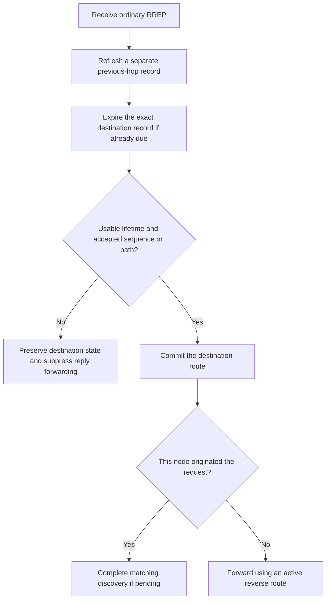

# AODV route freshness

This change implements row 2 of
[the RFC 3561 correction plan](../../../plan/pending/aodv-rfc3561-corrections.md).
Its owner is `Aodv`: incoming UDP control reaches `processPacket()`, then the message-specific
handler updates `AodvRouteData` on an owned routing-table record. No packet wire layout changes.

The original handlers compare sequence numbers as ordinary integers, overwrite neighbor sequence
knowledge before selecting an advertised path, and use the request's U flag to decide whether
the originator's sequence is known. These actions can replace fresh paths or reject fresh replies
across wraparound. A request also clears U without having any known destination information.

The correction uses unsigned 32-bit subtraction for serial ordering and exact owned host records
for protocol state. RREQ, RREP, Hello and RERR keep their own acceptance rules. When the sender is
also the advertised originator or destination, the message-specific decision happens before any
neighbor update can change that same record. Separate neighbor observations retain their sequence
value and validity. An already-due active route first enters ordinary inactive retention.

The destination adopts a known fresher requested sequence without an extra unconditional increment.
This is the explicit interpretation of RFC 3561 §§6.1/6.6.1 chosen in the plan. A half-range
comparison establishes freshness in neither direction. These are model decisions, not assertions
that the source resolves both questions unambiguously.

An aliased previous hop skips the first refresh. ACK handling is an independent later concern in
the plan. This diagram does not claim that rejected A-flagged replies are already acknowledged.

All tests use a scripted peer through real UDP, IPv4 and AckingMac. Assertions inspect public
route records or control packets received through UDP. They do not call AODV handlers.

| Test | Stimulus and assertion | Source-based comparison with the parent |
| --- | --- | --- |
| `Rfc3561SequenceFreshness.test` | Inject successive replies around both unsigned and signed boundaries, including equality, older values and a half-range candidate. Check destination sequence, next hop and metric after each message. | Ordinary `>` rejects 0 after `0xffffffff`. The expected-zero assertion distinguishes serial selection. |
| `Rfc3561ReverseRoute.test` | Seed an unknown-sequence neighbor with an unrelated reply, then send known- and unknown-floor requests across wrap and the signed boundary. Check originator validity and reject stale originator values. | The first known-floor request leaves the originator sequence marked unknown because the parent tests the destination's U flag. The known-sequence assertion detects it. Later cases also check freshness preservation. |
| `Rfc3561DestinationSequence.test` | Request sequence 1, several-ahead 5, older/equal values, one-ahead 6, a half-range candidate and an unknown request. Observe the actual reply sequence. | The destination only advances by one in the parent. The reply-to-5 assertion detects its failure to adopt the fresher requested value. |
| `Rfc3561NeighborSequence.test` | A direct reply from the destination installs sequence 20, expires, then receives stale 19 and equal 20. Stale information must leave it inactive, while equal information reactivates it. | The neighbor refresh activates and clears validity before acceptance. The assertion for inactive sequence 20 after stale 19 detects that ordering. |
| `Rfc3561RequestFloors.test` | Forward requests with absent, unknown and known host state. Check U and sequence on the outgoing request, and check that the stored destination sequence stays unchanged. Include wrap, equality and half-range. | The first unknown request with no destination record has U cleared by the parent. The outgoing-U assertion detects it. |
| `Rfc3561HelloAcceptance.test` | A zero-lifetime Hello must create no record. Then inject wrapping, stale, half-range and equal Hellos and inspect the sender's direct record. | The parent installs the zero-lifetime Hello and overwrites sequence information on every later Hello. The no-record assertion detects the first defect. |
| `Rfc3561ErrorFreshness.test` | Invalidate a known route with an applicable error, recover across wrap with a reply, then inject stale, half-range and equal errors. Stale/ambiguous errors must preserve the active route. | The parent copies a stale error sequence and invalidates the recovered route. The active-zero assertion detects it. |
| `Rfc3561ReplyAcceptance.test` | Expire sequence 20, queue one real local UDP datagram, answer its discovery with stale 19, then equal 20. Assert that the stale reply leaves the record inactive and emits no data, while the accepted reply releases the datagram once and cancels further requests. | The originator's unconditional second installation overwrites sequence 20 with 19 and releases data. The inactive-20 and no-data assertions distinguish that production failure. |

Fresh debug executions now show all eight distinguishing regressions failing at their intended
assertions on the parent and passing on the corrected source. The preparation control passes on
both. Exact source trees, commands, setup corrections and local artifacts are recorded in
[the model results](../../../doc/project/evidence/model/aodv/results.md). A second separate parent
checkout and the remaining plan validation are still pending. The arithmetic unit test supplements
these production paths and is not a parent runtime reproduction.

The tests establish the listed host-route transitions and one-datagram discovery completion.
They do not establish multi-destination queue ownership,
subnet precedence, multiple interfaces, independent ACK validation, Hello-loss attribution, reboot
recovery or local repair. Those remain assigned to the later plan rows. Mermaid rendering is
unverified until a renderer is available.
