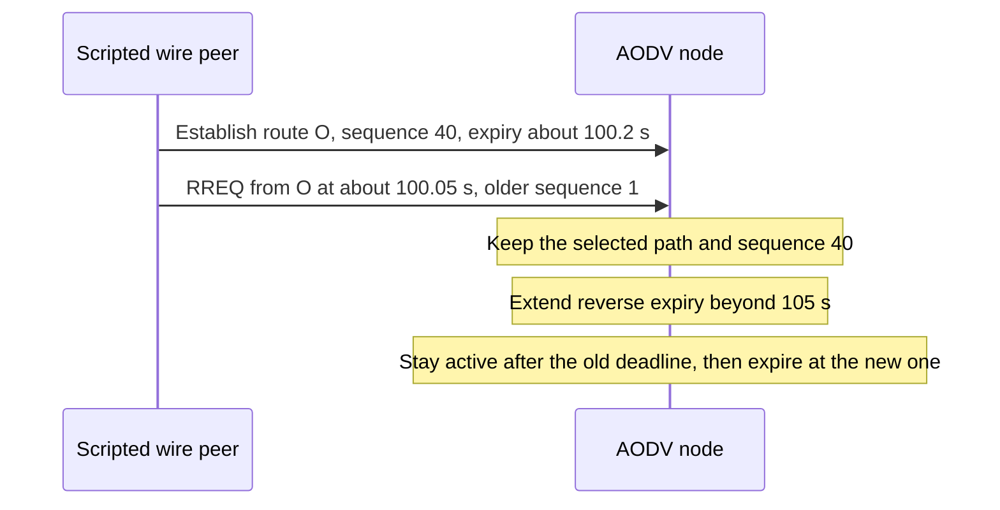
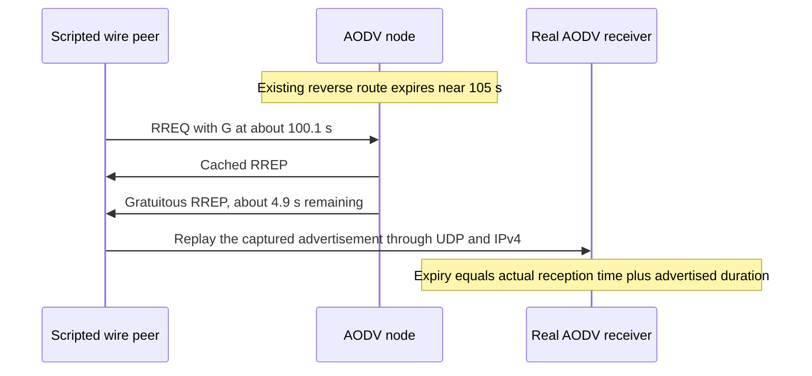

# AODV reverse-route and advertisement lifetimes

This change implements the lifetime concern in row 3 of
[the correction plan](../../../plan/pending/aodv-rfc3561-corrections.md).
`Aodv::handleRREQ()` owns reverse-route refresh. Reply creators own conversion from an absolute
route expiry to a relative, representable wire duration. The expiry scheduler observes the
resulting deadlines. Route sequence knowledge stays in the existing owned route record.

A nonduplicate RREQ refreshes its reverse lifetime even when its originator information does not
replace the path. A path update also preserves an already later expiry. Both cases use the maximum
of the existing deadline and the minimum computed under RFC 3561 §6.5.

`Rfc3561ReverseLifetime.test` checks that sequence 40 and the selected path survive while the
short expiry is extended. The parent leaves the deadline unchanged, so the assertion for an
expiry more than five seconds ahead fails. `Rfc3561ReverseLifetimeLong.test` starts with a later
expiry near 110 s and supplies a newer originator sequence 41. The parent installs its shorter
minimum deadline. The corrected handler preserves 110 s. Both tests wait past the original short
deadline and then past the selected expiry, checking active/inactive state and unchanged known
sequence information. Ordinary idle expiry is a control, not a newly discovered sequence-increment
defect.

Gratuitous replies describe the remaining life of the reverse path. The parent puts the absolute
expiry into the relative lifetime field. At simulation time 100 s that can advertise roughly
105 seconds instead of roughly five. The correction subtracts the current time, truncates downward
to whole milliseconds, and checks the uint32 millisecond range before producing an advertisement.

`Rfc3561GratuitousReply.test` observes the emitted duration and replays the captured packet as input
to a real AODV recipient. It checks the recipient's public route expiry against its actual IPv4
reception time plus that duration. The parent fails the four-to-five-second duration assertion.
The peer uses two addresses/interfaces so the request arrives from a different next hop than the
cached destination path. The AODV nodes each retain the existing single-interface profile. This is
controlled packet replay, not an implementation of intermediate AODV dispatch in the fixture.

The four encoding cases set an owned destination route's deadline at real IP reception of the
crafted RREQ, before UDP dispatch. They use exact integer microseconds to avoid floating-point
uncertainty at the largest millisecond boundary. The real AODV handler then decides whether to
answer or forward the request.

| Test | Remaining duration | Required observation | Parent |
| --- | --- | --- | --- |
| `Rfc3561SubmillisecondReply.test` | 999 us | No RREP, normal RREQ forwarding | Fails because it emits a zero-lifetime reply |
| `Rfc3561MillisecondReply.test` | 1999 us | One RREP advertising exactly 1 ms | Passes as an existing quantization control |
| `Rfc3561MaximumLifetimeReply.test` | UINT32_MAX milliseconds | One RREP with that exact duration | Passes as a capacity control |
| `Rfc3561OversizedLifetimeReply.test` | UINT32_MAX + 1 milliseconds | No RREP, normal RREQ forwarding | Fails because it emits an unrepresentable advertisement |

Suppressed cached replies create no precursor obligation. Configured destination and Hello
advertisement durations must also fit a positive uint32 millisecond count. Four module fixtures,
`tests/module/AodvAdvertisementLifetimeInvalid_1.test` through `_4.test`, cover submillisecond and
oversized values for `myRouteTimeout` and `allowedHelloLoss * helloInterval`. Other time relationships
are chosen to remain valid. The parent completes initialization and reaches its 10 ms simulation
limit, violating the required rejection. The correction fails initialization with the field-specific
diagnostic and no undisposed-message output. These are initialization checks, not full runtime
lifecycle coverage.

Commands and executed results are recorded in
[the model results](../../../doc/project/evidence/model/aodv/results.md). The five protocol
regressions and four configuration rejection cases have distinguishing parent outcomes. The two
passing protocol parents remain controls. Fixture setup failures from absolute packet offsets and
the radio medium's simultaneous-transmission guard are excluded from those outcomes.

These tests establish control-field durations, reverse expiration and recipient expiry. They do
not independently verify serialized bytes, a complete intermediate forwarding chain, link-loss
sequence actions, discovery scheduling, reboot or local repair. Mermaid rendering remains
unverified until a renderer is available.
