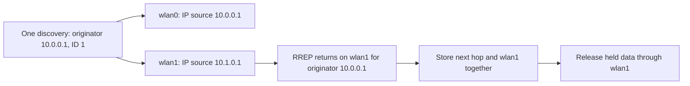
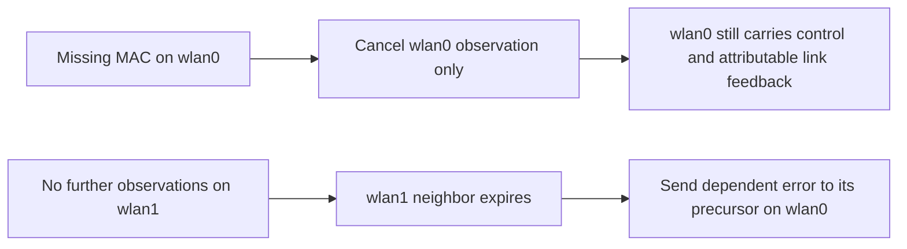

# Selected interfaces and local identities

The optional interfaces parameter is a whitespace-separated list of exact IPv4 interface names.
Empty keeps the legacy primary selection. A nonempty set must contain interface, whose address
remains the node's discovery originator identity. All copies share one request ID, node sequence,
attempt and rate charge.

Resolve and validate the selection at actual start, after interface configuration is available.
Reject unknown or repeated names, missing primary membership, down/loopback/unaddressed interfaces,
mixed families and duplicate local IPv4 addresses. Explicit selection is IPv4-only. Legacy
single-interface IPv6 remains selected through the empty parameter; its bounded runtime evidence
is assigned to the later compatibility cases.

Both selection parameters are mutable, with changes applied on the next start. Stop, reconfigure
and start is supported. Live interface removal or address reassignment remains outside the profile.

Every selected local address answers a request naming that address with the shared node sequence.
Requests originating at any selected local address are suppressed before reverse-state/cache work.
A reply to the primary discovery identity terminates even on a secondary ingress link. Unicast
control uses the owned exact reverse record, avoiding diversion by an unrelated manual route.
Cached-reply precursors carry the actual RREQ ingress, even if the selected reverse path differs.

Hello output belongs to each selected interface: its IP source and advertised destination are that
interface's address. Active routes and their precursor dependencies determine which links need
Hellos. Broadcast suppression is per interface and is recorded at actual send; a broadcast exactly
one interval ago does not suppress the next Hello. ACK, blacklist, attribution and loss observation
remain qualified by neighbor and interface. An unidentifiable ingress cannot establish which
selected link was heard, so it disables observation on all selected links conservatively.

Ignore control on unselected ingress before binding, route, ACK, blacklist or search changes.
This boundary leaves legitimate data forwarding through an external interface available. Address
scope considers every selected IPv4 subnet. The synthetic gateway adapter is created by the
configured routing table and follows the learned gateway route's actual interface; it has no
independent sequence domain.

## Protocol cases

Names below have prefix Rfc3561Interfaces and suffix .test. Separate UnitDisk media give each
selected link an independent physical path. Two scripted receivers on the primary medium share
one application; broadcast observations are deduplicated by IP source/identification, preserving
distinct interface copies and logical request IDs.

| Suffix | Required observation | Immediate parent 14013e9c8a |
| --- | --- | --- |
| Discovery | One logical request appears on both links with primary originator, ID 1 and sequence 1. Secondary reply is ACKed on that link and releases data there. A second destination waits for the next rate window and appears twice with ID 2. | Only one first-request interface copy is observed. |
| DownStart | First actual start from initial DOWN has no reboot hold; the same secondary completion and rate ownership apply. | Only one first-request copy is observed. |
| Gateway | Two external queues share gateway discovery, and both leave through its secondary path. Inspect the adapter's interface and next hop while active. | Adapter remains on the primary interface without the secondary path. |
| SecondaryScope | A selected secondary subnet is internal even with an external gateway configured. Request the actual member and create no synthetic default adapter. | Misclassifies it as external and creates the adapter. |
| LocalAddresses | Request the secondary address through the primary link, then the primary through the secondary link with a fresher reverse sequence. Both replies name the requested address and shared sequence 25. | Missing secondary processing/reply fails the two-reply assertion. |
| SelfPrimary | Suppress a primary-originator request. | Passing control. |
| SelfSecondaryPrimaryIngress | Suppress a secondary-originator request returning on the primary link; create no owned route to the local address. | Forwards it as a foreign originator. |
| SelfSecondarySecondaryIngress | Same suppression when returning on the secondary link. | Passing absence control because the parent ignores that ingress entirely. |
| Unselected | Ignore request and A-flagged reply on a third unselected link, including its duplicate-cache candidate. A selected copy with the same originator/ID still receives a reply; a later legitimate primary update forwards data. | Passing boundary control. |
| OwnedReply | Add a higher-priority manual host route carrying AODV-shaped data through an unselected interface. Reply through the owned reverse path and preserve the manual route. | Diverts the reply to the manual route's interface. |
| AckIsolation | Validate two selected links, acknowledge only the primary and deliver a late secondary ACK after its timeout. Later primary query succeeds; secondary remains blacklisted. | No initial secondary reply. |
| Fanout | Real requests/cache replies establish precursors on both interfaces for two destinations. One budget slot delivers both copies of the first received error and suppresses all copies of the second, while invalidating both records. | Only the primary precursor copy exists. |
| HelloSources | Verify source equals advertised local address on each link. An attributable-gap transit failure broadcasts an error only on the primary; that broadcast suppresses only its next Hello. | Secondary Hellos are absent; per-link counts fail. |
| LivenessIsolation | Missing primary MAC metadata disables only primary observation. Secondary loss still invalidates its destination and sends its precursor error through the primary. | No secondary destination record was learned. |
| MissingIngress | A completed control indication loses its interface identity after both links are armed. Cancel both detectors and retain the secondary learned route. | No secondary route was learned. |
| Reconfigure | Complete node shutdown, change selection from 0/1 to 0/2, then restart. Reply on 2 and ignore the former 1; preserve the primary identity. | Selection remains primary-only, failing the link reply counts. |
| ExternalGateway | Real data enters through selected primary and leaves the gateway through an unselected external interface to a separate receiver. | Passing control. |
| ExternalIngress | Data enters through the unselected external interface and follows a legitimate manual route to the MANET peer, without AODV discovery/error. | Passing control. |

The four AodvInterfaces module repetitions cover DownStart, Reconfigure and the two external data
directions. The capacity fixtures now explicitly select their two public precursor interfaces.
Fanout supplies the production learned-precursor integration that the earlier isolated capacity
setup deliberately deferred.

Twelve AodvInterfacesValidation module cases check eleven missing startup rejections and one
LegacyEmpty passing control. Unknown, Pattern, DuplicateName, MissingPrimary, Down, Unaddressed,
Loopback, DuplicateAddress, MixedSecondary, ExplicitIpv6 and StartDownUnknown each require the
specific startup diagnostic. The last also requires a marker immediately before actual start,
proving the check was deferred while initially down. Public interface-data setup supplies invalid
addresses/family combinations after configuration; these are rejection fixtures, not native IPv6
exchange evidence.

## Reconfiguration diagnostic control

The initial reconfiguration fixture completed shutdown asynchronously, so the controller callback
must finish before changing parameters or starting again. Its next failure was below IP: Generic
Radio restarted in its configured default OFF mode. AckingMac's initialization had enabled reception
at first setup, while this restart required an explicit initialRadioMode of receiver.

Direct Cmdenv evidence in /tmp/aodv-interface-reconfigure-debug.out shows OFF-to-OFF at 0.25 s and
ignored reception of the request on interface 2 at 0.4 s. The same executable with only the radio
startup-mode override passes. The final configured run, recorded in
/tmp/aodv-interface-reconfigure-after-radio.out, shows OFF-to-RECEIVER at 0.25 s, reception on
interface 2 at 0.40058 s, its reply reaching the peer at 0.401128 s and PASS at 0.5 s.
Both use General, run 0, seed 0 and the same debug library. This is a fixture configuration control;
no MAC/PHY source is changed.

The initial rejection expectations also used stdout for diagnostics that Cmdenv emits on stderr.
Those expectation-stream failures are excluded from the final comparison. Executed commands,
final outcomes and bounded coverage are in
[the model results](../../../doc/project/evidence/model/aodv/results.md).
