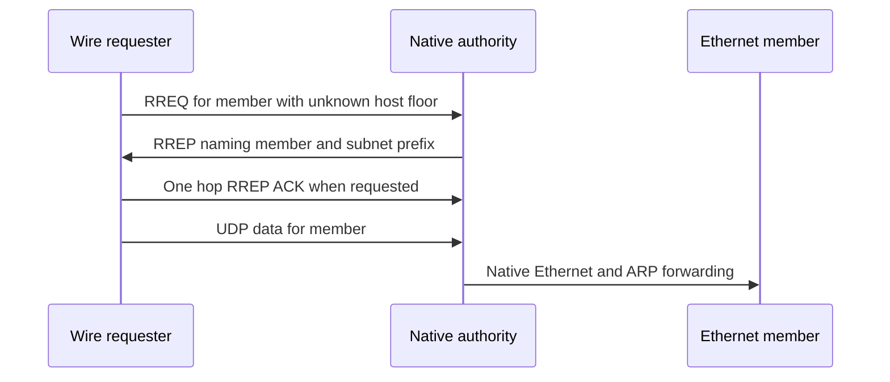
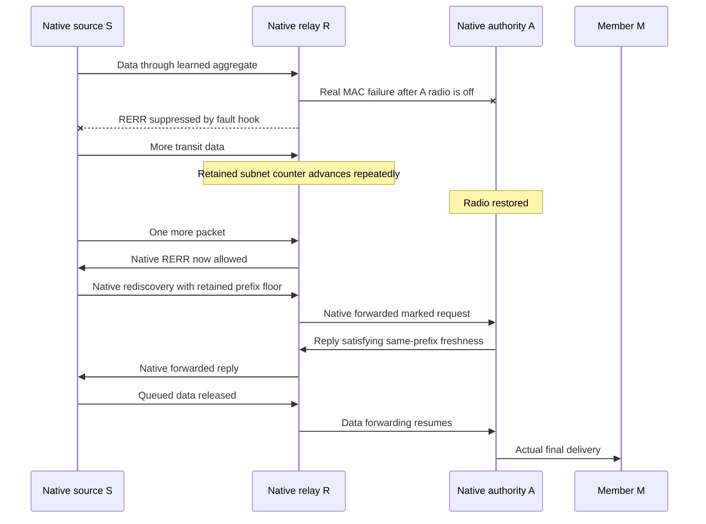

# Authoritative subnet replies and freshness recovery

These C8 tests exercise native AODV authority through UDP/IP. The configured subnet profile uses extension type 253 as an INET scenario-local identifier, not an IANA allocation. The authority advertises one attached Ethernet prefix, retains the requested member in its RREP and owns a sequence domain independent of its host address. All 14 authority cases and eight initialization cases passed in the matching final debug8 build.

The ordinary fixture has one scripted wireless requester, a native authority and two Ethernet members on a switch. A second native AODV router has no export in these single-authority cases. The script constructs requests, observes replies and sends ordinary member data; it never decides authority state or invokes AODV handlers. The member applications observe actual delivery. Native ARP, rather than a synthetic ICMP injection, proves the missing-member path.

The IPv6 missing-member case sets the native interface's address-resolution retransmission timer to 30 ms through `Ipv6InterfaceData` before sending data. Native ND performs all solicitations, exhausts them and generates the real ICMPv6 error; the fixture does not inject an error or call an ND handler.



| Case family suffix | Required observation |
| --- | --- |
| `Ipv4Members`, `Ipv6Members` | Two members receive actual UDP data through the same advertised prefix. IPv6 uses native configuration, ND and a router-advertised on-link prefix. |
| `CounterDomains` | Raising the node's host sequence to 100 does not set the independent subnet counter to 100. |
| `DestinationOnly` | The configured authority can answer a D=1 unknown-host-floor request for an attached member. |
| `KnownHostFloor` | An independent U=0 host floor does not elicit an aggregate authority reply. |
| `MarkedFloor` | Supplementary wire check: an explicitly marked exact `/24` floor 17 is adopted before the reply. This is not the failure/relearning reproduction. |
| `MemberMissing`, `Ipv6MissingMember`, `MemberReturns` | Real ARP or ND exhaustion produces the native family-specific unreachable error quoting the missing member and UDP ports. A fresh request for another member retains the aggregate prefix and sequence, and that member receives data. The IPv4 return case also receives data at a member that appears later, without a new negative cache. |
| `WithdrawLink` | Attached-interface loss yields a prefix-owned RERR to a learned precursor, suppresses replies while unavailable and preserves freshness when it returns. |
| `Restart`, `CrashRestart` | Real AODV stop/start or crash/start suppresses hold-time replies and recovers from an explicit same-prefix wire floor after the hold. The crash case adopts `fffffffe` after its previous known-zero domain; incorrectly retaining valid zero would reject that floor as older. These cases do not claim a native remote router generated the retained floor. |

## Relearning after actual failures

`Rfc3561SubnetAuthorityRelearnAfterFailure.test` uses three native AODV routers. Source S reaches relay R over Ethernet; R reaches authority A over a separate wireless link; A reaches two members through an Ethernet switch. The native source delivers to each member before the failure. No routing state is seeded in this reproduction.

After two successful packets, the fixture records the native aggregate's counter and switches A's radio off. A real failed AckingMac transmission invalidates R's aggregate. The source continues sending through its still-active route because a test netfilter hook drops only R's outgoing RERR packets during a bounded fault window. Subsequent transit failures advance R's retained prefix counter through the production failure path. The test requires a real link-failure observation, at least three suppressed errors and at least three serial counter advances from the recorded baseline before restoring the link.



The final assertions require a forwarded floor higher than the value observed before restoration, an active recovered native aggregate, three actual member deliveries and no originating application failure. GlobalArp in this fixture isolates routing/failure recovery from address-resolution timing; the separate missing-member cases use real Arp.

`Rfc3561SubnetAuthorityUnknownOriginatorThroughRetainedRelay.test` isolates the intermediate-hop case. It seeds one inactive aggregate with sequence 17 through the public routing table on R, leaves S without knowledge, then sends actual originating data. The source's wire RREQ must lack a marker, R's forwarded request must carry floor 17 with U=1,D=1/base floor zero, and native authority/forwarding must deliver the packet. This establishes relay attachment and production completion, not how the retained state originally arose.

## Startup and evidence

`AodvSubnetAuthorityValidation{Case}.test` checks default/host-prefix rejection, family mismatch, duplicate entries, missing interfaces, broader unattached exports and legacy-gateway conflicts. `ContainedPrefix` is a successful-start control for a narrower prefix within a real attached prefix. All use actual initialization; rejection diagnostics must come from export validation, not an unknown parameter.

Run from the checkout root after a fresh matching debug build. The single checkout lock prevents the category runner from deleting another filtered run's suite work directory:

```sh
flock /tmp/inet-aodv-test-runner.lock opp_run_protocol_tests --load . -p inet -m debug --no-build --no-concurrent -w '^tests/protocol/aodv$' -f 'Rfc3561SubnetAuthority.*\.test$'
flock /tmp/inet-aodv-test-runner.lock opp_run_module_tests --load . -p inet -m debug --no-build --no-concurrent -f 'AodvSubnetAuthorityValidation.*\.test$'
```

Every configuration is General/run 0/seed 0, fixed positions and zero AODV jitter. The parent lacks the new export parameters and authority behavior; a startup/compilation incompatibility is not a paired runtime protocol failure. No parent runtime result or RFC-wide conformance claim is made here.

On 2026-11-14, the combined selection passed 37/37 protocol cases and 12/12 initialization cases, both runner exits 0. This includes all 14 authority cases and eight authority initialization cases. The focused native selection also passed 3/3 after the failure test gained the explicit measured-counter-delta assertion; it includes `RelearnAfterFailure`, `UnknownOriginatorThroughRetainedRelay` and the infrastructure `NativeReturn` path.

Commands, exact selected paths and before/after binary/helper hashes are recorded in `/tmp/aodv-subnet-debug8-record.json` and `/tmp/aodv-subnet-debug8-native-delta-record.json`. Raw logs are `/tmp/aodv-subnet-debug8-{protocol,module,native-delta}.log`; matching `-artifacts` directories retain the fixtures and generated output. Every execution used the same debug8 library, SHA-256 `94959d33c3a6a4b7457ce1dde67c073b8ca5c806e155b1df1c5e300837a58d04`. These are fixed-topology, single-seed protocol checks, not a mobility or loss-rate campaign.

The focused crash-state-loss check also passed (1/1, runner exit 0): `/tmp/aodv-subnet-debug8-crash-floor.log` and its `-artifacts` directory. Before/after `.sha256` files with that stem confirm the same library and unchanged helper during execution.
