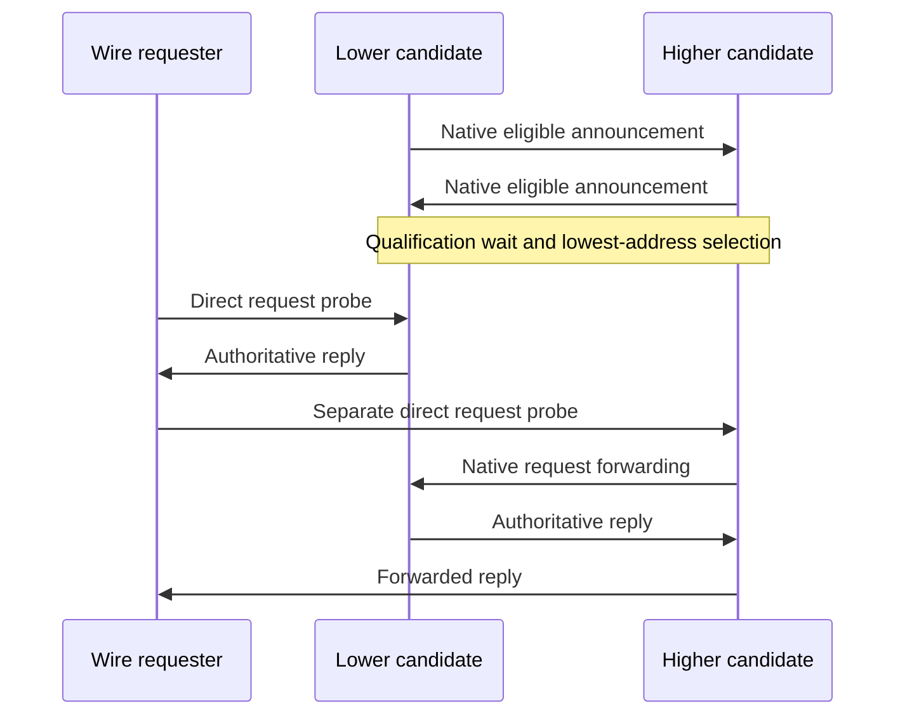

# Subnet-router election on a bounded common network

These C9 tests use two native AODV authorities with the same configured subnet, candidate list and shared Ethernet coordination network. Candidate addresses on that network are 192.0.2.1 and 192.0.2.2. Their wireless addresses differ, so the requester cannot infer the authority from a relayed packet's final IP source. Instead it observes each native UDP output: only a hop-zero authoritative RREP identifies the answering authority. All nine election cases passed in the matching final debug8 build.

The native profile assumes trusted candidates, fail-stop crashes and bounded reliable delivery on the common coordination network. H is 50 ms and D is 10 ms in the fixture. A newly eligible lower candidate must announce before waiting H+D plus one simulation tick; the incumbent stops answering after hearing it. This is not a proof of consensus under arbitrary partitions or loss.



The two probes are 20 ms apart. The fixture's AckingMac has no collision avoidance, so simultaneous wireless probes would create a fixture collision rather than meaningful election evidence. Requests still traverse native AODV; the driver does not implement an election algorithm.

The same spacing separates member-data transmissions. A restored Ethernet interface restores both administrative state and carrier, so its native directly connected route becomes usable. The configured traversal bound keeps the requester's reverse route alive through the subsequent data/ICMP exchange. Module stop is allowed to finish asynchronously through native UDP closure.

| Case suffix | Direct assertion |
| --- | --- |
| `LowestAddress` | Both candidates receive requests, but only the lower candidate originates hop-zero subnet replies; actual member data is delivered. |
| `LateLowerCandidate` | The lower candidate's export interface is initially down, so the higher candidate answers. After restoration and qualification, only the lower candidate originates the answering reply. |
| `LeaderStop`, `LeaderCrash` | Real module stop or fail-stop crash removes the lower candidate; after the configured observation bound the higher candidate answers and forwards data. |
| `CounterWrap` | Wire floors cross `fffffffe` to zero, then establish floor 5. After the lower candidate crashes, an unmarked request requires the higher candidate to retain the announced floor 5. |
| `Rejoin` | The stopped lower candidate returns through native module start and the recovery/qualification hold, then resumes lowest-address authority. |
| `LostCoordination` | An observed coordination/export-interface loss withdraws the lower candidate and permits the higher candidate to answer. |
| `PartitionHeal` | The same observed local cut is restored and lowest-address selection returns. This case does not assert safety during an unobserved arbitrary network partition. |
| `TwoPrefixes` | The lower candidate owns the shared `/24`, while a separate `/25` export on the higher candidate answers its member and forwards data independently. |

No candidate state is fabricated in the test. Sequence floors are ordinary test wire stimuli; candidate observations and transfers belong to native UDP announcement processing. A probe of an explicitly stopped UDP endpoint may receive Port Unreachable, which is consumed as control evidence and never counted as a member-data failure.

After a fresh matching debug library, from the checkout root:

```sh
flock /tmp/inet-aodv-test-runner.lock opp_run_protocol_tests --load . -p inet -m debug --no-build --no-concurrent -w '^tests/protocol/aodv$' -f 'Rfc3561SubnetElection.*\.test$'
```

All runs are General/run 0/seed 0 with fixed positions and zero AODV jitter. There is no parent runtime claim: the parent lacks election configuration. Remaining coverage limits are the explicit bounded-delivery/fail-stop profile, the local-interface-cut interpretation of `PartitionHeal`, and the absence of a statistical mobility or packet-loss campaign.

The nine election cases passed within the combined 37/37 protocol selection (runner exit 0) on 2026-11-14. Exact paths, command and unchanged before/after library/helper hashes are in `/tmp/aodv-subnet-debug8-record.json`; raw output and fixtures are `/tmp/aodv-subnet-debug8-protocol.log` and `/tmp/aodv-subnet-debug8-protocol-artifacts`.

`tests/unit/AodvSubnetIntrospection.test` separately checks exact IPv4/IPv6 announcement wire bytes and the registered generic dissector/printer on raw bytes in known/unknown sequence states. It passed in the matching final debug8 epoch (unit selection 3/3, runner exit 0; `/tmp/aodv-hello-debug8-unit-run.log`, binary SHA-256 `94959d33c3a6a4b7457ce1dde67c073b8ca5c806e155b1df1c5e300837a58d04`). This deterministic unit does not prove the production outgoing packet's protocol tag.

The ten `AodvSubnetCoordinationValidation*.test` module cases passed on the same library (exit 0, General/run 0/seed 0). Nine reject unsupported extension types, invalid/colliding coordination ports, zero announcement durations, duplicate candidates and a missing self candidate. The positive case starts native routers with extension types 128 and 255; it checks accepted bounds rather than interoperability between different profiles. Command: `opp_run_module_tests --load . -p inet -m debug --no-build --no-concurrent -f 'AodvSubnetCoordinationValidation[A-Za-z0-9_]+\.test$'`, under the shared lock. Raw output is `/tmp/aodv-coordination-validation-run.log`; generated inputs/output are `/tmp/aodv-coordination-validation-work.OQl5RY/work`.

Mermaid rendering passed in the series-wide [implementation record](../../../doc/project/evidence/model/aodv/remaining-features-results.md).
