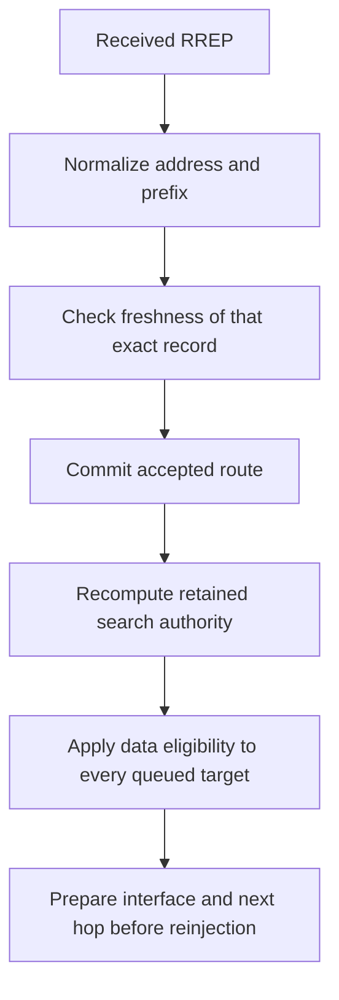
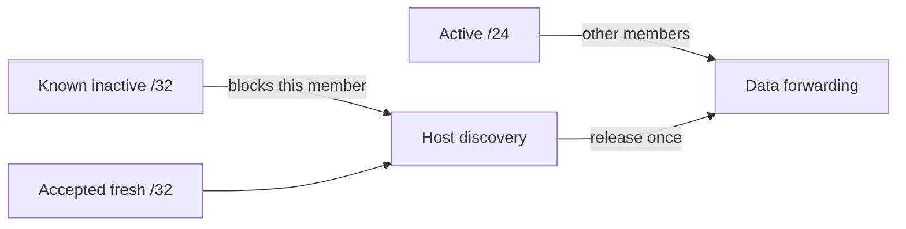

# Received subnet routes

This stage implements plan row 10 in Aodv's existing UDP/IP path. RFC 3561
sections 5.2 and 7 supply the RREP prefix and subnet counter; the host-only RREQ
floor convention is a bounded model policy documented in model conformance.

A nonzero IPv4 RREP prefix identifies a normalized, owned route record. A zero
prefix identifies a host. Acceptance compares sequence information only against
that exact record. Neighbor observations, reverse hosts, /24 and /25 advertisements
remain separate even when their address values coincide.

## Fixtures and assertions

All cases use General/run 0/seed 0, fixed positions, zero jitter, native IPv4
and UDP, AckingMac and UnitDisk. The DUT has one selected interface. The wire peer
has two addresses on two radios on the same medium; address .2 advertises routes
and address .3 supplies independent requests/precursors. Duplicate reception of
a broadcast by both peer radios is not a second logical send. Data is counted by
IPv4 identification, and the received destination MAC proves the selected next hop.

Every name below has prefix Rfc3561Subnet and suffix .test.

| Case | Setup and direct assertion |
| --- | --- |
| Basic | Nonzero /24 advertisement normalizes the route; two different members emit data through .2. |
| Counters | Aggregate 100 and host 5 coexist without comparing their independent counters. |
| CountersSwap | Aggregate 5 and host 100 exercise the opposite numerical ordering. |
| Wrap | Same-prefix fffffffe to zero is accepted; the exactly half-range update is rejected. |
| KnownBlock | Expired known /32 blocks /24 for that host, while another member uses /24. A fresh /32 releases queued data once and new data follows it. |
| UnknownMask | A public, inactive unknown /32 imposes no floor; actual data takes the /24 next hop. |
| Cached | U=1,D=0 gets a cached /24 RREP naming the requested host, with the aggregate sequence and prefix-owned precursor. |
| KnownRequest | U=0 gets no aggregate cached reply and no aggregate floor promotion. |
| OnlyRequest | D=1 bypasses the cache and remains set when forwarded. |
| RetainedFloor | Inactive known /24 makes an originating host request U=1,D=1, numeric zero. The aggregate survives due deletion while searched, rejects older information, then an independent /32 completes the queue. |
| Ambiguous | Wire address shared by /24 and /25 leaves both records untouched. |
| AmbiguousN | N with that ambiguous address also leaves both records untouched. |
| InactiveAmbiguous | An inactive /25 remains an ambiguity witness against an active /24. |
| UniqueError | Unambiguous wire prefix updates only its record to the received sequence. |
| OutgoingError | Failed transit member reports the canonical aggregate address and its once-incremented counter. Peer radios may both observe the fallback broadcast. |
| Alias | A /31 normalized to the sender's address coexists with the sender's unknown /32 neighbor record. |
| IcmpMember | Real quoted ICMP Host Unreachable reaches IP/UDP; the aggregate remains active and forwards the member afterwards. |
| RecoveryAuthority | Stop/start holds a queued unknown host; a known /24 becomes its authority and survives deletion during an extended hold. An older /24 is rejected, a /32 is accepted independently, and data waits for recovery expiry. |
| Forwarded | Reverse host learned from a request forwards a received nonzero-prefix reply with the prefix and incremented hop count intact. A second member then uses the aggregate. |
| MixedError | Ambiguous /24-/25 entry is skipped while an unrelated unambiguous host entry in the same error is processed. |
| Sustained | Repeated demand across bounded search/deletion intervals retains known /32 blocking. Quiescence permits ordinary deletion; subsequent data can use /24. |
| Manual | Active manual /32 precedence sends data to .3 while preserving the aggregate's counter. |
| RelayError | A real cached request learns the prefix precursor, then an ordinary error relays the canonical prefix and updates its record. |
| RelayN | The same learned dependency relays N while preserving active prefix state and its stored counter. |
| Downstream | A second native Aodv instance discovers one member through the DUT's cache, installs /24, and sends a second member without another discovery. Both datagrams traverse the DUT's two selected interfaces to the advertiser. |
| HelloBlock | A Hello creates router R's known /32; a real failed MAC transmission invalidates it. A /24 with a much larger independent counter arrives through another neighbor. It serves another member but cannot release R's queue. A fresh /32 does, without retaining or retransmitting the failed MAC-owned original. |

UnknownMask and RecoveryAuthority use public routing-table setup for an unknown
inactive host placeholder. The wire controls, aggregate learning, acceptance,
searches, hooks, queue disposal and emitted data remain production paths. The
fixture schedules the seeded deadline through subsequent real control reception;
it does not invoke Aodv handlers. The ICMP quote is a UDP member datagram with the
DUT's source port, delivered through the existing error path.

Downstream additionally runs as AodvSubnetDownstream.test in the module suite.
It uses two independent radio media, so the native originator cannot hear the
scripted advertisement directly. Both native tables must contain the normalized
prefix with sequence 100 and expected metrics; the DUT's precursor must name the
originator on its secondary interface. Emitted data preserves the originator's
source address and uses the advertiser's destination MAC. This supplies direct
downstream installation and forwarding evidence for the cached aggregate reply.

## Causal comparison and changes

The immediate parent is 9fd380a795. On that source, a received /24 remains a /32.
Most cases therefore fail first at the explicit normalized-record assertion;
that reproduction does not independently demonstrate each later assertion.
KnownBlock instead fails actual member eligibility, Alias fails coexistence,
and RecoveryAuthority fails its missing aggregate assertion. The corrected
source runs all later observations, including real emission and retention.

The implementation reads the existing wire prefix, uses exact owned prefix
lookup for RREP acceptance, and creates normalized native routes. Cache replies
retain the selected prefix. Relays promote only exact host floors. Search state
retains a route key, recomputed from current known nondefault records before
completion or recovery deferral; expunge respects that key. There is no additional
counter store, inferred owner map, IPv4 change or packet/tag extension.

## Limits and execution

This is IPv4 receiving/using subnet routes, constrained cached replies and
forwarding. It does not implement authoritative subnet-router election or
advertisements. Same-prefix counters must share one subnet meaning; independent
host and subnet counters never become comparable. Stable RERR wire identity
remains a documented profile assumption; ambiguous entries are conservatively
skipped, including inactive witnesses. Continuing demand can retain a blocking
known host indefinitely.

Exact commands, final results, setup failures excluded from reproduction and
build provenance are recorded in the model results. Existing fixture expectations
and regression baselines remain unchanged.
