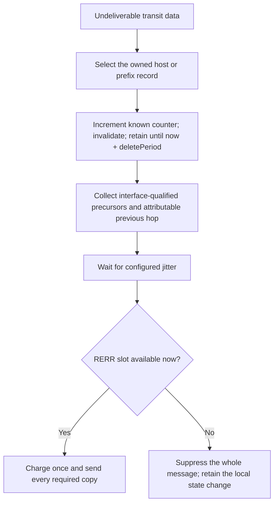

# Transit failure and route errors

A failed data action changes the retained route before considering whether an error can be sent.
Known counters increment modulo 2^32; unknown counters remain unknown and appear as zero on the
wire. A received ordinary error copies its applicable counter instead. An N notification changes
none of the route's fields.

At PREROUTING, a usable selected route is prepared once. The forward hook does not run another
longest-prefix lookup or generate an error for a legitimate route owned by another protocol.
Data updates source and attributable previous-hop leases; AODV control bypasses data decisions.
An absent transit route never creates an originating search.

Precursor identity is now (address, interface ID). Cached replies add their requester to the
advertised destination and the destination next hop to the reverse route. Forwarded replies add
the reverse next hop to the advertised destination and its applicable neighbor record.
Locally generated replies no longer add a route's own next hop as its own precursor.

An incoming error first resolves each wire address against owned records using its sender and
ingress interface. Active and retained inactive records both witness prefix ambiguity. A collision
between /24 and /25 therefore suppresses that entry before any freshness or activity decision,
while unrelated entries still run. No prefix history or wire extension is introduced. The fixed
prefix-identity profile limitation in the plan remains.

Ordinary errors require an active record and nonstale information. N errors preserve even inactive,
stale and half-range route state, while retaining N in the permitted precursor relay. Link loss
invalidates all current affected owned routes, but only records with eligible precursors enter the
outgoing list. Missing previous-hop attribution for failed transit data uses the primary broadcast
fallback; available stable bindings select the actual previous hop.

## Cases and observations

All names below have prefix Rfc3561NoDeleteError and suffix .test. The helper sends real UDP
controls, observes IP ingress and received errors, and inspects the public routing table.

| Suffixes | Required observation |
| --- | --- |
| NoDelete, NoDeleteStale, NoDeleteHalf, NoDeleteInactive | Preserve sequence validity, counter, activity, expiry, next hop, interface and metric; relay exactly one N notification to the precursor. |
| OrdinaryError, StaleError, HalfError, OtherHop | Accept ordinary 21 through the selected link; reject stale, half-range and other-hop errors. |
| NoPrecursorNotification, NoPrecursorError | N preserves the route without relay; ordinary error invalidates without relay. |
| ForeignError | A manual route carrying the same protocol-data class remains untouched. |
| PrefixAmbiguous, PrefixInactiveWitness, PrefixUnique | Resolve identity before state/freshness filtering; process an unrelated host entry. Unique prefix accepts 600. |
| OwnedForward, ForeignForward | Forward actual transit data with no RERR. |
| TransitKnown, TransitBudget, TransitUnknown, TransitAbsent | Apply each failed-data action, wrap known counters, preserve unknown placeholder 999, refresh retention even when budget is exhausted, and create no absent route. |
| TransitAggregate, TransitBlockedHost | Report and mutate the applicable counter domain; preserve an independent aggregate for a host-specific failure. |
| TransitUnknownHostAggregate | An unknown inactive host does not prevent forwarding through an active aggregate; no erroneous second lookup or RERR. |
| TransitBudgetCrossing | Two failed arrivals in one admission window send after jitter in separate windows; both errors must be emitted. |
| FanoutBudget | One slot delivers both precursor copies for the first destination; suppress the second logical error while still invalidating its route. |

The prefix fixtures seed public route records to isolate received-error identity before subnet
learning is implemented. Cached and forwarded controls establish the precursor lists in the
other cases. The budget-crossing fixture checks distinct IP identifiers as well as reception times.
It distinguishes two logical emissions from copies of one broadcast.

Module cases AodvTransitErrorKnown, AodvTransitErrorOwned and AodvTransitErrorForeign repeat the
failed-data and successful forwarding observations through a full router. IP hook DROP deletes the
packet without emitting packetDroppedSignal; the fixture observes arrival, absence of forwarding
and absence of originating RREQ rather than inventing that signal.

The new grouped delayed-error message requires an explicit owner. Tracking and cancelling both
these messages and existing delayed-control holders moves that narrow lifecycle obligation from
stage 8 into this stage. Full stop/restart route cleanup and reboot hold remain stage 8 work.
Outgoing list partitioning remains the separate P2 change.

Executed comparisons and coverage limits are recorded in
[the model results](../../../doc/project/evidence/model/aodv/results.md).
