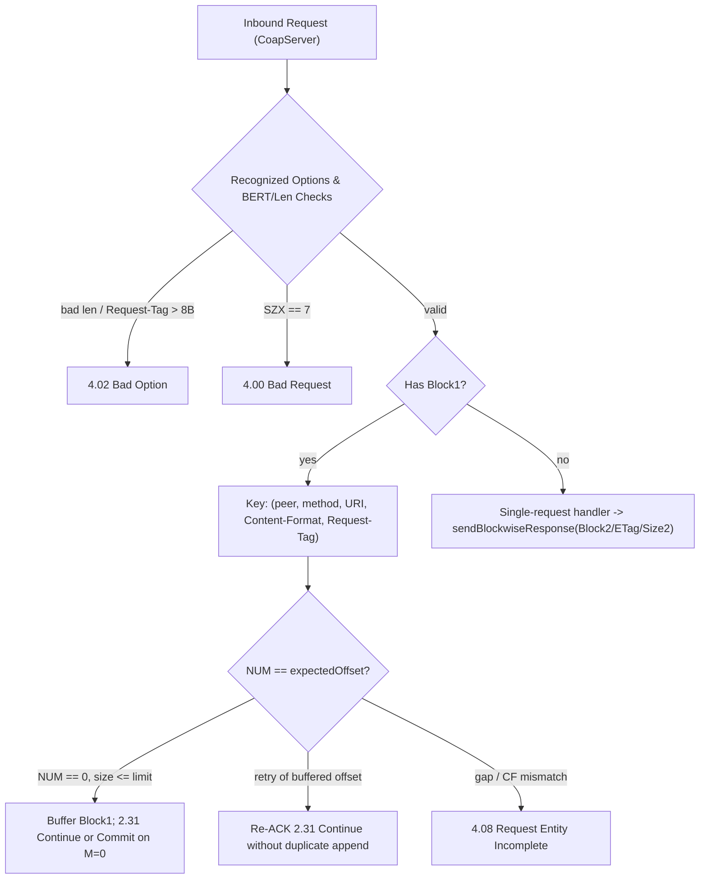

# CoAP Blockwise Transfers and Request Tags (C6)

- **Plan:** [`plan/pending/coap.md`](../../../plan/pending/coap.md) (Commit C6 — `coap: add: blockwise transfers and request tags`)
- **English checks:** [`doc/project/evidence/protocol/coap/checks/blockwise.md`](../../../doc/project/evidence/protocol/coap/checks/blockwise.md)
- **Covered tests:**
  - [`Rfc7959Block2Download.test`](Rfc7959Block2Download.test) (`GET` Block2 multi-block download with block-0 `Size2` and `ETag`, sequential `NUM` assembly, descriptive `ETag` change restarting from `NUM=0`, multi-block `Block2` without `ETag` failing, `/.well-known/core` Link-Format Block2 pagination, client `4.13` / `Max-Age` error paths)
  - [`Rfc7959Block1Upload.test`](Rfc7959Block1Upload.test) (atomic `PUT` Block1 upload with `2.31 Continue`, identical already-buffered Block1 retry re-ACK without duplicate payload append, `POST` Block1 returning Block2-paginated result and `Location-Path`, 8192-block `128 KiB` Block1 stress upload using `16 B` chunks)
  - [`Rfc7959BlockNegotiation.test`](Rfc7959BlockNegotiation.test) (`Block2` server SZX down-negotiation, mid-transfer `Block2` SZX shrink maintaining exact byte offset continuity, `Block1` server SZX down-negotiation in `2.31 Continue`, `Block1` client `4.13` recovery via smaller `SZX` restart)
  - [`Rfc7959BlockErrorsAndGc.test`](Rfc7959BlockErrorsAndGc.test) (`4.08` on skipped Block1 `NUM` and mid-transfer `Content-Format` change, `4.13` + `Size1` over `maxBlockwisePayloadSize`, `4.02` on oversized block option and `> 8 B` `Request-Tag`, `4.00` on `SZX == 7` BERT over UDP, `5.03` + `Max-Age` when `maxIncomingBlockTransfers` is exhausted, server Block1 and retained Block2 garbage collection at `maxTransmitWait`)
  - [`Rfc9175RequestTag.test`](Rfc9175RequestTag.test) (parallel untagged/identical-key Block1 and short-POST mutation serialization without interleaved corruption or `retainedBlock2` overwrite, concurrent `PUT`/`POST` transfers with distinct `Request-Tag` values completing independently, combined `Block1 + Block2` retained `Request-Tag`, server never echoing `Request-Tag`)

## Blockwise state and key isolation



- **Logical signal accounting:** `CoapEndpointBase` routes matched responses, failures, and aborts through virtual dispatch hooks overridden in `CoapClient`, ensuring multi-block exchanges emit `requestCompleted`, `requestFailed`, `requestAborted`, and `requestLatency` once per logical CoAP request rather than per block exchange.
- **Serialization vs Request-Tag concurrency:** `CoapClient` serializes concurrent `Block1`/`Block2` operations sharing a conflicting request key and dispatches concurrent `Request-Tag` uploads in parallel without cross-request buffer corruption.

## Observed verification

```text
opp_run_protocol_tests --load . -p inet -m debug -w '^tests/protocol/coap$' -f '(Rfc7252|Rfc6690ResourceDiscovery|Rfc7641Observe|Rfc7959Block|Rfc9175RequestTag).*\.test$'
[24/24] ◉ Tested test (22 concurrent): 22 PASS in 2:53.016 (exit 0)
```
