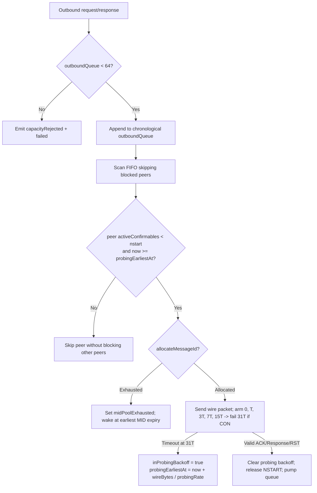

# CoAP Confirmable Exchanges and Congestion Control (C3)

- **Plan:** [`plan/pending/coap.md`](../../plan/pending/coap.md) (Commit C3 — `coap: implement confirmable exchanges and congestion control`)
- **English checks:** [`doc/project/evidence/protocol/coap/checks/messaging.md`](../../doc/project/evidence/protocol/coap/checks/messaging.md)
- **Covered tests:**
  - [`Rfc7252ConfirmableRetry.test`](Rfc7252ConfirmableRetry.test) (`seed-set = 0, 1, 2`; IPv4 & IPv6)
  - [`Rfc7252SeparateResponse.test`](Rfc7252SeparateResponse.test) (IPv4 & IPv6 separate `CON` + `CoapTestPeer` mixed `NON`/`CON`)
  - [`Rfc7252DuplicateSuppression.test`](Rfc7252DuplicateSuppression.test) (cached piggybacked ACK replay, peer scoping, half-open `EXCHANGE_LIFETIME` `[t0, t0+247s)` boundary, duplicate separate `CON`)
  - [`Rfc7252ResetAndEmpty.test`](Rfc7252ResetAndEmpty.test) (Empty `CON` ping -> Empty `RST`, Empty `NON`/`ACK`/`RST` silence, foreign/wrong-MID isolation, `RST` cancellation)
  - [`Rfc7252CongestionAdmission.test`](Rfc7252CongestionAdmission.test) (`NSTART=1`, Empty `ACK` slot release while response awaits, blocked-head cross-peer progress, queue limit 64, `PROBING_RATE` delay, MID-pool expiry deferral)
  - Extended [`Rfc7252MalformedDatagrams.test`](Rfc7252MalformedDatagrams.test) (Empty `ACK`/`RST` format errors, request-in-`ACK`, non-empty `RST`, recovery)
  - Extended [`Rfc7252ResponseMatching.test`](Rfc7252ResponseMatching.test) (wrong-MID/right-token and right-MID/wrong-token `ACK`s, retired-token late `CON` rejection)

## Message-layer completion vs application completion

`CoapEndpointBase` separates message reliability (`activeExchanges`, keyed by `(peer, MID)`) from logical request lifetime (`pendingRequests`, keyed by `Token`):

1. **Confirmable request with piggybacked `ACK`:** A valid `ACK` whose `(peer, MID)` matches `activeExchanges` AND whose `Token` matches `pendingRequests` retires **both** records simultaneously, releases the peer's `NSTART` slot, pumps the outbound queue, and delivers one application result (`onRequestCompleted`).
2. **Confirmable request with Empty `ACK` (separate response):** An Empty `ACK` (`Code = 0.00`, `TKL = 0`) matching `activeExchanges[(peer, MID)]` retires only the `CON` exchange and releases the `NSTART` slot, allowing subsequent admitted requests to progress while `pendingRequests[Token]` remains open up to `EXCHANGE_LIFETIME` (`247s`) waiting for the separate response.
3. **Separate `CON` response:** When `CoapServer` has `responseDelay > 0`, it sends an immediate Empty `ACK` (caching its wire bytes in `duplicateEntries`), snapshots the resource state/ETag at request processing, and submits the delayed separate `CON` response through `submitOutboundMessage` with a newly allocated server `MID` and the client's `Token`, inheriting full `CON` retransmission.

```mermaid
sequenceDiagram
    participant C as CoapClient
    participant S as CoapServer
    Note over C: Queue item -> allocate MID m, draw T in [2s,3s]
    C-xS: CON GET (MID m, Token t) [t0 + 0]
    C->>S: CON GET (MID m, Token t) [t0 + T]
    S-->>C: Empty ACK (MID m) [t0 + T + d]
    Note over C: Retire activeExchange(S,m); release NSTART; keep pendingRequest(t)
    Note over S: responseDelay expires -> allocate MID n
    S-xC: CON 2.05 (MID n, Token t)
    S->>C: CON 2.05 (MID n, Token t) [retransmit after T_s]
    C-->>S: Empty ACK (MID n) [cached in duplicateEntries(S,n)]
    Note over C: Retire pendingRequest(t); deliver 1 result
```

## Congestion admission, retry schedule, and probing backoff



## Verification results

Observed on commit C3 (`make MODE=debug -j8`, `libINET_dbg.so`):

- `opp_run_protocol_tests --load . -p inet -m debug -w '^tests/protocol/coap$' -f 'Rfc7252.*\.test$'` -> `9 PASS`, `exit 0`.
- `Rfc7252ConfirmableRetry.test` multi-seed verification (`seed-set = ${seed=0, 1, 2}` with `%not-contains: stdout FAIL`) -> 3/3 runs `PROTOCOLTEST coap_confirmable_retry: PASS`, `exit 0`.
- `check-architecture.sh src/inet/applications/coap`, `check-interfaces.sh src/inet/applications/coap`, `check-naming.sh src/inet/applications/coap` -> all `PASS`, `exit 0`.
