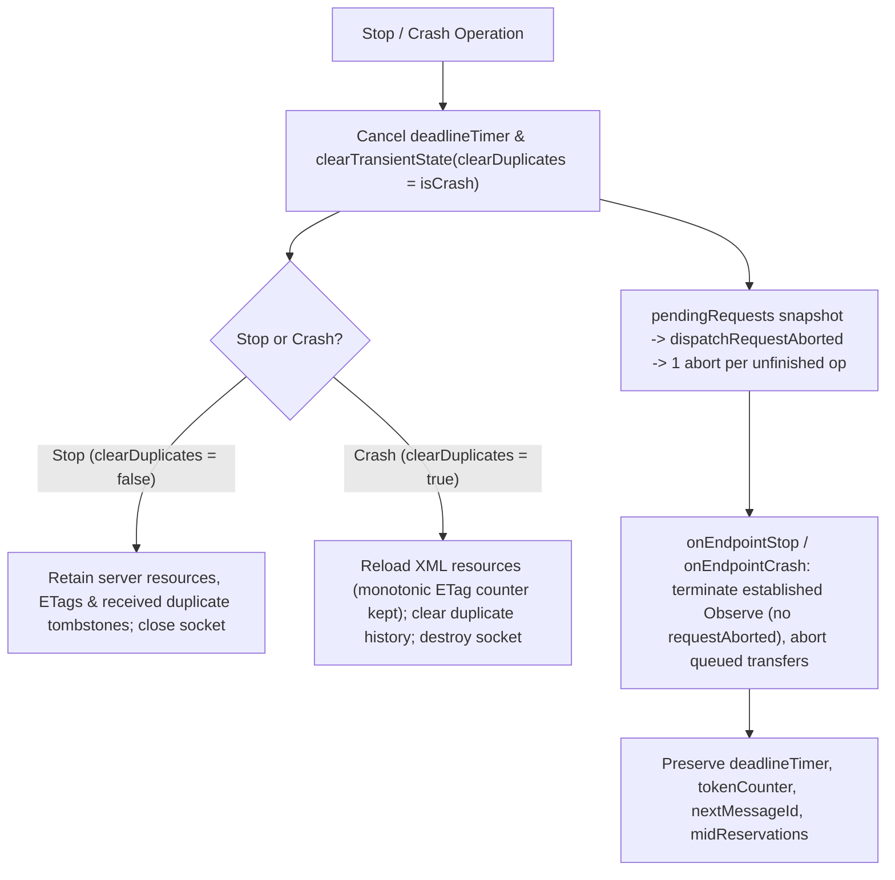

# CoAP Lifecycle Recovery and Statistics (C8)

- **Plan:** [`plan/pending/coap.md`](../../../plan/pending/coap.md) (Commit C8 — `coap: add: lifecycle and statistics`)
- **Covered tests:**
  - [`CoapLifecycle.test`](CoapLifecycle.test) (`ModuleStopOperation`, `ModuleCrashOperation`, and `ModuleStartOperation` across unfinished `CON` GET, initial `Observe` registration, partial `Block1` upload, and partial `Block2` download — verifying one `requestAborted` outcome per unfinished logical operation — plus already-established `Observe` relation lifecycle termination via `onObserveTerminated` without duplicate `requestAborted`, zero transmissions and admission refusal while down, `deadlineTimer` and token/MID/ETag reservation reuse across restarts, rejection of injected stale pre-stop replies, server ordinary stop/start resource + duplicate tombstone persistence, and server crash reset clearing receive duplicate history)
  - [`CoapStatistics.test`](CoapStatistics.test) (`requestStarted`, `requestCompleted`, `requestFailed`, `requestAborted`, `requestLatency`, `retransmission`, `duplicateReceived`, `malformedReceived`, `capacityRejected`, `notificationReceived`, `activeObservations`, `requestHandled`, `activeObservers`, and `notificationSent` across `2.05`, `4.04`, multi-block `Block1`/`Block2`, superseded `Observe + Block2`, local freshness cache hit emitting 0 wire packets and 0 latency samples, retry exhaustion, capacity limit failure, and lifecycle abort)

## Lifecycle ordering and crash boundary



- **Order of cleanup:** `CoapEndpointBase::handleStopOperation()` and `handleCrashOperation()` invoke `clearTransientState(...)` over a moved `pendingRequests` snapshot prior to `onEndpointStop()`/`onEndpointCrash()`, allowing logical blockwise and Observe registration sub-requests to route their single abort outcome cleanly before remaining idle established observations invoke `onObserveTerminated(...)` without emitting a duplicate abort.
- **Freshness cache accounting:** `CoapClient` suppresses `requestLatencySignal` on synthetic cache-hit completions satisfied locally from a fresh observation so latency statistics measure network exchanges only.
- **Documented crash deduplication limit:** Because received duplicate history is cleared on server crash (`clearDuplicates = true`) while module resources reset to XML defaults, an old inbound `POST` replayed after crash re-executes once.

## Observed verification

```text
opp_run_protocol_tests --load . -p inet -m debug -w '^tests/protocol/coap$' -f '.*\.test$'
[28/28] ◉ Tested test (26 concurrent): 26 PASS in 1:47.686 (exit 0)
```
