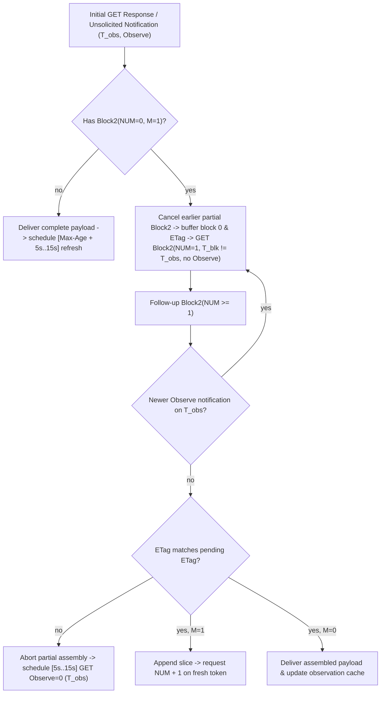

# CoAP Observe + Block2 Interoperability (C7)

- **Plan:** [`plan/pending/coap.md`](../../../plan/pending/coap.md) (Commit C7 — `coap: add: observe blockwise interop`)
- **English checks:** [`doc/project/evidence/protocol/coap/checks/blockwise.md`](../../../doc/project/evidence/protocol/coap/checks/blockwise.md)
- **Covered tests:**
  - [`Rfc7959ObserveBlock2.test`](Rfc7959ObserveBlock2.test) (Observe registration and unsolicited notifications exceeding block size sending `Block2(NUM=0, M=1)` + `Size2` + `ETag` on `T_obs`, while client fetches `NUM >= 1` via normal `GET` with `Block2`, no `Observe` option, and fresh exchange token `T_blk != T_obs`, keeping `T_obs` active for subsequent updates)
  - [`Rfc7959ObserveVersionChange.test`](Rfc7959ObserveVersionChange.test) (Phase 1: newer `Observe` notification `V2` arriving mid-retrieval superseding and discarding partial `V1` assembly while safely ignoring late delayed `V1` follow-up replies; Phase 2: follow-up `Block2(NUM=1)` `ETag` mismatch without superseding notification aborting inconsistent assembly and triggering `[5s, 15s]` randomized jittered `GET Observe=0` re-registration using `T_obs` to recover `V4`)

## Observe notification with Block2 state machine



- **Server retention of Block2 SZX:** `CoapServerObserverRelation` retains any client-requested initial `Block2` `SZX` preference and slices unsolicited notifications (`NUM=0`) at `min(requestedSzx, preferredSzx)` with `Size2`.
- **Client isolation:** `CoapClient` maintains `pendingObserveBlock2SubRequests` and `ignoredObserveBlock2SubRequests` so superseded follow-up replies never leak into logical request counts or corrupt active notification buffers.

## Observed verification

```text
opp_run_protocol_tests --load . -p inet -m debug -w '^tests/protocol/coap$' -f '(Rfc7641Observe|Rfc7959).*\.test$'
[13/13] ◉ Tested test (11 concurrent): 11 PASS in 1:02.363 (exit 0)
```
