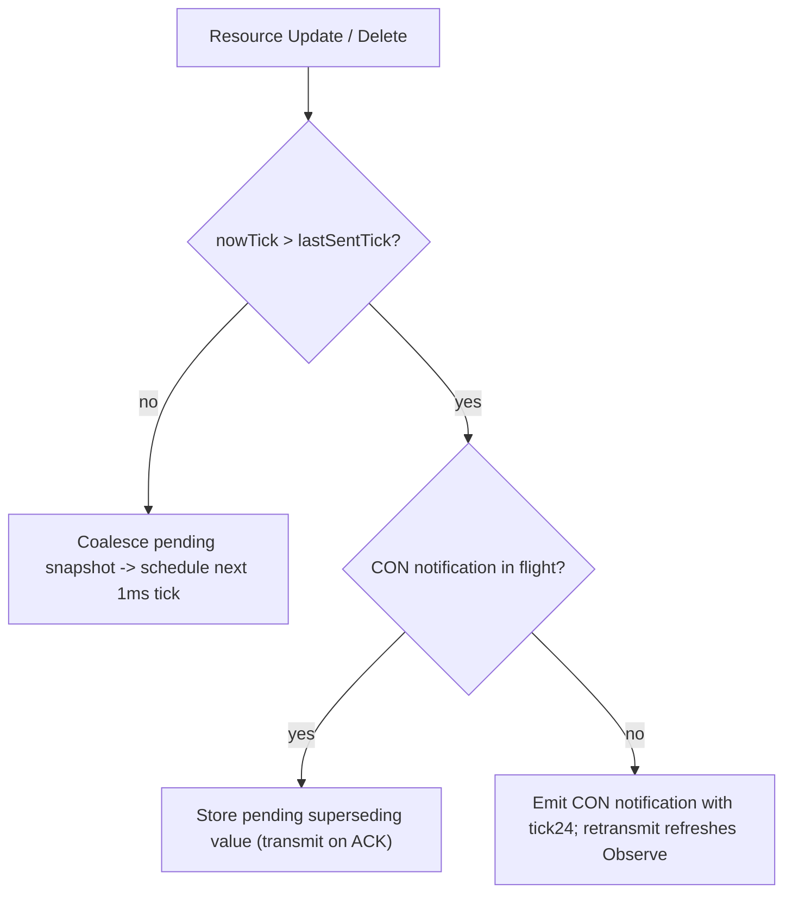

# CoAP Observe Extensions (C5)

- **Plan:** [`plan/pending/coap.md`](../../../plan/pending/coap.md) (Commit C5 — `coap: add: CoAP Observe extensions`)
- **English checks:** [`doc/project/evidence/protocol/coap/checks/observe.md`](../../../doc/project/evidence/protocol/coap/checks/observe.md)
- **Covered tests:**
  - [`Rfc7641ObserveRegistration.test`](Rfc7641ObserveRegistration.test) (`GET` with `Observe=0`, registration ACK response carrying `Observe`, initial `2.05` payload, re-registration with same key replacing earlier entry without duplicate observer entries, `maxObservers` fallback to normal `2.05` without `Observe`, non-`GET` `Observe` option fallback without registering, separate ACK/response initial registration carrying `Observe` sequence)
  - [`Rfc7641ObserveNotifications.test`](Rfc7641ObserveNotifications.test) (`CON` notification updates with server 1ms tick serial values, same-tick coalescing emitting only the latest representation, in-flight notification supersession, retry `Observe` tick refresh without mutating shared frozen header chunk, `4.04` / `4.06` terminal error notification deregistration)
  - [`Rfc7641ObserveReordering.test`](Rfc7641ObserveReordering.test) (client 24-bit serial arithmetic ordering, stale `CON` Empty `ACK` without state update, 24-bit wrapacross `16777200 -> 5`, strict `Tnew > Told + 128s` boundary enforcement)
  - [`Rfc7641ObserveCancellation.test`](Rfc7641ObserveCancellation.test) (explicit `Observe=1` GET deregistration retaining request token without `ETag`, client silent local unsubscribe triggering `RST` on the next `CON` notification, server `CON` notification `MAX_RETRANSMIT` exhaustion pruning the observer)
  - [`Rfc7641ObserveFreshness.test`](Rfc7641ObserveFreshness.test) (`[Max-Age + 5s, Max-Age + 15s]` randomized re-registration jitter timer across seeds `0, 1, 2`, `2.03 Valid` notification refresh preserving cached representation without payload overwrite, local multi-consumer subscription aggregation and plain `GET` cache reuse without exposing `Observe`)

## Observe notification pacing and supersession



- **Shared header immutability on retry:** `CoapEndpointBase::processConfirmableRetransmissions()` copies `ex.header` with `makeShared<CoapHeader>(*ex.header)` before calling `setCoapOptionUint(refreshedHdr, COAP_OPT_OBSERVE, tick24)` on outbound notifications marked `refreshObserveOnRetry`.
- **Freshness jitter precision:** `CoapClient` schedules re-registration using integer `SimTime(maxAge, SIMTIME_S) + SimTime(uniform(5.0, 15.0))`.

## Observed verification

```text
opp_run_protocol_tests --load . -p inet -m debug -w '^tests/protocol/coap$' -f '(Rfc7252|Rfc6690ResourceDiscovery|Rfc7641Observe).*\.test$'
[19/19] ◉ Tested test (17 concurrent): 17 PASS in 26.264 (exit 0)
```
