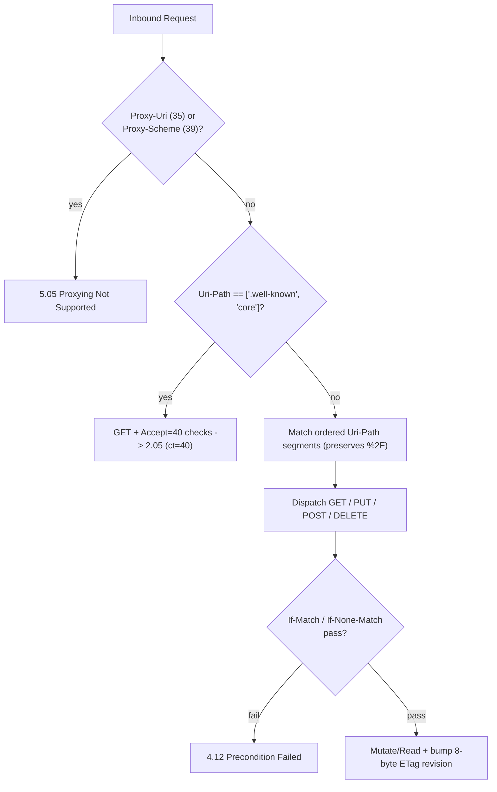

# CoAP Resource Methods, Conditional Requests, and CoRE Discovery (C4)

- **Plan:** [`plan/pending/coap.md`](../../../plan/pending/coap.md) (Commit C4 — `coap: add: resource methods, conditional requests, and discovery`)
- **English checks:** [`doc/project/evidence/protocol/coap/checks/resources.md`](../../../doc/project/evidence/protocol/coap/checks/resources.md), [`doc/project/evidence/standard/rfc6690/catalog.md`](../../../doc/project/evidence/standard/rfc6690/catalog.md)
- **Covered tests:**
  - [`Rfc7252ResourceMethods.test`](Rfc7252ResourceMethods.test) (`GET`, `PUT` create/replace with optional `Content-Format` and no `Location-*`, `POST` append and `4.15` mismatch, `DELETE` idempotency and retained recreation policy, monotonic 8-byte `ETag` across server crash reset, IPv6 dual-stack methods)
  - [`Rfc7252OptionsAndConditions.test`](Rfc7252OptionsAndConditions.test) (`%2F` single-segment URI splitting vs 3-segment paths, `Uri-Host`/`Uri-Port`/`Uri-Query`, `Accept` `4.06`, `ETag` `2.03 Valid`/`2.05`, `If-Match`/`If-None-Match` `4.12`, unknown elective/critical request and response options including `4.02`/silent-NON/`RST`, `Proxy-Uri`/`Proxy-Scheme` `5.05`, client `Location-Path`/`Location-Query` decoding)
  - [`Rfc6690ResourceDiscovery.test`](Rfc6690ResourceDiscovery.test) (`GET /.well-known/core` `Content-Format = 40`, `rt`/`if`/`ct`/`title`/`obs` formatting, `href`/`rt`/`if` exact and `*` prefix queries, empty query result, `4.06` `Accept`, `4.05` `POST`, deleted resource omission)
  - Extended [`Rfc7252DuplicateSuppression.test`](Rfc7252DuplicateSuppression.test) (real CON `POST /append` mutation + duplicate retry proving cached `2.04` reply with single byte append)

## Resource representation, ETag, and segment-exact lookup



- **Monotonic 8-byte `ETag`:** `CoapServer::allocateNextEtag()` encodes an 8-byte big-endian `uint64_t` revision (`nextEtagRevision`, starting at `1`) that is preserved across `ModuleCrashOperation` / `ModuleStartOperation` resets so post-crash initial resources never reuse pre-crash `ETag` bytes.
- **Duplicate `POST` protection:** Inbound request deduplication in `CoapEndpointBase` runs before `CoapServer::handleInboundRequest()`, so a retransmitted `CON POST` replays the cached `2.04 Changed` response without invoking resource append a second time.

## Observed verification

```text
opp_run_protocol_tests --load . -p inet -m debug -w '^tests/protocol/coap$' -f '(Rfc7252|Rfc6690ResourceDiscovery).*\.test$'
[14/14] Tested test (12 concurrent): 12 PASS in 14.346 (exit 0)
```
