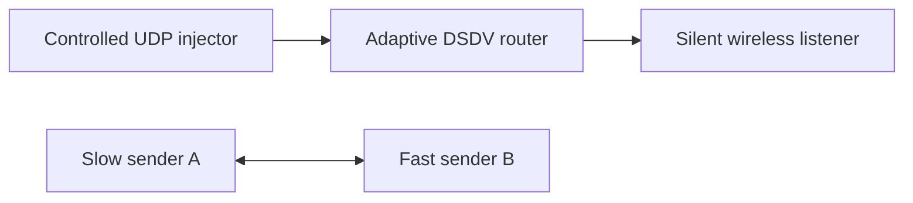

# Adaptive full-dump timing

`DsdvAdaptiveDumps.test` exercises the opt-in policy through production DSDV modules, controlled UDP input and advertisements received by silent wireless neighbors. Four separated injector/router/listener groups cover quiet periods, route churn, the payload-bitrate floor and the maximum-interval clamp. A fifth group contains two real routers with different send intervals and receive timeouts.



The first periodic callback is observed through a self-sequence advance rather than assumed to occur at time zero. With initial interval 1 s, minimum 0.5 s, maximum 4 s and two-entry capacity, the first three selected intervals are:

| Group | Stimulus | Expected intervals |
| --- | --- | --- |
| Quiet, then urgent loss | No changes before the second callback, then finite route 10 followed by withdrawal 11 | 2 s, 4 s, 2 s |
| Churn | Three new destinations after the first callback | 2 s, 1 s, 2 s |
| Payload cost | Two new destinations, then an 80-byte full dump at a 320 bps target | 2 s, 2 s, 4 s |
| Maximum clamp | The same 80-byte dump at 128 bps, whose cost floor is 5 s | 2 s, 4 s, 4 s |

Callback gaps must match the preceding selected interval, and every corresponding periodic advertisement must reach the remote listener within 10 ms. Separating these observations accounts for the different transmission durations of differently sized full dumps. The three-destination burst forces a two-fragment full dump while the self sequence remains unchanged. It must not reset periodic timing. In the quiet group, a newly learned route is withdrawn during a four-second gap; the remote listener must receive its odd/infinite update before the next periodic dump.

The heterogeneous pair uses A's initial/minimum 2 s and maximum 4 s with receive timeouts 1.5 s/2 s. B sends with initial/minimum 0.25 s and maximum 0.5 s, with both receive timeouts 6 s. Zero jitter and a 0.1 s settling cap keep the fixture's peer gaps below those timeouts. Reciprocal one-hop routes must be present at 3 s and 15 s, and neither router may report expiry during that interval. This guards against incorrectly comparing a node's receive timeout with its own sending interval.

Run General/run 0/seed 0 from the repository root after a fresh debug build:

```sh
opp_run_protocol_tests --load . -p inet -m debug -w '(^|/)dsdv$' -f 'DsdvAdaptiveDumps\.test$'
```

The common version-1 header and packet-spacing observations permit a parent comparison with new adaptive parameter assignments omitted. The quiet listener's second periodic packet must arrive exactly 2 s after its first: both carry only the self entry, so their equal air durations cancel. This receiver assertion executes before any interval-statistic presence assertion. Constant one-second spacing on the parent is the source-grounded expected difference; absence of the new statistic alone is not scheduling evidence. The heterogeneous case is configuration coverage rather than a claimed parent failure. Lifecycle reset and invalid parameter boundaries belong to the module cases. No channel-wide congestion or universal performance improvement is claimed. Execution records belong in the DSDV results document.
