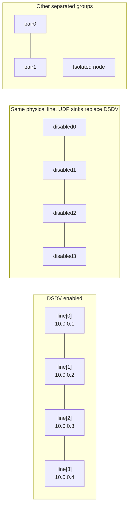

# DSDV forwarding test

> **Kind:** reference · **Status:** current · **Seal:** none · **Owns:** — · **Stands on:** [DsdvForwarding.test](DsdvForwarding.test)

This fixture checks whether real DSDV UDP advertisements install IPv4 host routes that carry application packets. It observes accepted updates, next-hop ARP, intermediate ICMP traffic, echo replies and route ownership. This guide explains the assertions, not the result of a new execution.

## Setup

The General/run/seed 0 simulation contains four separated groups. Neighbors are 100 m apart, with `AckingWirelessInterface` and `GenericUnitDiskRadio` configured for a 110 m range. Two-hop shortcuts and cross-group links are impossible. Static addresses, ordinary local ARP, disabled configurator-generated static/default/subnet routes and cleared `netmaskRoutes` prevent supplied routes from bypassing DSDV. These simplified links do not test IEEE 802.11 MAC/PHY behavior.

DSDV occupies `app[0]` on enabled `AdhocHost` nodes. The simulation lasts 10 s; Ping begins at 6 s and repeats every 500 ms. The enabled and disabled lines attempt first-to-last delivery; the pair exchanges direct-neighbor traffic. For `10.0.0.4`, the enabled source must choose `10.0.0.2` as its next hop, resolve that neighbor through ARP and traverse both relays. A reply requires a return path too.

## Assertions and limits

| Observation | Required result |
| --- | --- |
| Control traffic | At least one accepted update across the network, not a per-node count. |
| Application delivery | At least one reply at the enabled line source and pair source; none at the disabled source. |
| Intermediate forwarding | Both enabled relays receive suitable IPv4 ICMP traffic for `10.0.0.4`. |
| ARP | At least one source request, with every observed request targeting next hop `10.0.0.2`, not the remote destination. |
| Final enabled routes | All 12 ordered non-self routes are owned by that node's DSDV application, have `/32` prefix and MANET type, use the adjacent next hop toward the destination and have metric equal to the number of line edges. |
| Negative controls | The disabled source has no route to its far endpoint, and the isolated node has no DSDV-owned route. |

For example, the enabled source's route to `10.0.0.4` must use `10.0.0.2` with metric 3. A correct foreign route cannot satisfy ownership assertions. The fixture requires some delivery, not every ping, and checks routes only at the end. Relay observations do not correlate every request/reply hop by identity. No forced control-packet loss, exact update sequence, throughput or convergence-time claim is made.

The controller change introduces the UDP `IApp` attachment. Its parent has the older `IManetRouting`/IP-gate contract, so this `app[0]` fixture cannot execute unchanged there. An attachment or initialization failure is not a measured forwarding assertion failure, and none is claimed here. The disabled line and isolated node are runtime negative controls within the supported new fixture.

## Run and diagnose

From the INET root with the OMNeT++ environment loaded, run `make -j8 MODE=debug`, then `opp_run_protocol_tests --load . -p inet -m debug --no-build -w '(^|/)dsdv$' -f 'DsdvForwarding\.test$'` against that matching library. Require successful execution and `DSDV forwarding PASS: owned routes, local ARP, two intermediate traversals, disabled control`. The preceding counter line identifies missing accepted updates, replies, relay observations or ARP targeting as investigation starting points, not root-cause proof. A build/launch error is setup failure. Avoid overlapping runs sharing generated output; this test does not compare or update fingerprints.
