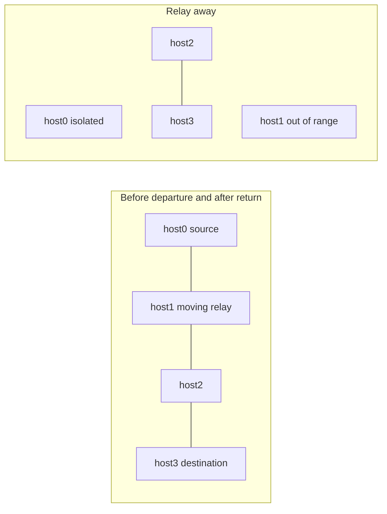

# DSDV mobile recovery test

> **Kind:** reference · **Status:** current · **Seal:** none · **Owns:** — · **Stands on:** [DsdvMobile.test](DsdvMobile.test), [mobile example](../../../examples/dsdv/omnetpp.ini)

This fixture runs the production mobile example and checks application delivery before a relay departs, silence during the resulting partition and delivery after return. It observes source Ping reply timestamps independently of DSDV's update signals and injects no routes. This guide explains the assertions, not the result of a new execution.

## Setup and timing oracle

Four [DsdvRouter](../../../src/inet/node/dsdv/DsdvRouter.ned) nodes attach their separate `dsdv` controllers through the transport dispatcher. Static addresses, ordinary local ARP, disabled configurator-generated static/default/subnet routes and cleared `netmaskRoutes` prevent supplied multihop shortcuts. Neighbors start 100 m apart; `AckingWirelessInterface` and `GenericUnitDiskRadio` use a 110 m range. These simplified links test routing, not IEEE 802.11 MAC/PHY behavior.

The simulation runs Mobile/run/seed 0 for 32 s. `host[0]` pings `host[3]` every 500 ms from 4 s. `host[1]` starts at `(200 m, 100 m)`, moves vertically to `(200 m, 500 m)` during 8–12 s, waits until 20 s and returns during 20–24 s. It crosses the radio-range boundary while moving; the movement milestones are not asserted route-change instants.

| Receipt-time window | Required observation |
| --- | --- |
| `4 <= t < 8` | At least one reply before departure. |
| `12 <= t <= 22` | No reply during the checked partition interval. |
| `26 <= t < 32` | At least one reply after return and a recovery allowance. |

The unasserted gaps allow movement and recovery without prescribing one exact convergence time. The no-reply window includes both endpoints.

## Observation and limits

The Python fixture runs `inet --debug` in Cmdenv with the production Mobile configuration, writing `simulation.log`, `mobile.vec` and `mobile.sca`. It invokes `opp_scavetool export -F CSV-R` to extract the source application's `pingRxSeq:vector` into `replies.csv`. Exactly one vector must match; missing or ambiguous data fails instead of satisfying silence. Its timestamps provide the three assertions above, and an echo reply exercises both forward and return paths.

Silence alone does not prove stale-route removal: a physical disconnection can block packets while a stale route remains installed. Recovery establishes a usable path in this scenario, not each route's repair mechanism, withdrawal sequence or expiry deadline. One reply suffices in each success window; continuous delivery, every-ping success, throughput and average convergence are not measured.

The production example and this test are introduced together; the parent lacks that example. Missing parent configuration or initialization support is not a measured protocol assertion failure, and no such parent forwarding failure is claimed. This fixture adds coverage for the new mobile scenario and node attachment.

## Run and diagnose

From the INET root with the OMNeT++ environment loaded, run `make -j8 MODE=debug`, then `opp_run_protocol_tests --load . -p inet -m debug --no-build -w '(^|/)dsdv$' -f 'DsdvMobile\.test$'` against that matching library. Require successful execution and `DSDV mobile PASS: initial forwarding, partition loss, rejoin recovery`. First distinguish a subprocess error in `simulation.log` from a timestamp assertion in `replies.csv`; the latter identifies which delivery window failed. A build, launch or export error is setup failure, not routing evidence. Avoid overlapping runs sharing generated output. This test does not compare or update fingerprints.
