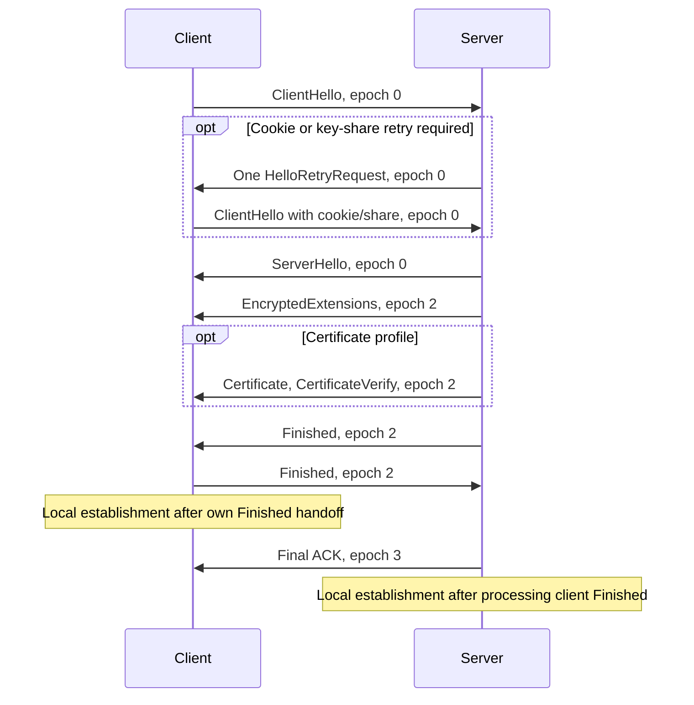
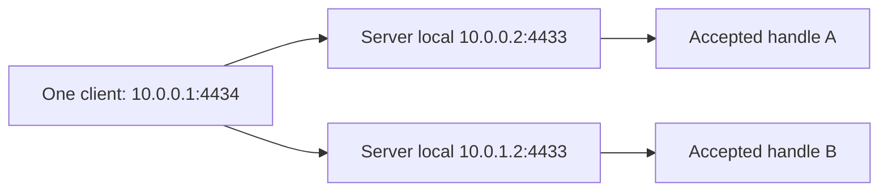

# Establishing DTLS associations

> **Kind:** report · **Status:** snapshot 2026-11-16 · **Seal:** none · **Owns:** — · **Stands on:** [dtls.md](../../../plan/pending/dtls.md)

This is the reviewer document for C3, `dtls: add: establish modeled client and server associations`. All cases below drive the production UDP-backed engine. They use modeled profile compatibility, without cryptographic certificate, signature, binder or Finished verification.

## Setup and exchanges

The ordinary fixture uses two StandardHosts, a PacketTap, declared checksums/FCS, static neighbor resolution and seed 0. The server listens on UDP 4433; clients use distinct source ports when testing multiple peers. The PSK controlled-link path disables cookies. Certificate and initial client-authentication paths use cookies; their 512-byte certificates fit one record, so fragmentation is a C4 requirement.



Optional initial client authentication adds CertificateRequest to the server flight and Certificate/CertificateVerify to the client's final flight. The client establishment callback follows its actual Finished handoff and precedes receipt of the final ACK. The server callback and outgoing ACK have no required relative order; the tests observe both without imposing one.

## Positive and negotiation cases

| Case | Stimulus and required evidence |
| --- | --- |
| [Rfc9147Handshake.test](Rfc9147Handshake.test) | Parallel PSK and certificate associations; admit a queued PSK send, observe epoch-zero hello, epoch-two certificate/client Finished, epoch-three ACK and one callback per side. The full PSK server flight remains within three times its initial input. |
| [Rfc9147PskHandshake.test](Rfc9147PskHandshake.test) | Isolated no-cookie PSK exchange: both Finished epochs, final ACK epoch, callback timing and one queued marker delivered once. |
| [Rfc9147ClientHello.test](Rfc9147ClientHello.test) | A 7 ms handshake output cost produces ClientHello at 0.207 s. Check direct body length, DTLS legacy version, empty legacy cookie, suite offer, version/share extensions and PSK-last ordering; observe UDP handoff. |
| [Rfc9147CookieRetry.test](Rfc9147CookieRetry.test) | First offer, retry, second offer and establishment. The retry cookie occupies an extension while legacy_cookie stays empty; the stateless first retry must not report an accepted full association. |
| [Rfc9147CookieKeyShareRetry.test](Rfc9147CookieKeyShareRetry.test) | Offer key_share with an empty client_shares vector. Require one retry combining cookie and X25519 request, then a second offer containing both and successful setup. |
| [Rfc9147ClientAuthentication.test](Rfc9147ClientAuthentication.test) | CertificateRequest, client Certificate and CertificateVerify precede establishment. |
| [Rfc9147NegotiationFailure.test](Rfc9147NegotiationFailure.test) | Incompatible modeled identity: a real offer precedes local failure, with no establishment or data. |
| [Rfc9147UnsupportedVersion.test](Rfc9147UnsupportedVersion.test) | Validly framed unsupported-version offer requires protocol_version (70). |
| [Rfc9147UnsupportedSuite.test](Rfc9147UnsupportedSuite.test) | Unsupported-suite offer requires handshake_failure (40). |
| [Rfc9147UnofferedSelection.test](Rfc9147UnofferedSelection.test) | A server-selected unoffered suite requires the client's illegal_parameter (47), one local failure and no establishment. |

## Cookie rejection cases

| Case | Mutated or delayed production stimulus | Required result |
| --- | --- | --- |
| [Rfc9147LegacyCookie.test](Rfc9147LegacyCookie.test) | Nonempty legacy cookie, with every affected length repaired | illegal_parameter; no establishment |
| [Rfc9147CookieExpired.test](Rfc9147CookieExpired.test) | Delay retry beyond a 10 ms cookie lifetime | illegal_parameter; no establishment |
| [Rfc9147CookieWrongRandom.test](Rfc9147CookieWrongRandom.test) | Change retry random while retaining its token | illegal_parameter; no establishment |
| [Rfc9147CookieWrongSource.test](Rfc9147CookieWrongSource.test) | Change retry UDP source port | Server emits illegal_parameter; no establishment |
| [Rfc9147CookieMissing.test](Rfc9147CookieMissing.test) | Remove cookie extension from the retry offer | Server sends another retry; an already-retrying client emits unexpected_message (10) |

The fixture edits typed ClientHello content, then adjusts handshake, record, UDP, IPv4 and enclosing EthernetSignal lengths. It changes represented input rather than supplying a fake negotiation or authentication result.

## Isolation and resource limits

| Case | Stimulus and required evidence |
| --- | --- |
| [Rfc9147AssociationIsolation.test](Rfc9147AssociationIsolation.test) | Two source ports share one listener; require distinct accepted handles and two independent establishments. |
| [Rfc9147AssociationLimit.test](Rfc9147AssociationLimit.test) | One established slot is full. A second candidate fails without closing or evicting the first peer. |
| [Rfc9147HalfOpenLimit.test](Rfc9147HalfOpenLimit.test) | A credit-blocked candidate fills one half-open slot. Reject another candidate; after expiry, a later peer establishes, proving capacity release. |
| [Rfc9147AmplificationLimit.test](Rfc9147AmplificationLimit.test) | Oversized no-cookie certificate flight; block later client traffic. Output never exceeds three times initial input and the server fails at its deadline. |
| [Rfc9147AmplificationIsolation.test](Rfc9147AmplificationIsolation.test) | One certificate candidate lacks credit. A second padded offer has enough credit and establishes through the same processor; correlate its callback with its source port. |
| [Rfc9147CoalescedAmplification.test](Rfc9147CoalescedAmplification.test) | Two identical ClientHello records share one UDP payload. Its byte count supplies credit once, and an independently calculated 1058-byte flight remains blocked. |
| [Rfc9147SameTupleReplacement.test](Rfc9147SameTupleReplacement.test) | With two peers established, reject a fresh first-peer retry without releasing old state. A later validated replacement establishes and releases its old handle; the unrelated peer remains open. |
| [Rfc9147Multihomed.test](Rfc9147Multihomed.test) | One client IP/UDP source opens both local server addresses. Require equal peer tuples, distinct server local addresses/handles, and correct reply source identity. |



The second server address is reached through its first Ethernet interface using an explicit host route. Both associations therefore have the same remote IP/port, isolating the local-address component of the association key.

The coalesced case deliberately chooses a flight larger than three times the actual combined input and smaller than twice that allowance. It reproduced excess output on development snapshot 6935 and passed after the per-datagram accounting fix in snapshot 67909. This is a development-snapshot comparison: the C3 parent has no completed handshake capability, so this is not a claimed parent-versus-change protocol failure.

## Execution and limits

The following focused malformed-message and alert-isolation cases observe the actual incoming stimulus before requiring the appropriate alert or continued healthy association.

| Additional case | Required observation after positive receiver input |
| --- | --- |
| [Rfc9147ClientHelloCompression.test](Rfc9147ClientHelloCompression.test) | Legacy compression vector other than exactly {0} produces illegal_parameter (47). |
| [Rfc9147UnexpectedHandshakeType.test](Rfc9147UnexpectedHandshakeType.test) | An in-sequence Certificate in the PSK EncryptedExtensions position produces unexpected_message (10). |
| [Rfc9147FinishedLength.test](Rfc9147FinishedLength.test) | A complete 31-byte Finished body produces decode_error (50). |
| [Rfc9147MalformedRetryShare.test](Rfc9147MalformedRetryShare.test) | A malformed encoded HRR key-share length produces decode_error (50). |
| [Rfc9147ForbiddenRetryPsk.test](Rfc9147ForbiddenRetryPsk.test) | HRR containing pre_shared_key produces unsupported_extension (110). |
| [Rfc9147SecondRetrySequence.test](Rfc9147SecondRetrySequence.test) | A second logical HRR with unchanged body but sequence 1 produces unexpected_message (10). |
| [Rfc9147ObsoletePlainAlert.test](Rfc9147ObsoletePlainAlert.test) | An epoch-zero fatal alert cannot destroy an already protected association; valid data still progresses. |
| [Rfc9147PlainAlertLocalIdentity.test](Rfc9147PlainAlertLocalIdentity.test) | After HRR identifies the pending local address, an alert to another local address cannot fail that attempt; it completes normally. |
| [Rfc9147EarlyPeerFinished.test](Rfc9147EarlyPeerFinished.test) | An expected represented peer Finished arriving early cannot establish the server before its own delayed Finished handoff. |
| [Rfc9147ProtectedAlertBeforeHello.test](Rfc9147ProtectedAlertBeforeHello.test) | An epoch-two fatal alert arriving before ServerHello supplies protection state is dropped; the original attempt later completes. |
| [Rfc9147TrailingClientHello.test](Rfc9147TrailingClientHello.test) | One extra body byte after valid ClientHello extensions produces decode_error (50), with no association allocation. |
| [Rfc9147InflatedClientHello.test](Rfc9147InflatedClientHello.test) | Typed body chunkLength exceeds its unchanged field encoding by one; adjusted outer lengths cannot hide the invalid representation, which produces decode_error. |
| [Rfc9147EmptyCookieExtension.test](Rfc9147EmptyCookieExtension.test) | A present Cookie vector of length zero is a syntax error (decode_error), distinct from an absent extension or a well-formed invalid token. |
| [Rfc9147MissingKeyShareExtension.test](Rfc9147MissingKeyShareExtension.test) | supported_groups without the required key_share extension produces missing_extension (109). |
| [Rfc9147MissingCertificateExtensions.test](Rfc9147MissingCertificateExtensions.test) | A certificate offer retaining groups/share but missing signature_algorithms independently requires missing_extension (109). |

From the checkout root after a matching debug library build:

```sh
source .envrc
opp_run_protocol_tests --load . -p inet -m debug --no-build --no-concurrent -w '^tests/protocol/dtls$' -f 'Rfc9147(Handshake|CookieRetry|NegotiationFailure|AssociationIsolation|ClientHello|PskHandshake|ClientAuthentication|CookieKeyShareRetry|UnsupportedVersion|UnsupportedSuite|LegacyCookie|CookieWrongRandom|CookieWrongSource|CookieMissing|CookieExpired|AmplificationLimit|AmplificationIsolation|HalfOpenLimit|AssociationLimit|SameTupleReplacement|Multihomed|UnofferedSelection|CoalescedAmplification|ClientHelloCompression|UnexpectedHandshakeType|FinishedLength|MalformedRetryShare|ForbiddenRetryPsk|SecondRetrySequence|ObsoletePlainAlert|PlainAlertLocalIdentity|EarlyPeerFinished|ProtectedAlertBeforeHello|TrailingClientHello|EmptyCookieExtension|InflatedClientHello|MissingKeyShareExtension|MissingCertificateExtensions)\.test$'
```

On 2026-11-16, all **38 cases passed**, debug mode, seed 0, against frozen fresh build 55487. Recorded execution divided the first 37 into five successive batches of 8, 8, 8, 8 and 5 cases; each batch used the runner's concurrent default, with fixtures and shared headers held stable. Their times, including generated builds, were 28.897, 20.811, 13.384, 23.082 and 26.595 seconds. The additional certificate-required-extension case passed separately in 28.74 seconds. The sequential command above selects the identical cases and configurations while bounding compiler work.

Raw runner output is `audit/dtls/protocol-c3-final-batch0.log` through `protocol-c3-final-batch4.log`, plus `audit/dtls/protocol-c3-required-certificate.log`; retained per-case output is `audit/dtls/c3-final/*.out` and `*.err`. These ignored local artifacts are execution evidence rather than committed fixtures. Callback timing, pre-validation allocation, tuple identity, formal cookie errors and native body-representation checks are included in this passing set. No fingerprint baseline was changed.

The suite does not establish cryptographic interoperability, confidentiality, authentic rejection of old-association ciphertext or certificate security. Fragment loss/recovery, replay stress, processing limits and post-handshake behavior belong to later reviewer documents. Mermaid rendering remains unverified.
