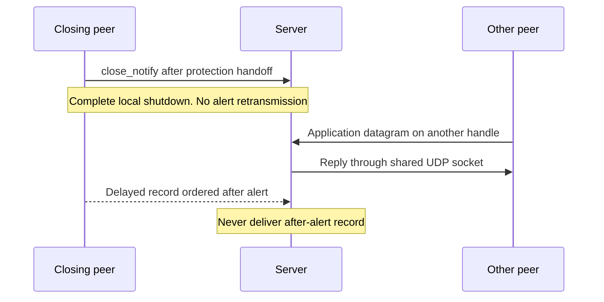

# Closing associations and lifecycle cleanup

> **Kind:** report · **Status:** snapshot 2026-11-16 · **Seal:** none · **Owns:** — · **Stands on:** [dtls.md](../../../plan/pending/dtls.md)

This is the reviewer document for `dtls: add: close associations without disrupting other peers`. Seven wire cases cover graceful and forced closure, alert-description dispatch, shared-socket peer isolation and lifecycle cancellation.

Protection follows INET IPsec's modeled representation: retained packet content, modeled tag sizes and processing costs. These checks do not claim real key derivation, encryption, MAC verification or cryptographic interoperability.

**Verified scope:** the rewritten CLOSE source boundary passes all seven CLOSE cases and its complete 125-case protocol matrix. The earlier combined-source evidence is retained separately below.

## Closure and shared sockets



| Case | Stimulus and required evidence |
| --- | --- |
| [Rfc9147Close.test](Rfc9147Close.test) | Use nonzero protection, lose close_notify and require bounded local closure, rejection of later sends and no alert retry. Peer notification is not reliable. |
| [Rfc9147CloseDelivered.test](Rfc9147CloseDelivered.test) | Deliver close_notify after protection, require the peer's closed indication and no app interpretation, then reject a later send. |
| [Rfc9147AlertDisposition.test](Rfc9147AlertDisposition.test) | Change two-byte production app payloads into equal-size protected alerts while retaining real wire record numbers. Dispatch by description, ignoring the legacy level: user_canceled at level 2 is ignored; handshake_failure at level 1 terminates once. Normal intervening data delivers without treating alerts as application data. |
| [Rfc9147CloseDeadline.test](Rfc9147CloseDeadline.test) | Queued protection takes three seconds but close deadline is half a second. Forced cleanup reports one error followed by exactly one closed completion; no stale alert handoff survives cancellation. |
| [Rfc9147FatalDuringClose.test](Rfc9147FatalDuringClose.test) | Receive a fatal-description alert during positive-cost local close processing. Report error then closed exactly once, cancel the pending alert handoff and prevent repeated completion at the old deadline. |
| [Rfc9147SharedPortClose.test](Rfc9147SharedPortClose.test) | Close one accepted server handle; a second peer continues bidirectional data through the same bound UDP socket. |
| [Rfc9147CloseBoundary.test](Rfc9147CloseBoundary.test) | Deliver an app record, then process a valid alert; copies subsequently arrive on either side of the alert's sequence pair. Content processed after that alert never delivers. The API may discard earlier in-flight content too; no guaranteed draining or rollback of already delivered data is claimed. |

Module tests separately exercise stop during handshake, queued processing and crash without alert traffic. The real-host [DtlsRestartLifecycle_1.test](../../module/DtlsRestartLifecycle_1.test) covers stop/start of the same instance past old deadlines; its runtime result is reported with the module evidence.

The real-host lifecycle fixture preserves its earlier stop-during-active-application, crash and restart phases. Its additional close-then-stop phase keeps the already-started protection cost and original close deadline, hands off one alert when time permits, and reports one normal closed completion without a forced error.

## Execution and evidence

Run the seven named cases after building the matching source:

```sh
source .envrc
opp_run_protocol_tests --load . -p inet -m debug --no-build --no-concurrent -w '^tests/protocol/dtls$' -f 'Rfc9147(Close|CloseDelivered|CloseDeadline|FatalDuringClose|SharedPortClose|CloseBoundary|AlertDisposition)\.test$'
```

The verified combined implementation passed **125/125 DTLS protocol cases**: eighteen KEYS cases, seven CLOSE cases, ninety-nine C3–C5 controls and the framing control. Every group used debug mode, seed 0, at most eight cases and a 60-second process-group timeout; none timed out and no case was waived.

The matching build is `audit/dtls/build-c6-promotion-fixed.log`; its source manifest is `audit/dtls/source-c6-promotion-fixed.sha256`. Exact commands, selected cases and group exit codes are recorded in `audit/dtls/protocol-c6-application-final-run-record.json` and canonical `audit/dtls/protocol-c6-final-run-record.json`. Runner logs are `audit/dtls/protocol-c6-application-final-{c6,c3,c4,c5,c2}-batch*.log`; all 125 per-case output/error files are under `audit/dtls/c6-application-final-all/`.

Complementary FIFO-capture checks passed six units and eight modules, recorded in `audit/dtls/unit-c6-fifo-fixed.log` and `audit/dtls/module-c6-fifo-fixed.log`, with source manifest `audit/dtls/source-c6-fifo-fixed.sha256`. Those are separate captures from the final promotion-refusal alert correction, which the unchanged AssociationLimit fixture and complete 125-case protocol run verified.

### Isolated CLOSE boundary

The isolated worktree `/home/miguel/workspace/inet-dtls-c6-series` at `e65868cd302808b5757b68806700162853a2c120` passed **125/125 unique protocol cases**: seven CLOSE cases, eighteen KEYS cases, ninety-nine C3–C5 controls and the framing control. This executes the assembled CLOSE stage on its verified prerequisites rather than relying on the earlier combined-source result.

The matching debug build is recorded in the main worktree's `audit/dtls/c6-series/build-close-matching.log`. Eighteen sequential runner groups each selected at most eight cases, used seed 0 and debug mode, and ran under `timeout --signal=KILL 60s`; every group exited zero without a setup exception or timeout. Each command sourced the isolated worktree's `.envrc` and used `opp_run_protocol_tests --load . -p inet -m debug --no-build -w '^tests/protocol/dtls$'` with its bounded case selector.

Exact commands, all selected names, source HEAD and group exit codes are in `audit/dtls/c6-series/close-isolated-protocol-run-record.json`. Runner logs are `audit/dtls/c6-series/close-protocol-{close,keys,c3,c4,c5,c2}-batch*.log`; all 125 per-case output/error pairs are preserved under `audit/dtls/c6-series/close-protocol-raw/`. These audit paths belong to the main `/home/miguel/workspace/inet-dtls` worktree.

`audit/dtls/c6-series/close-library-resolution.log` confirms that the test executable resolves both INET and protocol-test libraries inside the isolated worktree. The tested `src/libINET_dbg.so` SHA256 is `4919e089a2a0ff25d6bacbeaf9eebbfb799e49ba2f007e2a77de577720da751a`.

Complementary checks on this isolated capture passed six units and eight modules, including the real-host restart and close-then-stop phases. Their separate logs are `audit/dtls/c6-series/unit-close.log` and `audit/dtls/c6-series/module-close.log`; these counts are not included in the 125 wire cases. The checks are deterministic seed-0 evidence, not statistical or cryptographic interoperability evidence.

### Parent control distinction

The original eighteen-case parent baseline ran against the verified C5 binary: twelve update cases failed because no KeyUpdate appeared, five closure cases failed because alert handoff or bounded completion was absent, and the original AlertDisposition control passed. That alert control used user_canceled at level 1 and handshake_failure at level 2; its later reverse-level strengthening was not part of the passing parent result. There were no setup exceptions or timeouts. Exact parent logs are `audit/dtls/protocol-c6-parent-batch0.log` through `batch2.log`, with raw output under `audit/dtls/c6-parent/`.
The current AlertDisposition case intentionally reverses those levels: user_canceled at level 2 is ignored and handshake_failure at level 1 terminates, proving description-based TLS 1.3 dispatch rather than the old level shortcut. FatalDuringClose is an additional case that was not executed in the parent baseline.

Lifecycle module evidence complements wire observations with cancellation, packet ownership, retained-state release and exactly-once callback checks. Mermaid rendering remains unverified.
