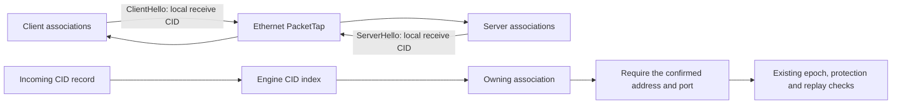

# DTLS 1.3 connection identifiers

> **Kind:** report · **Status:** snapshot 2026-11-16 · **Seal:** none · **Owns:** — · **Stands on:** [extension plan](../../../plan/pending/dtls-extensions.md), [CID obligation](../../../doc/project/evidence/standard/rfc9147/extensions.md#dtls-ext-cid)

C6 adds receiver-selected CIDs through the ClientHello/ServerHello `connection_id` extension and the DTLS 1.3 unified header. Enable `connectionIdEnabled`; `receiveConnectionId=false` offers an empty receive ID while remaining able to send to the peer's ID. No CID is used unless the extension is negotiated, and each protected direction follows the receiving peer's choice. Defaults retain the original records.

Each engine allocates eight-byte receive IDs from a monotonic lifetime counter. Ordinary close, failure, stop and crash remove lookup entries; restarting the same engine does not rewind its counter. Allocation refuses collision or exhaustion without replacing another owner. There is no retired-ID history. The serializer can send peer-selected lengths through 255 bytes. Raw receive decoding uses the local eight-byte profile; native outgoing dissection also respects a peer's different length. CIDs add their actual bytes to headers, fragmentation, application budgets, ACK packing, queue reservations, alert sizes and amplification accounting.

An incoming CID selects an association through the local index before modeled deprotection. An unknown, missing or inconsistent CID record is dropped without replay commitment. A CID selected from another tuple is refused with an unsupported-path drop; address changes are not available at this stage. Known protected records from different associations cannot be mixed in one datagram. Matching a CID is routing information, not authentication: retained-chunk protection cannot establish security against forged headers or real cryptographic replay attacks.

Early data can precede this attempt's ServerHello and its fresh CID negotiation. Such epoch-1 input can use tuple lookup while its early receive state remains live. Once the peer CID becomes known, later output uses the negotiated header. An active early operation whose reserved header budget changes is skipped after its sampled service, with one send error; it is not automatically retried. This keeps queue accounting bounded without guessing the future peer's CID size.

Production fixtures use StandardHosts, the existing Ethernet PacketTap, 1 ms links, seed 0, declared checksums/FCS and finite limits. Initial state and explicit packet faults are specified in each file; no fake handshake replaces the engine.

| Case | Setup, stimulus and required observations |
| --- | --- |
| [Rfc9147ConnectionId.test](Rfc9147ConnectionId.test) | Five association pairs cover bidirectional, client-empty/server-nonempty, both-empty, client-disabled and server-disabled negotiation. The bidirectional pair uses SHA-384/RSA with initial client authentication. Observe actual directional CID arrays and 1200-byte records, deliver 1170 bytes with an eight-byte CID or 1178 without, reject one excess byte, and deliver replies in every direction. |
| [Rfc9147ConnectionIdInvalid.test](Rfc9147ConnectionIdInvalid.test) | Two clients share one server engine. Substitute an unknown CID, the other peer's live CID, no CID and an inconsistent native header. Require the appropriate drops without delivery. Then reuse every rejected record number in a correctly addressed record (including the other association's window); all four valid markers must arrive exactly once. The inconsistent native encoding complements raw truncation units rather than claiming an authenticated wire forgery. |
| [Rfc9147ConnectionIdMalformedOffer.test](Rfc9147ConnectionIdMalformedOffer.test) | Advertise eight CID bytes while carrying seven. The server emits `decode_error` (50) without accepting or establishing an association. |
| [Rfc9147ConnectionIdUnsolicited.test](Rfc9147ConnectionIdUnsolicited.test) | Add an unoffered CID extension to the actual plaintext ServerHello, updating its represented lengths. The client emits `unsupported_extension` (110), reports one error and never establishes. |
| [Rfc9147ConnectionIdReuse.test](Rfc9147ConnectionIdReuse.test) | Enable CIDs in the PSK ticket ACK-loss/KeyUpdate fixture, close and reconnect, then deliver a four-second duplicate of the old client Finished. Its old CID is unknown; the replacement association remains established and its application marker is delivered once. |
| [Rfc9147ConnectionIdLifecycle.test](Rfc9147ConnectionIdLifecycle.test) | Stop/restart and crash/restart the server in the existing real-peer ticket lifecycle fixture. All three advertised receive CIDs must differ. Ticket table clearing and lifetime ticket-serial observations remain controls. |
| [Rfc9147ConnectionIdEarlyData.test](Rfc9147ConnectionIdEarlyData.test) | Enable CIDs in the explicit early-data fixture. The initial resumed epoch-1 datagram precedes the new ServerHello; it is delivered once through the marked callback, while later negotiated traffic and ordinary delivery succeed. |
| [Rfc9147ConnectionIdEarlyBudget.test](Rfc9147ConnectionIdEarlyBudget.test) | Start ten milliseconds of early protection before ServerHello, then negotiate a larger CID header during that active service. Observe the error exactly ten milliseconds after service began. Early admission remains positive, no early payload is sent or retried, and later ordinary data arrives. |

`DtlsRecordSerializer_1` checks exact eight-byte CID wire fields, every truncated header prefix, oversized CID rejection, encoding a different peer length, raw eight-byte dissection and native different-length dissection. `DtlsConnectionIds_1` tests allocator/index collision, per-owner removal, non-reuse after clearing and exhaustion. That module deliberately bypasses network initialization and claims no handshake or lifecycle exchange; the production lifecycle case supplies those observations.

The [execution ledger](../../../doc/project/evidence/model/dtls/extensions.md) records final selectors and counts separately from unexecuted release, parent and baseline comparisons. CID update messages and validated migration belong to later commits. This stage does not claim real-world interoperability, CID unpredictability or address-migration security.
