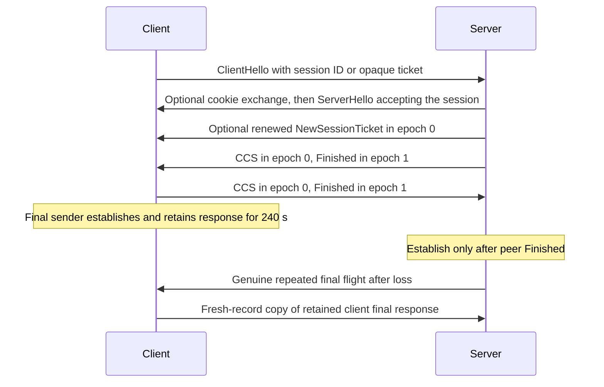

# DTLS 1.2 session resumption

> **Kind:** report · **Status:** current · **Seal:** none · **Owns:** — · **Stands on:** [extension profile](../../../doc/project/evidence/standard/rfc9147/extensions.md), [execution ledger](../../../doc/project/evidence/model/dtls/extensions.md)

This is C14, `dtls: add: resume modeled DTLS 1.2 sessions`, in the [implementation plan](../../../plan/pending/dtls-extensions.md). It extends the [legacy association](dtls12-associations.md) with the abbreviated exchange and uses the existing bounded engine store. The [execution ledger](../../../doc/project/evidence/model/dtls/extensions.md) owns actual commands, results and limits; the diagrams below have not been render-checked.

## Selected behavior

[RFC 5246 §§7.3–7.4](https://www.rfc-editor.org/rfc/rfc5246.html#section-7.3) defines session-ID resumption and saved parameters. [RFC 5077 §§3.1–3.4](https://www.rfc-editor.org/rfc/rfc5077.html#section-3.1) defines ticket extension 35, its separate NewSessionTicket body, renewal and the interaction with session IDs. [RFC 6347 §4.2.4](https://www.rfc-editor.org/rfc/rfc6347.html#section-4.2.4) supplies flight recovery and final-response retention. The model follows those message exchanges with a bounded stateful lookup of opaque tickets; it does not implement stateless ticket encryption or real master secrets.

`resumptionEnabled` remains false by default. When enabled, `dtls12SessionTicketsEnabled = true` permits tickets; false permits session IDs only. The same finite PSK/GCM and ECDHE-ECDSA/GCM profiles apply. Saved version, suite and identity must agree. Unknown, expired, evicted or cross-version state falls back to the full selected profile; removing its only suite from the offer causes handshake_failure because no common full profile remains. The server never uses a presented session ID to rescue an invalid nonempty ticket. A ticket-issuing full ServerHello has an empty session ID. Ticket acceptance echoes the client's nonempty marker ID; receiving a renewed ticket discards the session ID.

The concrete owner is `DtlsAssociation` with session members in `Dtls12Session.cc`. Its existing lazy legacy value retains one pending session and the promised-ticket phase. The engine's store shares capacity across client/server roles and both versions, with separate ID/ticket lookups. Identifiers use the existing issuer-component/monotonic-serial namespace. Session IDs are at most 32 bytes; generated IDs and tickets are 16 bytes. No new protocol engine, processor or recovery ledger is added.

Both endpoints install pending state only at successful establishment, before callbacks can initiate another open. A plaintext ticket alone is insufficient. Normal close preserves eligible entries; fatal legacy failure invalidates its associated identities; stop/crash clears the engine store. Duplicate ticket messages do not refresh expiry. A zero lifetime hint means unspecified lifetime and uses the finite configured local lifetime; nonzero received hints are capped at seven days. ID-only resumption retains the existing expiry; renewal issues a fresh opaque ticket.

Legacy rows cannot supply 1.3 PSKs or early admission. Mixed clients prefer a compatible 1.3 cache row, otherwise may offer a legacy row while still preferring 1.3. Saved certificate authentication is restored on abbreviated exchanges, without sending or claiming a new certificate. Record sequence/nonce allocation and logical/record service remain association-owned.

The server verifies client Finished before issuing a ticket in the full exchange. In an abbreviated exchange, the server sends its ticket/CCS/Finished first. A promised ticket must be processed before the client's read phase advances to Finished; reordered CCS can wait in the existing flag. Protected records arriving too early may be discarded and recovered by whole-flight retry.

## Fixture and observations

The ordinary fixtures use TapPairNetwork, static IPv4/GlobalArp, declared checksum/FCS modes, seed 0, 1200-byte UDP budget, client/listener starts at 0.2/0.1 s, 10 ms logical input/output service and 5/3 ms record output/input service. Close completes before reconnect. The actual legacy records, message types, ticket identities, callback counts, authentication state and bidirectional marked datagrams are asserted. A 1200-byte non-CID path exposes 1163 application bytes.

| Cases | Stimulus and required observation |
| --- | --- |
| `Rfc6347Resumption`, `Certificate`, `SessionId`, `CertificateSessionId` | Full handshake then real reconnect. PSK and mutual-certificate origins use tickets or IDs. Require one full ServerHelloDone/ClientKeyExchange sequence, four total CCS, no repeated certificates on resumption, restored authentication at both endpoints and bidirectional delivery. Ticket cases require two distinct opaque identities. |
| `Rfc6347ResumptionLoss` | Drop the actual second ticket message, which belongs to the resumed server flight. Require fresh record numbers carrying that same renewed identity and exactly five CCS across both handshakes: the client cannot send its final CCS before recovering the missing promised ticket. |
| `Rfc6347ResumptionFinalRetention` | Drop resumed client Finished until 121 s. Client deadline is 120 s; waiting server deadline is 300 s. A genuine server retransmission must recover the retained client response between 120 and 240 s, without repeated establishment. |
| `Rfc6347ResumptionExpiry`, `SessionIdExpiry` | Set lifetime to one second and reconnect after 1.1 seconds. Require two full exchanges and no resumed outcome. |
| `Rfc6347ResumptionUnknownTicket`, `InvalidTicketWithSessionId` | Replace an actual offered ticket with unknown bytes; or add an invalid ticket while presenting a known stateful ID to an ID-only server. Both must complete full fallback rather than resume. |
| `Rfc6347ResumptionEviction` | Capacity one at each endpoint. Resume once to renew, then present the original evicted token during a third real open. Require full fallback and three distinct issued identities. |
| `Rfc6347ResumptionCacheAfterFinished` | Deliver the plaintext ticket but suppress server Finished until the first client times out. A later resume request must use a full exchange; the pending ticket was never trusted. |
| `Rfc6347ResumptionMalformedTicket` | Give an actual ticket inconsistent typed length metadata. Require a fatal client error before establishment. Then explicitly offer the captured original identity on a fresh attempt; full fallback and delivery prove the server invalidated it on receiving the fatal alert. |
| `Rfc6347ResumptionUnsupportedExtension` | Append a well-framed unsupported extension to the actual ticket-promising ServerHello, updating every enclosing length. Require alert 110 and no client establishment. |
| `Rfc6347ResumptionIncompatibleOffer` | Keep the real saved certificate ticket but remove its only suite from the new offer. Require alert 40 and no second establishment/resumed outcome. This is refusal with no common full profile, not a claim of runtime configuration changes. |
| `Rfc6347ResumptionEarlyRefused` | Enable early-data configuration and explicitly request early output while resuming 1.2. Require one false early outcome, a local send error, no early delivery and a successful ordinary resumed exchange. |
| `Rfc6347ResumptionSharedVersions` | Two client ports share one dual-version listener. Close/resume the 1.2 handle while the 1.3 peer retains bidirectional data service. |
| `Rfc6347ResumptionCrossVersionLegacyTicket`, `CrossVersionModernTicket` | One dual-version engine holds legitimate 1.2 and 1.3 tickets for two client ports. Offer the legacy token through a genuine 1.3 resume attempt, or the modern token through a genuine 1.2 resume attempt. Require full certificate fallback and data delivery; neither version may accept the other's stored row. |
| `Rfc6347ResumptionServerLifecycle` | A certificate server stops/starts at 1/2.5 s and crashes/starts at 4/5 s. The client retains its old token. Both reconnects require full fallback and new, distinct ticket identities. |
| `Rfc6347ResumptionClientCrash`, `ClientStop` | Suppress the resumed client's final Finished while it has already established and retained its final response. Crash or shut down host1 at 1 s and restart at 2 s. The fresh open must be full, with the expected cumulative lifecycle callbacks. Wait 305 further seconds, beyond old final retention and the waiting server's deadline, then require data on the fresh handle. |

Grouped suffixes retain the `Rfc6347Resumption` prefix and `.test` extension. Shared-version/cross-version cases use two client engines on ports 4434/4436 and one server socket. The restart cases add ScenarioManager and the relevant host status module; their exact XML schedule is in each fixture.

The extended independent-octet handshake unit covers the legacy ticket body, empty decline, truncation and trailing bytes. `Dtls12SessionStore_1.test` directly checks empty identities, version-specific lookup, ID bounds, shared capacity/expiry, role separation, removal and refusal of legacy early admission. Existing 1.3 ticket, early-data, authentication-snapshot and version controls are included in the combined run. Helper success is not substituted for the wire assertions above.

## Evidence limits

C13 has no successful 1.2 resumption path. The new preference and successful cases are unavailable there; no executed parent interoperability comparison is claimed. Runtime-incompatible saved state is covered by cross-version fallback and an unoffered saved suite; arbitrary live profile mutation is outside the public API. Static CID, heartbeat and legacy path-budget integration remain the subsequent stage. Sized signatures, Finished and retained encrypted payloads provide no cryptographic, security or arbitrary real-endpoint interoperability proof. The executed checks above use IPv4; no resumption-specific IPv6 path claim follows from them.
