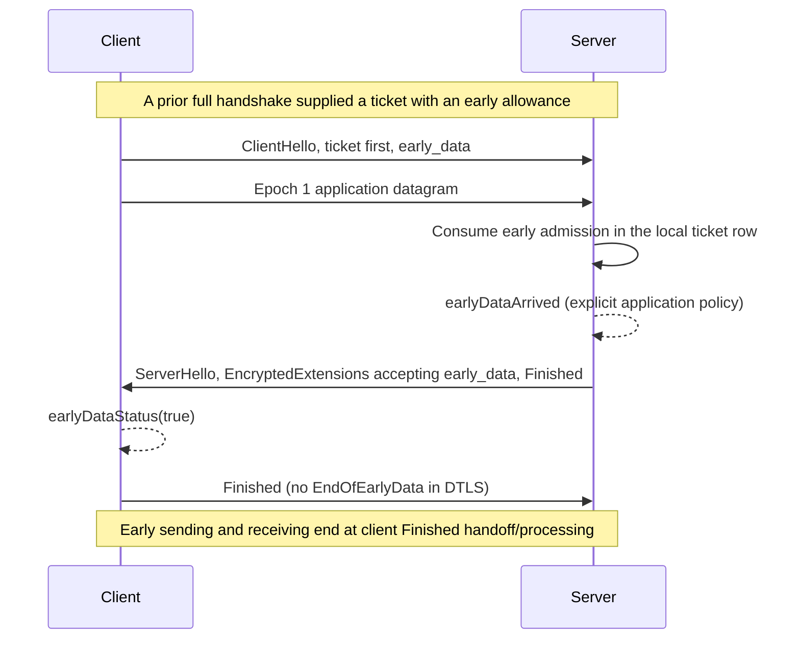

# Explicit DTLS 1.3 early data

> **Kind:** report · **Status:** snapshot 2026-11-16 · **Seal:** none · **Owns:** — · **Stands on:** [extension plan](../../../plan/pending/dtls-extensions.md), [early-data obligation](../../../doc/project/evidence/standard/rfc9147/extensions.md#dtls-ext-early)

C4 adds explicit epoch-1 datagrams to a ticket reconnect. Both engines require `resumptionEnabled=true` and `earlyDataEnabled=true`. The issuing ticket advertises `earlyDataBytes` (4096 by default when enabled). The client opens with `DtlsOpenOptions{true, true}` and calls `sendEarly`; ordinary `send` retains its existing behavior. Delivery uses `earlyDataArrived`, and `earlyDataStatus` reports the client's association-level admission outcome separately from establishment. Neither acceptance nor local admission acknowledges delivery of an individual UDP datagram. The engine never retries early application payload as ordinary traffic.

The server consumes a row before admitting the attempt, retaining its ClientHello random and association ID. Matching input can continue only that live owner; close or handshake failure does not restore admission. Consumed rows still permit ordinary ticket resumption. Expiry or eviction removes the row entirely, making its identity unknown; there is no separate tombstone table. Local admission counts aggregate application bytes even if a datagram is later lost. The receiver counts unique accepted records after replay checks and fails an excessive sender with `unexpected_message`. Queued early output rechecks eligibility at handoff and reports one send error if Finished or HRR ended early sending.

Each production fixture uses the existing pair of Ethernet-connected StandardHosts and PacketTap, 1 ms links, seed 0 and declared checksums/FCS. Tickets allow 64 application bytes to make boundary stimuli small. The successful profile explicitly disables cookies on the server and sends an initial key share. Default cookie policy remains enabled in the HRR case. The peer-limit case adds a second client application/port sharing the same server engine. Simulation limits are finite (5–10 s); fixtures do not perform real cryptography or prove real-world anti-replay security.

| Case | Stimulus and required observations |
| --- | --- |
| [Rfc9147EarlyData.test](Rfc9147EarlyData.test) | Obtain a ticket, close and reconnect explicitly. Send 32 early bytes; refuse another 33 bytes locally against the 64-byte allowance. Duplicate the first record twice before Finished. Observe epoch 1, one marked early delivery before the second establishment, one positive admission outcome, one local send error, and exactly one later ordinary marker. |
| [Rfc9147EarlyDataHrr.test](Rfc9147EarlyDataHrr.test) | Keep cookie validation enabled. HRR rejects early data, while the reconnect still resumes normally. No early marker is delivered or retried. |
| [Rfc9147EarlyDataNoAllowance.test](Rfc9147EarlyDataNoAllowance.test) | Server issues an ordinary ticket without early allowance. Explicit early send is refused and admission is negative; ordinary ticket resumption and marker delivery succeed. |
| [Rfc9147EarlyDataExpired.test](Rfc9147EarlyDataExpired.test) | Expire a one-second ticket before reconnect. Early admission is negative; full authentication and later ordinary delivery succeed. |
| [Rfc9147EarlyDataLoss.test](Rfc9147EarlyDataLoss.test) | Drop the early datagram. Client admission is positive, but no early marker reaches the server and no automatic retry occurs. |
| [Rfc9147EarlyDataBeforeHello.test](Rfc9147EarlyDataBeforeHello.test) | Delay the resumed ClientHello by 50 ms so epoch 1 arrives before a usable attempt. Drop that input without a pre-hello buffer; later admission and handshake may succeed, with no early delivery. |
| [Rfc9147EarlyDataLate.test](Rfc9147EarlyDataLate.test) | Delay epoch 1 by 50 ms until after client Finished processing. Admission can be positive, but the late datagram is discarded. |
| [Rfc9147EarlyDataReplay.test](Rfc9147EarlyDataReplay.test) | Capture one ticket and offer that identity on two successive completed reconnects. First admission delivers marker 46; the replacement receives a negative early outcome while ordinary resumption and marker 49 still succeed. Newly issued tickets do not reset the captured row's consumed flag. |
| [Rfc9147EarlyDataFailedAttempt.test](Rfc9147EarlyDataFailedAttempt.test) | The server closes its association directly inside the first marked-delivery callback, and the fixture cancels the client before Finished. Reusing the consumed ticket must reject early data while permitting ordinary resumption. No rollback of prior marked delivery is promised. |
| [Rfc9147EarlyDataPeerLimit.test](Rfc9147EarlyDataPeerLimit.test) | Replace an admitted 32-byte early datagram with 65 application bytes while retaining the represented protection envelope. The server fails that association before delivery; a second peer on the shared engine still delivers marker 50. This is a model-policy check, not an authenticated forgery experiment. |
| [Rfc9147EarlyDataQueuedBoundary.test](Rfc9147EarlyDataQueuedBoundary.test) | Pin a 100 ms client protection delay in the second Finished window and admit another early operation behind that active record. Finished handoff establishes first; the later operation must be skipped with one send error. The initial marked datagram and later ordinary marker still arrive once. |

`DtlsSessionStore_1` additionally tests same-owner continuation, replacement refusal, random mismatch, duplicate insertion, exact expiry and eviction of consumed entries. `TlsHandshakeParameters_1` rejects early_data without PSK or with a nonempty ClientHello payload. These pure values use unit tests. `DtlsEngineLifecycle_1` requests an early outcome on pending attempts and checks exactly one negative outcome on stop and crash; it does not claim successful early delivery. The other lifecycle/sender controls remain active after callback migration.

All callback implementations now provide two pure operations; see the [migration instructions](../../../doc/src/migration-guide/development/dtls-early-data.rst). The generic adapter discards marked early delivery unless `acceptEarlyData=true`; an opted-in adapter emits `earlyPacketReceived` before forwarding it. The [execution record](../../../doc/project/evidence/model/dtls/extensions.md) separates individual passes and final selectors from unexecuted release and parent comparisons. Alternate-suite early compatibility belongs to C5.
