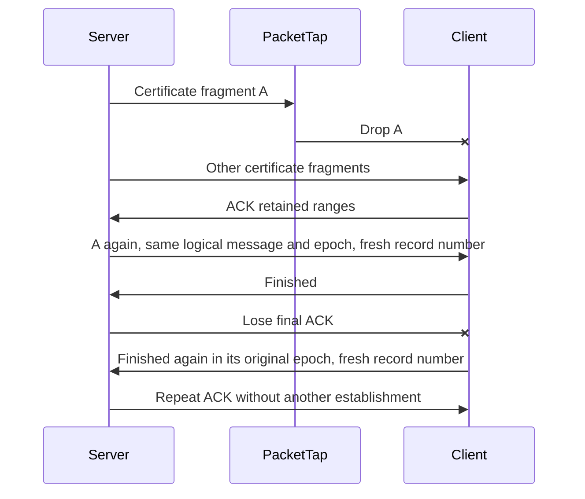
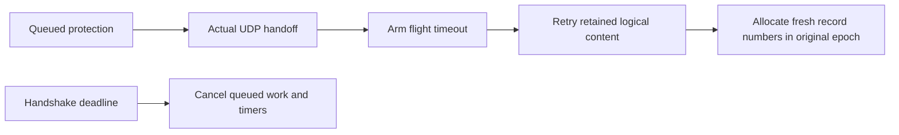

# Recovering handshakes over lossy UDP

> **Kind:** report · **Status:** snapshot 2026-11-16 · **Seal:** none · **Owns:** — · **Stands on:** [dtls.md](../../../plan/done/dtls.md)

This is the reviewer document for C4, `dtls: recover fragmented handshakes over lossy UDP`. C3 establishes loss-free exchanges; this stage retains logical handshake ranges, handles ACKs and fragments, and cancels recovery state at the appropriate deadline. Every case uses the real engine and UDP/Ethernet path with seed 0.

## Expected behavior



Flight timers start after actual UDP handoff. Initial retransmission is one second; backoff doubles to a 60-second cap. An eligible non-retransmitted RTT sample changes the timeout to 1.5 times that sample. Partial flights use delayed ACKs, initially a quarter of the current timeout. The handshake deadline bounds incomplete work independently. Final-flight response state persists for 240 seconds after server establishment.



## Loss, timers and retained state

| Case | Stimulus and required evidence |
| --- | --- |
| [Rfc9147HandshakeLoss.test](Rfc9147HandshakeLoss.test) | Drop the first ClientHello, observe one-second recovery with the same logical message but a fresh epoch-zero record number, then one establishment per peer. |
| [Rfc9147HandshakeBackoff.test](Rfc9147HandshakeBackoff.test) | Blackhole all client flights. Require intervals 1, 2, 4, 8, 16, 32, 60 and 60 seconds, failure at a 190-second deadline and no later retry across the next scheduled period. |
| [Rfc9147HandshakeDeadline.test](Rfc9147HandshakeDeadline.test) | A short 1.5-second deadline fails an incomplete association once and leaves no later ClientHello. |
| [Rfc9147FinalAckLoss.test](Rfc9147FinalAckLoss.test) | Lose the final ACK. Require a fresh-numbered client Finished retry in epoch 2, another server ACK and no repeated establishment callbacks. |
| [Rfc9147FinalAckRetention.test](Rfc9147FinalAckRetention.test) | Replay the real Finished with fresh record numbers at 239.9-second intervals. Require response just before the retention boundary, then no response to a positively observed copy after expiry. Use a 500-second limit. |
| [Rfc9147ProtectionBeforeRetry.test](Rfc9147ProtectionBeforeRetry.test) | A time-dependent volatile cost samples 1.2 seconds for the original Finished and zero for subsequent output. No premature retry may occur during that service; ACK loss requires the retry's actual handoff at the original handoff plus the eligible implicit-ACK RTT timeout. |
| [Rfc9147AckQueuedReceive.test](Rfc9147AckQueuedReceive.test) | A large flight is retried while client ACK protection is still queued. The client receives that retry, eventually sends the ACK and establishes once within the configured handshake lifetime. |
| [Rfc9147DeadlineBeforeHandoff.test](Rfc9147DeadlineBeforeHandoff.test) | The first output takes 1.2 seconds but the deadline is 0.5 seconds. The real open attempt fails at 0.7 seconds; neither queued output nor a retry appears afterward. |
| [Rfc9147RttTimeout.test](Rfc9147RttTimeout.test) | Measure an ACK fully covering the non-retransmitted EncryptedExtensions message against its final-fragment handoff. A partial Certificate ACK alone is not eligible. Lose part of the next burst, briefly suppress later ACKs, and require retry at 1.5 times that eligible sample before completion. |

One-second/backoff observations use a 10 ms tolerance. The RTT case uses a 1 ms tolerance around the independently measured value. Large-flight pacing counts handoffs between observed ACK arrivals; it does not impose a fixed quiet interval after implicit RTT samples. Its partial-ACK delay is one quarter of the 1.5-times RTT measured from retry ClientHello handoff to its implicit acknowledgment by ServerHello, within one microsecond. These are deterministic timing bounds, not statistical samples. A fresh-numbered retained Finished is a crafted model record; no authentic MAC forgery is claimed.

## Fragmentation and bounds

| Case | Stimulus and required evidence |
| --- | --- |
| [Rfc9147FragmentReassembly.test](Rfc9147FragmentReassembly.test) | A 4000-byte certificate crosses the 1200-byte budget. Duplicate/reorder its actual fragments; require size bounds and one complete exchange. |
| [Rfc9147FragmentOutOfRange.test](Rfc9147FragmentOutOfRange.test) | Move one fragment beyond its declared message range. Discard it; a consistent retransmission completes without failing the association. |
| [Rfc9147FragmentInconsistentLength.test](Rfc9147FragmentInconsistentLength.test) | Change the second fragment's total message length; require illegal_parameter and no establishment. |
| [Rfc9147FragmentConflict.test](Rfc9147FragmentConflict.test) | Hold later fragments while a fresh-numbered copy changes an already retained byte; require illegal_parameter. |
| [Rfc9147IdenticalOverlap.test](Rfc9147IdenticalOverlap.test) | Repeat the same retained bytes under a fresh number. With a 4096-byte budget, completion proves identical overlap is not charged twice. |
| [Rfc9147ReassemblyLimit.test](Rfc9147ReassemblyLimit.test) | A 1000-byte bound cannot retain the large certificate. Require resource-limit drop and bounded failure instead of promotion. |
| [Rfc9147LargeFlight.test](Rfc9147LargeFlight.test) | A 20,000-byte certificate needs more than ten records. Require ten-record pacing, an ACK before further output, continued progress and per-datagram size bounds. |

The overlap cases retain incomplete content by delaying later fragments. Copies get a distinct represented record number within the reconstruction half-space. A separately configured receive window keeps the remaining original record numbers admissible. These checks compare modeled retained bytes rather than cryptographic integrity.

## ACK accounting and ordering

| Case | Stimulus and required evidence |
| --- | --- |
| [Rfc9147SelectiveAck.test](Rfc9147SelectiveAck.test) | Lose certificate offset zero. Map actual sent record numbers to ranges and observe ACK arrival at the sender; forbid retrying any already acknowledged range. The missing content retries with its original message/epoch and a fresh record number. This allows valid early partial ACKs instead of assuming the first ACK covers every other fragment. |
| [Rfc9147UnsentAck.test](Rfc9147UnsentAck.test) | Rewrite a real ACK to name unsent record 65535 and lose client Finished. The server must retain/retry its outstanding flight, then finish after valid recovery. |
| [Rfc9147ReservedAck.test](Rfc9147ReservedAck.test) | Delay server protection beyond the partial-ACK delay. Rewrite the real early ACK to name epoch-2 record zero before its handoff. Required queued content still transmits and setup completes. |
| [Rfc9147ProtectedBeforeHello.test](Rfc9147ProtectedBeforeHello.test) | Hold ServerHello while protected records arrive. They cannot be falsely ACKed as processed; later ordering recovery establishes once. |

Typed tap predicates identify the exact handshake message, fragment offset or ACK. The tap's expression and predicate both apply before occurrence counting, so earlier queued UDP records do not steal the selected fault.

## Receive-boundary and resource regressions

These bounded variants exercise the same recovery requirements at paths identified during implementation review.

| Case | Stimulus and required evidence |
| --- | --- |
| [Rfc9147MinimumBudgetHandshake.test](Rfc9147MinimumBudgetHandshake.test) | A 40-byte UDP budget requires more than ten ClientHello fragments. Observe plaintext partial ACK, retry hello and complete establishment, with both senders within budget. |
| [Rfc9147HalfOpenFragmentNumbers.test](Rfc9147HalfOpenFragmentNumbers.test) | Split two delayed copies of an actual hello after its candidate exists. Plaintext ACK and server-flight numbers must remain distinct. |
| [Rfc9147HalfOpenFragmentConflict.test](Rfc9147HalfOpenFragmentConflict.test) | Conflicting duplicate fragments fail a replacement candidate with illegal_parameter; the prior established quartet still delivers data. |
| [Rfc9147AggregateReassembly.test](Rfc9147AggregateReassembly.test) | Two incomplete peer messages reserve bytes concurrently. Observe their sum, then each owner's expiry and eventual zero. |
| [Rfc9147PrevalidationProcessingExpiry.test](Rfc9147PrevalidationProcessingExpiry.test) | Expire a fragmented attempt during a one-second input operation. A later peer completes before the cancelled operation's original completion. |
| [Rfc9147QueuedFlightBudget.test](Rfc9147QueuedFlightBudget.test) | A large flight has positive output service and receives an ACK while records remain queued. Existing reservations count toward its ten-record burst allowance. |
| [Rfc9147WrongSequenceImplicitAck.test](Rfc9147WrongSequenceImplicitAck.test) | A positively observed wrong-sequence ServerHello fragment cannot stop ClientHello retransmission. |
| [Rfc9147LaterResponseImplicitAck.test](Rfc9147LaterResponseImplicitAck.test) | A retained later client-auth Finished fragment implicitly acknowledges the server flight while missing earlier Certificate/CertificateVerify still require recovery. |
| [Rfc9147EstablishmentReassemblyRelease.test](Rfc9147EstablishmentReassemblyRelease.test) | Establishing releases an incomplete future message; losing the final ACK still triggers the retained Finished responder without another callback. |
| [Rfc9147PackedProtectedHandshake.test](Rfc9147PackedProtectedHandshake.test) | One protected record carries consecutive EncryptedExtensions and represented Finished envelopes. Both are processed once and the retained record is ACKed. |
| [Rfc9147PackedProtectedMalformed.test](Rfc9147PackedProtectedMalformed.test) | A truncated trailing envelope prevents ACK of that record; a valid retransmission recovers. |
| [Rfc9147PackedClientHello.test](Rfc9147PackedClientHello.test) | Both halves of a real ClientHello share one plaintext record and complete once. |
| [Rfc9147PackedClientHelloMalformed.test](Rfc9147PackedClientHelloMalformed.test) | A truncated second envelope receives no ACK; a fresh valid record recovers. |
| [Rfc9147PackedClientHelloConflict.test](Rfc9147PackedClientHelloConflict.test) | Conflicting envelopes in one plaintext record cause illegal_parameter without association promotion or false ACK. |
| [Rfc9147FirstArrivalDeadline.test](Rfc9147FirstArrivalDeadline.test) | A complete first hello starts two seconds of service but expires after one second from UDP arrival. A later peer uses the released processor; the old job never emits a retry or accepted handle. |
| [Rfc9147QueuedRetryDeadline.test](Rfc9147QueuedRetryDeadline.test) | Tap-fragment CH0, then queue a complete CH1 across the original deadline using 200 ms link halves and 0.8 s input service. Observed timestamps must straddle expiry; no late accept or restarted cookie-issue deadline is allowed. |
| [Rfc9147PartialRetryImplicitAck.test](Rfc9147PartialRetryImplicitAck.test) | Drop explicit HRR ACKs and retain only the first CH1 fragment beyond the initial one-second HRR timeout. No HRR retry may occur; releasing the rest completes once. |
| [Rfc9147DuplicatePlaintextCost.test](Rfc9147DuplicatePlaintextCost.test) | Deliver fresh-numbered copies of CH0 and HRR during pending and processed windows. Exact positive processing-cost counts follow logical messages rather than duplicate records. |

`DtlsFragmentTestUtils.h` serializes real hello bodies before slicing and repairs all enclosing lengths. Represented protected-body mutations use the model's existing encryption wrapper; they do not claim cryptographic authenticity.

## Execution

After a matching debug build, run the 38 named files explicitly, or the full suite:

```sh
source .envrc
opp_run_protocol_tests --load . -p inet -m debug --no-build --no-concurrent -w '^tests/protocol/dtls$' -f 'Rfc9147(HandshakeLoss|HandshakeBackoff|HandshakeDeadline|FinalAckLoss|FinalAckRetention|ProtectionBeforeRetry|AckQueuedReceive|DeadlineBeforeHandoff|RttTimeout|FragmentReassembly|FragmentOutOfRange|FragmentInconsistentLength|FragmentConflict|IdenticalOverlap|ReassemblyLimit|LargeFlight|SelectiveAck|UnsentAck|ReservedAck|ProtectedBeforeHello|MinimumBudgetHandshake|HalfOpenFragmentNumbers|AggregateReassembly|PrevalidationProcessingExpiry|PackedProtectedHandshake|PackedProtectedMalformed|HalfOpenFragmentConflict|QueuedFlightBudget|PackedClientHello|PackedClientHelloMalformed|PackedClientHelloConflict|EstablishmentReassemblyRelease|WrongSequenceImplicitAck|LaterResponseImplicitAck|FirstArrivalDeadline|QueuedRetryDeadline|PartialRetryImplicitAck|DuplicatePlaintextCost)\.test$'
```

On 2026-11-16, a frozen debug diagnostic build (74741, seed 0) passed HandshakeLoss, FragmentReassembly, SelectiveAck and FinalAckLoss, plus the PSK/parallel-handshake controls. The six-case batch took 34.072 seconds including generated builds. Exact selection was `Rfc9147(PskHandshake|Handshake|HandshakeLoss|FragmentReassembly|SelectiveAck|FinalAckLoss)\.test$`; raw runner output is `audit/dtls/protocol-c4-first.log`, with retained per-case output under `audit/dtls/c4-first/`. At that diagnostic checkpoint only these four recovery cases had been executed.

The loss case was executed against the frozen C3 debug binary (build 55487, seed 0): **FAIL**, as neither the retry observation nor a fresh-numbered retransmitted ClientHello appeared by its 1.01-second window after the original handoff. This directly demonstrates the parent's missing recovery capability; C3 does not claim it. Raw runner output is `audit/dtls/protocol-c4-parent-loss.log`, with retained simulation output `audit/dtls/c4-parent/Rfc9147HandshakeLoss.out`.

The next integration checkpoint (26660) ran all original twenty recovery cases: sixteen passed and four failed. Missing complete-ServerHello delayed ACK affected LargeFlight and ReservedAck; ReassemblyLimit lacked the resource-drop observation; ProtectionBeforeRetry used the handoff signal as a timeout signal. The corrected ProtectionBeforeRetry and independently strengthened RttTimeout both passed that same binary afterward. Raw integration output is `audit/dtls/protocol-c4-integration-batch0.log` through `batch8.log`, with case output under `audit/dtls/c4-integration/` and `audit/dtls/c3-after-c4/`; correction evidence is `audit/dtls/protocol-c4-protection-correction2.log` and `audit/dtls/protocol-c4-fixture-correction.log`. The C3 regression had 37/38 passes, exposing retained invalid-cookie attempt state in SameTupleReplacement.

The reviewed capture 13678 ran all 34 recovery cases and all 38 C3 cases in groups of at most eight. Results were **31/34 C4 PASS** and **38/38 C3 PASS**; all original twenty C4 cases passed. Logs are `audit/dtls/protocol-c4-reviewed-batch0.log` through `batch4.log` and `audit/dtls/protocol-c3-reviewed-batch0.log` through `batch4.log`; all 72 per-case outputs are preserved under `audit/dtls/c4-reviewed/`. HalfOpenFragmentConflict then passed the same binary after waiting for the prior exchange's final ACK before opening its replacement. MinimumBudgetHandshake exposed the oversized-HRR path after all initial fragments arrived. LaterResponseImplicitAck needed an actual fragmented sender range rather than truncating an ACKed whole range; the corrected fixture exposed a tight loop when reassembling retry ClientHello sequence 1 while sequence 0 state remained. The implementation owner's live debugger identified the sequence-unspecific lookup. Its run was terminated after preserving partial output under `audit/dtls/c4-review-corrections/`. These remain diagnostic results, not final approval of C4.

The matching frozen fragmented-retry build (`audit/dtls/build-c4-fragmented-retry.log`) then passed both formerly failing cases in a 4.454-second bounded batch. A complete rerun passed **34/34 C4 and 38/38 C3**, all 72 cases, with seed 0 and debug mode. Each group selected at most eight cases and had a 60-second process-group timeout; none timed out. Exact selections and results are retained in `audit/dtls/protocol-c4-fragmented-full-batch0.log` through `batch4.log` and `audit/dtls/protocol-c3-fragmented-full-batch0.log` through `batch4.log`; all per-case outputs and errors are under `audit/dtls/c4-fragmented-retry-full/`.

The final matching C4 capture (`audit/dtls/build-c4-deadline-reviewed.log`, source manifest `audit/dtls/source-c4-deadline-reviewed.sha256`) passed **38/38 C4 and 38/38 C3: all 76 cases**, seed 0, debug mode. Groups of at most eight ran with a 60-second process-group timeout. The 75-case regression output is `audit/dtls/protocol-c4-deadline-full-batch0.log` through `batch4.log` and `audit/dtls/protocol-c3-deadline-full-batch0.log` through `batch4.log`; raw cases are under `audit/dtls/c4-deadline-reviewed-full/`. QueuedRetryDeadline's final passing result is `audit/dtls/protocol-c4-queued-retry-final.log`, with exact input and raw output under `audit/dtls/c4-queued-retry-final/`. Its positive 0.8-second service sample uses a one-nanosecond numeric tolerance, and the actual observed service start must be after CH1 arrival, before original expiry, with completion beyond expiry. Earlier exact floating-point comparison caused a fixture-only diagnostic failure; the corrected oracle observes service at 0.60004016 and 2.20013928 seconds and proves cancellation without late promotion. No case is waived or inferred passing from wire silence alone.

No passing recovery claim is inferred from the C3 positive tests. Separately assigned module tests cover object lifetime and lifecycle cancellation. Mermaid rendering remains unverified.
