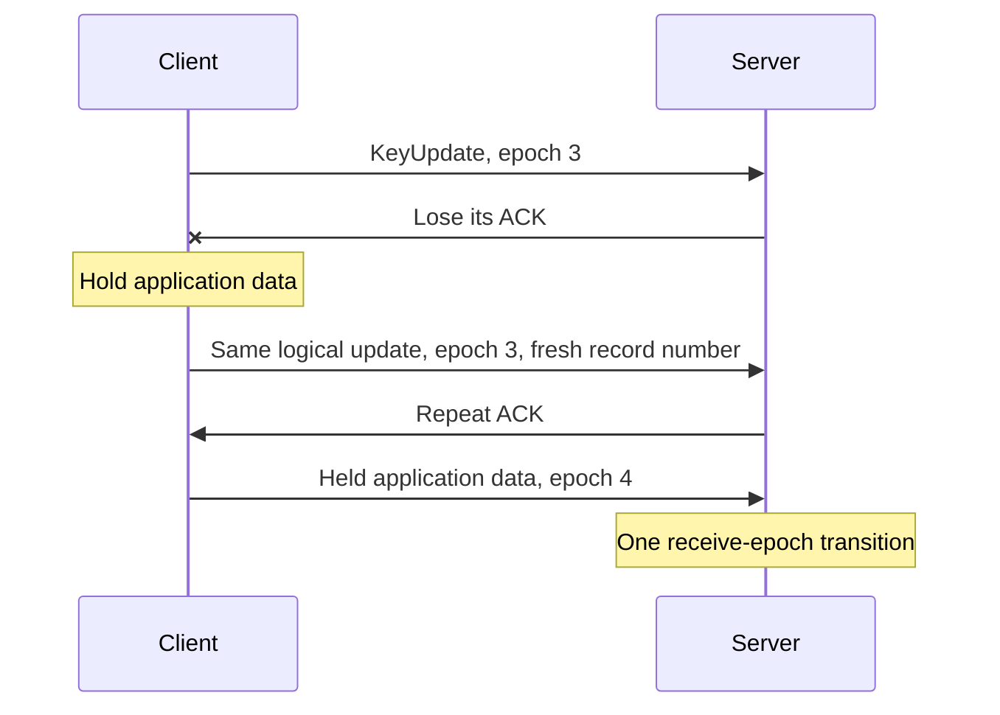

# Updating association protection epochs

> **Kind:** report · **Status:** snapshot 2026-11-16 · **Seal:** none · **Owns:** — · **Stands on:** [dtls.md](../../../plan/done/dtls.md)

This is the reviewer document for `dtls: add: update association protection epochs`. Eighteen wire cases cover update recovery, directional epoch state, input/output ordering and bounded sender state.

Protection follows INET IPsec's modeled representation: retained packet content, modeled tag sizes and processing costs. These checks do not claim real key derivation, encryption, MAC verification or cryptographic interoperability.

**Verified scope:** all eighteen KEYS cases and one hundred controls pass at the isolated KEYS source boundary, before the later CLOSE changes. The earlier combined implementation also passed its complete 125-case matrix; that separate evidence is retained below.

## Changing epochs without duplicating progress



The header exposes low epoch bits. Epoch four therefore appears as zero in header assertions; the fixture does not read an invented full epoch from packet metadata. ACK-loss filters inspect the ACK's listed epoch, so an earlier final-handshake ACK cannot accidentally become the selected fault.

| Case | Stimulus and required evidence |
| --- | --- |
| [Rfc9147KeyUpdate.test](Rfc9147KeyUpdate.test) | Request an update, lose its ACK and hold app data. The logical update retries in its original epoch with a fresh number; after ACK, epoch-four data delivers once. Accepting that data also detects an erroneous second receive-epoch transition. |
| [Rfc9147FinishedUpdateOverlap.test](Rfc9147FinishedUpdateOverlap.test) | Lose the first client Finished and request an update immediately at local establishment. The premature update is discarded at the server; independent Finished recovery establishes once before update/ACK progress and data delivery. |
| [Rfc9147EpochAliasFinalAck.test](Rfc9147EpochAliasFinalAck.test) | Hold final ACKs through three acknowledged server updates. The regenerated ACK has outer bits 2 from known epoch 6 and entries naming epoch 2. It must retire Finished recovery across the next measured retry timeout, rather than being replay-checked as handshake epoch 2. |
| [Rfc9147KeyUpdateAutomatic.test](Rfc9147KeyUpdateAutomatic.test) | Configure threshold four on both peers and use initial certificate authentication, whose server flight exceeds four protected handshake records. No update may occur during that handshake; then a five-record app burst triggers automatic production update and delivers all markers once. |
| [Rfc9147KeyUpdateBusy.test](Rfc9147KeyUpdateBusy.test) | Suppress update ACKs and measure the original retry interval. A second request returns false without terminal error; the next backoff deadline stays unchanged. Release ACKs and prove subsequent app delivery. |
| [Rfc9147KeyUpdateOldEpoch.test](Rfc9147KeyUpdateOldEpoch.test) | Delay an unseen epoch-three record until after update processing/ACK, but before the first new-epoch record. Require old marker 1, then new marker 2, without imposing retention beyond first new-epoch acceptance. |
| [Rfc9147SimultaneousUpdates.test](Rfc9147SimultaneousUpdates.test) | Both sides request peer updates. Require each original ACK before another local logical update, eventual update_not_requested responses, bidirectional app delivery and no echo-update loop. |
| [Rfc9147PeerRequestedUpdate.test](Rfc9147PeerRequestedUpdate.test) | Withhold the original local ACK until a peer's request actually arrives. A concurrent guard prevents a second outstanding local update; its deferred response must precede further app protection. |
| [Rfc9147PeerRequestActiveProtection.test](Rfc9147PeerRequestActiveProtection.test) | Admit a peer request during paid application protection, with positive handshake-input service extending beyond the active app cost. Hold UDP output from admission through required-response ACK, without charging the app twice; queued app work stays outside the shared processor. |
| [Rfc9147UpdateRequestGuard.test](Rfc9147UpdateRequestGuard.test) | Admit a peer update before the first local requested handoff, but finish its positive input cost afterward. Neither its late processing, the local record's ACK nor a fresh-numbered old duplicate clears the request guard. A subsequent new peer update permits another requested exchange. |
| [Rfc9147QueuedEpochTransition.test](Rfc9147QueuedEpochTransition.test) | Queue a valid update before a test-tap copy bearing the represented new epoch. The later record becomes eligible in input-service order; a subsequent genuine sender record also delivers. Epoch selection precedes its actual deprotection charge. |
| [Rfc9147KeyUpdateInputCost.test](Rfc9147KeyUpdateInputCost.test) | A new logical update pays one positive handshake-input cost. Fresh-numbered copies while pending and after processing are both ACKed without extra cost or another epoch transition. |
| [Rfc9147UpdatePeerIsolation.test](Rfc9147UpdatePeerIsolation.test) | Withhold one peer's update ACK for two seconds. A second peer on the shared server socket continues sending and receiving; the first resumes after the ACK-loss rule expires. |
| [Rfc9147UpdateDeadline.test](Rfc9147UpdateDeadline.test) | Lose every update ACK with a short deadline. Fail the association, report its held send once and cancel later update/app work. |

The busy test derives its next expected backoff from an observed retry after setup has settled. It does not assume the timeout remained at one second after eligible handshake RTT samples. Admission is a synchronous bool result; error callbacks are terminal and cannot represent a busy rejection.

The existing [Rfc9147InvalidRecord.test](Rfc9147InvalidRecord.test) is strengthened by KEYS with positive unprotection cost: definitely unknown epoch bits are rejected before any such charge, and the subsequent valid record pays exactly once. This extension is included in the C5 regression selector rather than counted twice in the C6 matrix. The queued-transition test changes a represented test-copy epoch and number without claiming an authentic cryptographic forgery. Cost-value comparisons use a one-nanosecond numeric tolerance; service ordering uses actual observed simulation times.

## Malformed updates

| Case | Positive stimulus and required evidence |
| --- | --- |
| [Rfc9147KeyUpdateInvalidFlag.test](Rfc9147KeyUpdateInvalidFlag.test) | Positively receive a real request changed to flag 2. Require illegal_parameter (47) under active application epoch 3, peer error receipt and one terminal local failure. |
| [Rfc9147KeyUpdateEmptyFragment.test](Rfc9147KeyUpdateEmptyFragment.test) | Replace the first update with a framed zero-byte fragment. No ACK may follow; the later complete one-byte retry progresses and delivers held data once. |
| [Rfc9147KeyUpdateImpossibleLength.test](Rfc9147KeyUpdateImpossibleLength.test) | Declare an impossible two-byte update. Require no successful ACK or app interpretation. |
| [Rfc9147KeyUpdateImpossibleOffset.test](Rfc9147KeyUpdateImpossibleOffset.test) | A one-byte fragment starts outside its one-byte message. Require no successful ACK or app interpretation. |

The malformed fragment helper rebuilds the represented inner sequence, keeps the separate modeled tag, and repairs record/UDP/IP/Ethernet lengths. Wire observations alone cannot prove absence of hidden buffer allocation. Association/reassembly probes separately check the exact no-allocation/no-retained-state assertions. Counter and sending-epoch ceilings exercise the actual association send path; receive-only record-state units do not prove sender enforcement.

The assigned [DtlsSenderState_1.test](../../module/DtlsSenderState_1.test) probes the actual association's sender ceilings and malformed-update hidden state. [DtlsRekeyConfigMin_1.test](../../module/DtlsRekeyConfigMin_1.test), [DtlsRekeyConfigLow_1.test](../../module/DtlsRekeyConfigLow_1.test) and [DtlsRekeyConfigHigh_1.test](../../module/DtlsRekeyConfigHigh_1.test) cover threshold edges and rejected configuration. Their execution results remain separate from the wire-case counts.

## Execution and evidence

Run the eighteen named cases after building the matching source:

```sh
source .envrc
opp_run_protocol_tests --load . -p inet -m debug --no-build --no-concurrent -w '^tests/protocol/dtls$' -f 'Rfc9147(KeyUpdate|FinishedUpdateOverlap|EpochAliasFinalAck|KeyUpdateAutomatic|KeyUpdateBusy|KeyUpdateOldEpoch|SimultaneousUpdates|PeerRequestedUpdate|PeerRequestActiveProtection|UpdateRequestGuard|QueuedEpochTransition|KeyUpdateInputCost|UpdatePeerIsolation|UpdateDeadline|KeyUpdateInvalidFlag|KeyUpdateEmptyFragment|KeyUpdateImpossibleLength|KeyUpdateImpossibleOffset)\.test$'
```

The verified combined implementation passed **125/125 DTLS protocol cases**: eighteen KEYS cases, seven CLOSE cases, ninety-nine C3–C5 controls and the framing control. Every group used debug mode, seed 0, at most eight cases and a 60-second process-group timeout; none timed out and no case was waived.

The matching build is `audit/dtls/build-c6-promotion-fixed.log`; its source manifest is `audit/dtls/source-c6-promotion-fixed.sha256`. Exact commands, selected cases and group exit codes are recorded in `audit/dtls/protocol-c6-application-final-run-record.json` and canonical `audit/dtls/protocol-c6-final-run-record.json`. Runner logs are `audit/dtls/protocol-c6-application-final-{c6,c3,c4,c5,c2}-batch*.log`; all 125 per-case output/error files are under `audit/dtls/c6-application-final-all/`.

Complementary FIFO-capture checks passed six units and eight modules, recorded in `audit/dtls/unit-c6-fifo-fixed.log` and `audit/dtls/module-c6-fifo-fixed.log`, with source manifest `audit/dtls/source-c6-fifo-fixed.sha256`. Those are separate captures from the final promotion-refusal alert correction, which the unchanged AssociationLimit fixture and complete 125-case protocol run verified.
### Isolated KEYS boundary

The isolated worktree `/home/miguel/workspace/inet-dtls-c6-series` at `aa1a69c4431a1be0f81c299a5f5b79df8eeae991` passed **118/118 unique protocol cases**: eighteen KEYS cases, ninety-nine C3–C5 controls and the framing control. No CLOSE fixture was present or selected. This source has no graceful-close state or close deadline; its immediate-close behavior remains the preceding C5 contract.

The matching debug build is recorded in the main worktree's `audit/dtls/c6-series/build-keys-matching.log`. Seventeen sequential runner groups each selected at most eight cases, used seed 0 and debug mode, and ran under `timeout --signal=KILL 60s`; every group exited zero without a setup exception or timeout. Each command sourced the isolated worktree's `.envrc` and used `opp_run_protocol_tests --load . -p inet -m debug --no-build -w '^tests/protocol/dtls$'` with its bounded case selector.

Exact commands, all selected names, source HEAD and group exit codes are in `audit/dtls/c6-series/keys-isolated-protocol-run-record.json`. Runner logs are `audit/dtls/c6-series/protocol-keys-isolated-{keys,c3,c4,c5,c2}-batch*.log`; all 118 per-case output/error pairs are preserved under `audit/dtls/c6-series/keys-protocol-raw/`. These audit paths belong to the main `/home/miguel/workspace/inet-dtls` worktree.

`audit/dtls/c6-series/keys-library-resolution.log` confirms that the test executable resolves both INET and protocol-test libraries inside the isolated worktree. The tested `src/libINET_dbg.so` SHA256 is `ba5bc52a20943298779f4110fb4762d7d7dde8d913236a17d1678d97f6bc3ac8`.

Complementary checks on this isolated capture passed six units and seven modules, including the sender-state and rekey-configuration probes. Their separate logs are `audit/dtls/c6-series/unit-keys.log` and `audit/dtls/c6-series/module-keys.log`; these counts are not included in the 118 wire cases.

### Parent and diagnostic controls

The original eighteen-case parent baseline ran against the verified C5 binary: twelve update cases failed because no KeyUpdate appeared, five closure cases failed because alert handoff or bounded completion was absent, and the original AlertDisposition control passed. That alert control used user_canceled at level 1 and handshake_failure at level 2; its later reverse-level strengthening was not part of the passing parent result. There were no setup exceptions or timeouts. Exact parent logs are `audit/dtls/protocol-c6-parent-batch0.log` through `batch2.log`, with raw output under `audit/dtls/c6-parent/`.
The first combined capture passed the initial twenty-one cases after correcting an observer-order assumption: the already-paid active app record hands off inside the response-ACK event, so it must be captured concurrently. Later positive-input-cost and epoch-alias variants added independent coverage. QueuedEpochTransition then exposed a real classifier/deprotection FIFO error; preserving immediate processing continuations corrected it. The FIFO-fixed full run passed 124/125, exposing AssociationLimit's obsolete handshake-epoch promotion-refusal alert. Both defects were corrected before the final 125/125 result. The superseded complete run remains in `audit/dtls/protocol-c6-fifo-run-record.json` and `audit/dtls/c6-final-all/`.

These are deterministic seed-0 checks, not statistical or cryptographic interoperability evidence. Mermaid rendering remains unverified.
