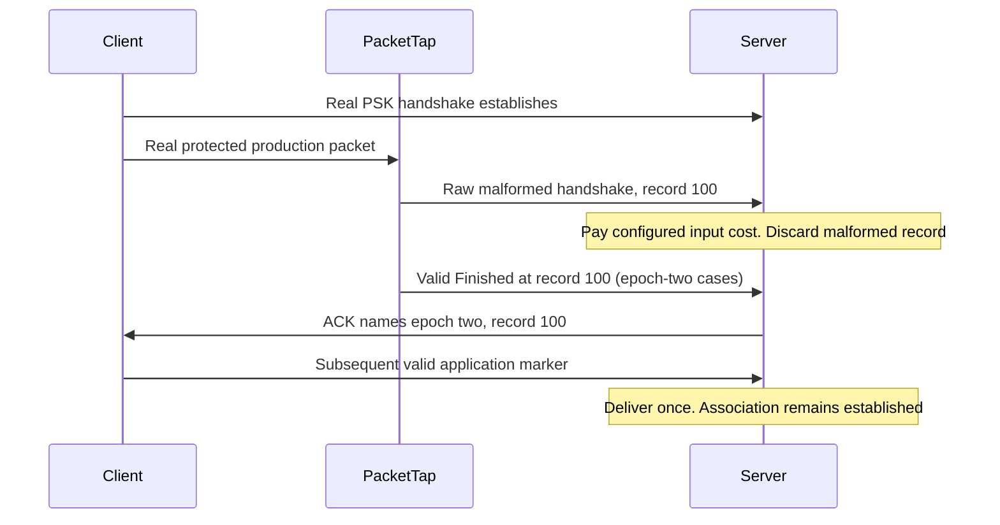

# Malformed protected handshake records

> **Kind:** report · **Status:** snapshot 2026-11-16 · **Seal:** none · **Owns:** — · **Stands on:** [dtls.md](../../../plan/pending/dtls.md)

This is the reviewer document for the standalone correction to malformed protected-handshake input. A raw handshake header can fail deserialization after the modeled input operation has been queued. Both retained main-handshake processing and current-epoch handshake dispatch must discard that record without aborting the simulation, failing the association or advancing replay state.

The four cases use the production UDP-backed DTLS engine and a real PSK establishment. PacketTap changes a real protected packet's represented inner content into these twelve raw bytes:

```text
14 00 00 00 00 00 00 00 01 00 00 00
```

They encode Finished with total length zero, fragment offset one and fragment length zero. The offset exceeds the total. The payload remains a BytesChunk inside EncryptedChunk, followed by the represented handshake content type and the separate modeled sixteen-byte tag. There is no retained typed handshake header that could bypass receive-side deserialization. The helper repairs unified-record, UDP, IPv4 and Ethernet lengths.



| Case | Receive path | Input cost | Replay and recovery evidence |
| --- | --- | --- | --- |
| [Rfc9147MalformedRetainedHandshakeSync.test](Rfc9147MalformedRetainedHandshakeSync.test) | Retained epoch two | Zero | Delay two copies of the real client Finished until after establishment. Replace the first with malformed bytes at number 100; the valid second copy reuses number 100 and must receive an ACK. Then deliver an application marker. |
| [Rfc9147MalformedRetainedHandshakeQueued.test](Rfc9147MalformedRetainedHandshakeQueued.test) | Retained epoch two | 1 ms | Same stimulus and ACK/recovery assertions, plus exactly one positive input-cost sample before malformed disposition and at least 1 ms elapsed service. |
| [Rfc9147MalformedCurrentHandshakeSync.test](Rfc9147MalformedCurrentHandshakeSync.test) | Current application epoch three | Zero | Replace the first real app record with malformed handshake bytes at number 100. The next genuine app record has its ordinary lower number and must deliver, proving the invalid future number did not poison replay state. |
| [Rfc9147MalformedCurrentHandshakeQueued.test](Rfc9147MalformedCurrentHandshakeQueued.test) | Current application epoch three | 1 ms | Same stimulus and recovery assertions, plus exactly one positive input-cost sample before malformed disposition and at least 1 ms elapsed service. |

Every case positively observes the exact raw bytes at packetReceivedFromLower, requires MALFORMED_RECORD (signal value 1), and checks exactly one establishment and no terminal error or closure at either endpoint. The retained cases forbid ACK of the malformed number before the valid Finished copy arrives. Only the subsequent valid application marker may reach the server driver.

The fixtures use existing public callbacks, PacketTap predicates, chunk types and processing-delay/drop signals. They require no close API behavior, production setters or inspection of private association state, and are compatible with the KEYS parent boundary. Protection uses INET's modeled representation; the crafted represented content makes no claim of forging an authenticated cryptographic record.

## Execution

The exact four-case selector is:

```sh
source .envrc
timeout --signal=KILL 60s opp_run_protocol_tests --load . -p inet -m debug --no-build -w '^tests/protocol/dtls$' -f 'Rfc9147Malformed(Retained|Current)Handshake(Sync|Queued)\.test$'
```

Topology is TapPairNetwork with two hosts, one DTLS test app per host, a PacketTap between them, 1 ms link delay and deterministic seed 0. The server listens at 0.1 s; the client opens at 0.2 s. Each simulation is bounded to 5 s. The service-sample comparison uses a 1 ns numeric tolerance, while elapsed service uses simulation time directly.

**Runtime validation: PASS on the fixed source.** All four new cases and four existing input-processing controls passed with unchanged assertions. The controls are InvalidRecord, InputQueueLimit, QueuedEpochTransition and KeyUpdateInputCost. They cover unknown-epoch cost rejection, exact input-queue admission, ordered epoch transitions and one logical KeyUpdate input charge.

The parent comparison used the preserved matching debug library in `/home/miguel/workspace/inet-dtls-c6-series` at `42bcad6ad65453fb32497ba88f6be43e5733b686`. Its library SHA256 is `12d31442cfa35d09a1ae7cc30753b1a396d71e94abdf8649663f631dc92f5685`. Both zero-delay cases passed. Both 1 ms cases terminated with `Invalid DTLS handshake fragment bounds` in the production DTLS module, after receiving the malformed raw bytes. The retained-path exception occurred at 0.26118416 s; the current-path exception occurred at 0.2142024 s. This comparison distinguishes the queued completion failure from synchronous rejection.

Exact parent commands, library identity, input hashes, observed statuses and the copied fixture inputs are retained in `audit/dtls/revision/parent-f1/run-record.json` and `inputs/`; per-case `.out`/`.err` files and both pair-run logs sit beside that record. Both final pair runners exited 1 because their queued case failed. An earlier four-case runner exceeded its 60-second bound after compilation and partial execution; it also exposed late installation of the retained-case tap rules. That attempt is preserved separately under `initial-attempt/`. Changing those two rules to run-start interception supplied the intended stimulus; neither protocol assertion nor production source was changed to accommodate the parent.

The fixed run used the main worktree's matching debug library after `audit/dtls/revision/build-fixed-final-debug.log` completed successfully. Exact working-source hashes, tested library hash, commands, case outcomes and six group exits are in `audit/dtls/revision/fixed-f1/run-record.json`; all eight output/error pairs are under `fixed-f1/raw/`. Each new case ran individually and each control pair ran serially under a 60-second process bound, with no timeout or setup exception. `fixed-f1/library-resolution.log` confirms that the test executable loaded the main worktree's INET and protocol-test libraries. The paired release compilation also passed, recorded in `audit/dtls/revision/build-fixed-final-release.log`; the behavioral comparison here uses debug mode on both sides.

The earlier direct-parser diagnostic under `audit/pull-request/pr-1459-evidence/probe/` identified the raw failing header. The new UDP cases independently reproduce and verify the correction. The reconstructed source before CLOSE requires its own boundary execution in the final series record; API compatibility and the full-source comparison above alone do not establish that check. No statistical, fingerprint or cryptographic interoperability claim is made. Mermaid rendering is unverified.
