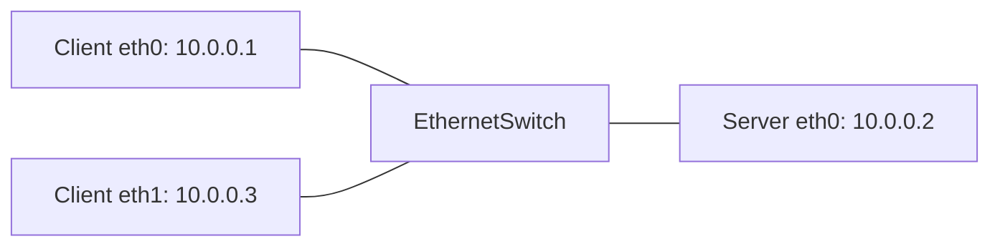

# Validated DTLS path changes

## Scope and contract

C9 implements the selected heartbeat validation strategy for [RFC 9146 §6](https://www.rfc-editor.org/rfc/rfc9146.html#section-6), as applied to 1.3 CIDs. The model deliberately excludes RFC 9853 RRC. Enable `migrationEnabled`, CID and heartbeat support. A changed tuple needs a negotiated nonempty receive CID and permission to probe the peer. Unsupported input is dropped with reason 5. Modeled protection must succeed before a candidate is considered.

The association retains one confirmed tuple and at most one candidate. Existing replay windows supply the highest accepted epoch/record pair; no parallel freshness ledger is introduced. Compare before accepting the triggering record. A newer record can select a candidate, and a matching heartbeat response must itself be newer than the previously accepted high-water mark to confirm it. Valid older records can deliver through the replay window without changing the path. A competing tuple does not replace the selected candidate.

Ordinary output uses the confirmed tuple until validation succeeds. Validation requests and bounded heartbeat replies can use the candidate. A reply uses its request's actual local destination, peer address/port and received interface, even before confirmation; its UDP payload cannot exceed the received record or configured send budget. This supports simultaneous validation in both directions. A timeout abandons the candidate and preserves a usable confirmed path.

## Local operations and lifetime

`migrateLocal(handle, address, interfaceId)` selects a locally owned source and interface; `-1` infers the interface owning the address. The UDP socket must have a wildcard address binding. The operation requires both CID directions, both heartbeat permissions, a free probe/candidate slot, and a nonempty peer spare that can carry the minimum probe. It reserves that spare for the candidate while ordinary output keeps the old CID. At confirmation the spare becomes current. A selected ID is consumed by the attempt; failure does not recycle it. Unsolicited peer movement uses a spare when available and otherwise validates with its current peer CID. Immediate peer CID updates also update a pending candidate's choice, and candidate IDs count against the bounded peer-ID pool.

`rebindLocalPort(handle, port)` replaces the actual UDP socket with a fresh framework socket ID. Admission requires exactly one established association, no listener or half-open peer, both CID/heartbeat directions and a suitable spare. The association, CIDs, counters and processing queues remain owned by the engine. An old diagnostic probe is cancelled before validation begins. Ordinary application data waits; completed record service is retained as paid work. Held datagrams are checked for exactly-once delivery without an order assertion. Handshake/ACK work waits for validation and resumes through its own recovery owner.

The scenario must supply a free port. UDP reports a collision as a simulation configuration error; there is no recoverable bind callback or rollback promise. If validation fails after replacement, the old socket is gone: the engine fails the association and rejects held data. Old-socket indications, including data already queued for deprotection, cannot act on the new socket. Stop/crash cleanup remains association-owned.

Confirmation calls `ICallback::pathChanged(handle, DtlsPath)` with local address/port, peer address/port and interface ID. The handle remains stable. `DtlsSocket` forwards both local operations; `DtlsSocketIo` logs the confirmed tuple and emits `pathChanged`. Probe failure remains separately observable through `probeResult`; a local rebind failure also uses the existing association error callback.

A validation request may cross KeyUpdate while previous read keys remain available. The model permits such requests on a changed path and can send them before its KeyUpdate ACK; this is a deliberate exception to RFC 6520 §3's recommendation to discard older-epoch heartbeat requests. It prevents a lost ACK and path change from blocking each other's recovery. Confirmation still requires freshness, and ordinary heartbeat processing retains its current-epoch policy. [Post-handshake authentication](post-handshake-authentication.md) pauses validation and refuses local moves during its active phase.

## Fixtures and direct evidence

The NAT cases use `TapPairNetwork`: two hosts, real UDP/IP/Ethernet and two 1 ms half-links around `PacketTap`. A translating rule changes outgoing client port 4434 to external port 5534; the reverse rule maps destination 5534 back to the bound client port. The main case suppresses the old inbound mapping. Actual UDP application delivery proves both translation directions. Each packet gets one tap rule, combining observation and translation where necessary. Translation starts after handshake settling.

The multihomed case uses the separate `DtlsMigrationNetwork`, which extends `WiredNetworkBase`. `StandardHost` client interfaces `eth0` and `eth1` connect through an `EthernetSwitch` to one server interface. Manual IPv4 configuration assigns 10.0.0.1/24 and 10.0.0.3/24 to the client, and 10.0.0.2/24 to the server. A /32 route to the server selects client `eth0` initially. Generated static routes and static MAC-table configuration are disabled; the switch learns addresses. The explicit candidate interface reaches the server on the shared LAN. MAC egress/ingress observations and UDP replies prove use of client `eth1`, rather than relying solely on request tags. The existing `DtlsMultihomedNetwork` remains unchanged for its original tests.

Runs pin seed 0, declared checksums/FCS and 5 ms output/3 ms input record costs. The wrapper in the rebind cases exposes the actual socket ID and injects one stale transport indication; it supplies no alternative protocol behavior.

The routed IPv4/IPv6 cases use `DtlsMigrationRoutedNetwork`: two point-to-point Ethernet links join the client to different interfaces of one router; a third link reaches the server. IPv4 uses 10.0.1.0/24 and 10.0.2.0/24 for the client links and 10.0.3.0/24 for the server link. Client addresses end in `.1`, router client-link addresses in `.2`, and the server is 10.0.3.2 via router 10.0.3.1. A host route initially selects client `eth0`; the server has a default route through the router. Direct router routes come from the configured subnets. IPv6 uses the corresponding 2001:db8:1::/64, :2::/64 and :3::/64 prefixes with the same host suffixes. `Ipv6NetworkConfigurator` assigns explicit addresses, disables DAD for them and generates routes; a manual /128 client route pins the initial interface. Each node's `Ipv6NodeConfigurator` explicitly references the network configurator. Both tests require probes and subsequent bidirectional data on client `eth1`.

Immediately before the IPv4 move, the scenario changes the client host route's interface and gateway to `eth1` and 10.0.2.2. Routing availability is an explicit scenario input: the DTLS API selects its source/interface but does not create an IP route or gateway. The configured route must support the selected path. The IPv6 case uses the network configurator's routes for both links.

IPv6 currently emits an interface-directed unicast packet with an Ethernet broadcast destination. The routed fixture confines that broadcast to the selected point-to-point link. A shared LAN with two client interfaces can deliver one response on both interfaces: accepting its replay number on the first interface can prevent validation on the intended second interface. Shared-LAN IPv6 movement is therefore outside the validated profile. No generic IPv6 behavior is changed here.

| Case | Stimulus and required observation |
| --- | --- |
| `Rfc9147Migration` | Activate bidirectional NAT translation and remove the old mapping. Require candidate data delivery, ordinary output to the old port before validation, one confirmed path callback, and subsequent delivery through port 5534 with a stable handle. |
| `...Unidirectional` | Repeat with an empty client receive CID. Require peer movement to work in the supported CID direction. |
| `...Multihomed` | Refuse movement without a spare or to an unowned address, then move to client `eth1`. Require both endpoint callbacks and actual bidirectional probe/data traffic on the second interface. |
| `...Routed`, `...Ipv6` | Repeat the interface move across separate IPv4 and IPv6 routed links. Require the same handle, both callbacks, actual MAC egress/ingress on `eth1` and delivery through the router. |
| `...Competing` | Send fresh data from ports 5534 and 6634 during one validation. Require a probe and commitment only for the first candidate. |
| `...FreshResponse` | Delay the first response while a higher-numbered data record arrives. Require no early confirmation and successful confirmation by a fresh retry response. |
| `...OldRecord` | Delay an unseen old-port datagram until after movement. Require its delivery within the replay window without another path change or probe. |
| `...Timeout` | Suppress validation responses, restore the old NAT mapping and require data exchange in both directions through the unchanged confirmed path. |
| `...NoPermission` | Negotiate support without permission to probe the changed peer. Require rebind refusal, changed-tuple rejection and successful reuse of its rejected record number on the confirmed tuple. |
| `...MalformedRecord` | Replace a new-path record's protected inner content with invalid all-zero content. Require deprotection rejection, no path change and unpoisoned replay state. |
| `...Rebind` | Bind a fresh actual socket, validate both directions and deliver held data once with exact service charges. Refuse another concurrent rebind and a listening server move; discard a stale old-socket close indication and continue using the new socket. |
| `...RebindMultiple` | Establish two peers through one client engine, obtain spares for both, refuse socket movement and preserve delivery on both original associations. |
| `...RebindProbe` | Rebind while an actual old-socket probe awaits its suppressed response. Require cancellation of that owner, one new validation and no late retry/timeout. |
| `...RebindTimeout` | Suppress replies after replacement. Require one association failure, held-packet rejection and refusal of further operations on the retired handle. |
| `...OccupiedPort` | Attempt to bind the driver's occupied port after establishment and spare receipt. Expect the existing UDP configuration error and process exit 1. This is an expected-error check. |
| `...KeyUpdate` | Lose a KeyUpdate ACK and rebind while it is outstanding, using a small rekey threshold. Require retained-key validation, independent ACK recovery and new-epoch data on the new socket. |

The `...` names expand to `Rfc9147Migration`. Existing CID/heartbeat/recovery and original multihomed tests provide regression controls. Executed commands and counts belong to the [execution ledger](../../../doc/project/evidence/model/dtls/extensions.md).

This is IPv4/IPv6 runtime evidence for the finite fixtures. It does not prove cryptographic authentication, resistance to forged CIDs/tokens, arbitrary routing asymmetry or live-endpoint interoperability. Protection validity is the existing abstract outcome. Active-validation stop/crash cases, PHA suspension, PMTU interaction, release execution, exact-parent and fingerprint comparisons remain outside this stage's executed evidence. Mermaid rendering is unverified.
