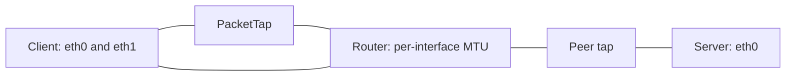

# DTLS path payload discovery

> **Kind:** report · **Status:** current · **Seal:** none · **Owns:** — · **Stands on:** [extension profile](../../../doc/project/evidence/standard/rfc9147/extensions.md), [execution ledger](../../../doc/project/evidence/model/dtls/extensions.md)

## Supported behavior

The opt-in model follows the base, search, search-complete and error structure of [RFC 8899](https://www.rfc-editor.org/rfc/rfc8899.html). It starts handshakes at a provisional 512-byte UDP budget. After establishment, padded heartbeat requests positively confirm a size; their minimum-sized responses test the forward direction independently. Search advances by at most 128 bytes. Three actual attempts, with fresh record numbers and tokens, use exponential per-attempt timeouts. The default first timeout is 16 s; tests use the permitted 1 s minimum. Confirmation and raise intervals default to 60 s and 600 s.

The 512-byte base deliberately departs from RFC 8899's IPv4 recommendation and IPv6 minimum to support small-MTU simulation profiles. Discovery requires heartbeat permission; otherwise a distinct unsupported result retains a fixed base. The model provides no real cryptography, authentication of ICMP, wire interoperability or strict RFC 8899 conformance claim.

`getMaximumDatagramSize()` reports application bytes after the actual record/CID overhead, capped at 16384. It returns zero for unavailable, invalid or unestablished handles. The callback reports initial positive confirmation, changed sizes and recovery. Failed confirmation returns to base; failed base confirmation suspends application output while small control messages and heartbeat replies remain usable. Bounded pending datagrams survive suspension. Oversized queued datagrams fail explicitly when output is reconsidered; application datagrams are never split. Positive base confirmation releases fitting pending output. A separate raise timer can revisit a formerly limited ceiling.

Typed IPv4/IPv6 PTB indications only reduce a candidate when their quoted tuple, latest handed-off record, CID and current eight-byte token match. The hint subtracts the consumed IP/UDP front offset from the reported IP MTU. Quoted native chunk metadata models correlation; the receiver reads the covered heartbeat prefix, not serialized real ciphertext. Short, raw, stale, unmatched and ordinary-application quotes are ignored. Positive probing is still necessary to raise the confirmed budget. IPv6 extension-header indications discarded below UDP cannot assist discovery.

Migration resets discovery to base after path validation. Authentication pauses the shared size-probe timer and scheduler. Re-fragmented handshake recovery retains epoch/message byte-range ACK history: a late old-record ACK covers new children. Superseded active record work finishes its charged service without output; unstarted obsolete work skips. Immutable body storage and logical handshake generation are reused, while each emitted replacement pays record service. ACK and CID exchanges keep their own recovery state.

## Topology and configuration

All fixtures use production DTLS, UDP, IP and Ethernet, seed 0, declared checksums/FCS and finite simulation limits. Drivers invoke the production API and observe callbacks. PacketTap changes only actual packets. No test peer substitutes for discovery, authentication or range recovery.

Routed IPv4 uses client `10.0.1.1/24` and `10.0.2.1/24`, router `.1.2`, `.2.2`, `.3.1`, and server `10.0.3.2/24`. The client /32 peer route initially selects eth0 through `10.0.1.2`; the server default uses `10.0.3.1`. Migration changes the client route to eth1 through `10.0.2.2`. Each path totals 4 ms propagation. The router's peer-facing MTU controls forward data; its client-facing MTU controls the reverse direction. Native IPv4 ICMP normally quotes eight payload bytes; hint cases explicitly request 64. Suppression cases drop actual type 3/code 4 errors.

IPv6 substitutes `2001:db8:1/2/3::/64` prefixes with the same host numbering, static addresses, disabled DAD and an explicit client /128 peer route. Router advertisements establish the server's return route. All non-bottleneck interface MTUs are 2000, but the UDP ceiling is 1452 to fit Ethernet's 1500-byte payload. The peer-facing bottleneck is 1280. The test observes actual source output without Fragment headers.

Pair fixtures use two StandardHosts and two 1 ms half-links. Record output/input costs are 5/3 ms unless specified. Each fixture contains its exact effective INI configuration.

| `Rfc9147PathMtu` suffix | Stimulus and required observation |
| --- | --- |
| Base | Forward ceiling 1200, reverse 512. Require requests 512 through 1200, 57-byte responses, actual IPv4 DF on initial and established output, maxima 482 through 1170, and bidirectional data. |
| `SearchLoss` | Drop 896-byte requests. Require three distinct tokens/records, bounded timeout, preserved 768-byte budget, explicit oversized-send rejection and fitting delivery. |
| `Routed` | Forward router MTU 828 and suppressed ICMP. Require actual drops and safe 768-byte discovery while reverse discovery reaches 1200. |
| `Ipv4Hint`, `Ipv4HintOptions` | Accept a real 64-byte quote, subtract 28 or 32 consumed bytes, keep the confirmed budget until positive probing, then confirm 800 or 796 UDP bytes. The options fixture inserts four NOP bytes and updates the enclosing signal length. |
| `Ipv6` | A real PTB at IP MTU 1280 proposes 1232 UDP bytes. Confirm application maximum 1202; reverse maximum is independently 1422. Deliver both ways without source fragmentation. |
| `ShortQuote`, `StaleQuote` | Keep the default eight-byte quote or delay the first sufficient quote beyond the retry's fresh token. Require no accepted PTB result and safe timeout behavior. |
| `OrdinaryQuote` | Reduce the real route MTU after successful discovery and send an oversized ordinary datagram. Observe its real PTB, unchanged discovery budget and later fitting delivery. |
| `Blackhole` | Shrink a working forward path from 1228 to 508 IP bytes and suppress ICMP. Require fallback, base failure/zero availability, held application data, continuing reverse data, then exactly-once held delivery and growth after restoration. |
| `Isolation` | Two handles share one client engine. Blackhole one handle's size probes; require zero availability only there and 1100-byte data/reply on the other. |
| `LateAck` | Use a 4096-byte PHA certificate, 30 ms logical generation, 100 ms client record output and a delayed real confirmation probe. Shrink the router to 620 and delay the first large-fragment ACK into active replacement service. Require four logical charges (three PHA and one CID), exactly two charged but suppressed records, a preserved response fence, successful PHA/CID, explicit queued oversized-send rejection and fitting delivery. |
| `Raise` | Confirm an 800-byte hint-limited budget, restore the route, and use 1 s confirmation/3 s raise intervals. Require idle confirmations without growth before raise, then positive growth to 1200. |
| `Migration` | Obtain spare CIDs and move the routed source to eth1 with a lower bottleneck. Require stable handle, reset to base, explicit rejection of active oversized output, confirmation at 592 UDP bytes and bidirectional data. |
| `AuthPause` | Drop the first size response and start a PHA exchange with 600 ms logical generation. Require no size request during authentication, no false failure and positive base confirmation after resumption. |
| `Lifecycle` | Shut down and crash a server with active base probes, then restart it with fresh client handshakes. Require no stopped retries/results, fresh tokens and successful final base confirmation. |

The flight unit checks repeated splits before generation completes, old ACK coverage after splitting, reservation versus actual handoff, and first-message ordering. The path-state module test covers policy transitions only. Their production callers are exercised by the protocol fixtures. Execution results and exact commands belong to the linked ledger; pending checks are not implied to pass. These deterministic scenarios do not cover arbitrary routing/loss schedules, real ciphertext quotations or all IPv6 extension layouts. Mermaid rendering is unverified.
