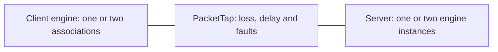

# Post-handshake client authentication

## Contract and selected profile

Enable `postHandshakeAuthEnabled` on both endpoints. The client advertises the empty `post_handshake_auth` extension (49) in ClientHello; the server never advertises it. `requestClientAuthentication(handle)` admits one server request on an established certificate or ticket-selected association. Full external-PSK authentication refuses the operation, including when the client advertises support. A subsequently selected ticket permits it even if the original connection used external PSK. This follows [RFC 9846 §§4.3.6, 4.4.2 and 4.7.2](https://datatracker.ietf.org/doc/html/rfc9846#section-4.7.2), with [RFC 9147 handshake recovery](https://www.rfc-editor.org/rfc/rfc9147.html#section-5.8).

The server issues a 16-byte context: an eight-byte engine-lifetime serial followed by eight modeled random bytes. The serial is not reset by stop/start and exhaustion refuses further requests. This represents uniqueness and modeled randomness, not cryptographic unpredictability. The client echoes the context in Certificate, selects an offered signature scheme from its local preferences, and sends Certificate, CertificateVerify and Finished with consecutive handshake sequence numbers. Setting `postHandshakeCertificateAvailable = false` declines with an empty Certificate and Finished. The selected server policy requires a certificate and fails the association on a declined, mismatched or expired request. Certificates, signatures and Finished remain the existing abstract representations; no X.509 validation or real signature/transcript computation is introduced.

Only the server reports `ICallback::authenticationResult(handle, success, identity)`. Success follows verification of the context, configured identity, signature profile and Finished length. Failure accompanies invalidation or closure and is reported once for the active request. A synchronous refusal produces no result. Resetting the active request before the success callback permits another request from that callback. All terminal paths cancel owned timers. The client does not receive a callback claiming that the server accepted its response.

`getPeerAuthentication(handle, result)` returns the established peer identity, whether it has certificate authentication, and whether this association selected a ticket. Initial mutual authentication sets this state without a PHA callback. Tickets capture the local peer state at issuance/cache receipt; PHA updates the current association but never upgrades an older ticket. Resumption restores that saved context without a fresh PHA result. `DtlsSocket` forwards both operations. `DtlsSocketIo` logs outcomes and emits `authenticationResult` (1/0).

## Ownership, bounds and ordering

The association owns one active server request. Each client response retains its own recovery owner keyed by the peer request sequence, so a second legitimate request can complete while the first response awaits a lost ACK. Full ACK coverage releases that response and its context. A repeated request sequence is re-ACKed without another response or logical verification charge. Reusing a context still retained for response recovery fails. The receiver does not keep an unbounded history of retired contexts; the issuer's monotonic counter supplies lifetime uniqueness. Handshake message sequences never wrap: the receive sequence uses an exhaustion sentinel after 65535.

Retained post-handshake fragment bodies, their handshake headers and held application payloads share `maxPendingBytes` when PHA is enabled. Existing processing/reassembly limits apply independently. The server refuses insufficient request-body or processing-queue capacity before consuming a handshake sequence. A mandatory client response that cannot be retained/generated fails its association. CID admission rolls back newly allocated lookup entries if this shared bound refuses its output. This is a finite memory model; it does not claim allocator overhead is counted byte for byte.

From the first response fragment's protection-service start through the first Finished handoff, that association emits only its Certificate/CertificateVerify/Finished flight. Ordinary application data waits, ACK records retain their pending entries, and independent CID/ticket/KeyUpdate output resumes afterward. Queued work is checked both before service and before handoff. An active service keeps its charge. The fence applies per association, so another association using the same engine can send and receive during the response. After the first Finished handoff, selective DTLS retransmissions recover independently and may interleave with ordinary traffic.

Heartbeat requests/responses and retry/deadline timers pause during the active server request, or from the client's first accepted request fragment through its first Finished handoff. The remaining probe deadline resumes afterward. Queued/active requests retain their token rather than completing as an output refusal solely because of authentication. A newly observed candidate path can wait for the shared probe slot; local address/rebind operations refuse while authentication is active. The migration fixture preserves the old return path until authentication completes. Loss of that only usable path during the ordered response can still cause the authentication deadline to fail; arbitrary simultaneous mobility is not promised.

## Fixtures and observations

All cases use production DTLS/UDP/IP/Ethernet on `TapPairNetwork`: two StandardHosts and PacketTap with two 1 ms half-links. They pin seed 0, declared checksum/FCS modes, static IPv4 addressing with GlobalArp, finite simulation limits, certificate profile and 5 ms/3 ms record output/input costs unless stated. PacketTap drops, delays, duplicates or mutates actual produced records. The driver invokes production APIs and records callbacks; it implements no authentication or recovery protocol.

| Case suffix | Setup, stimulus and required observation |
| --- | --- |
| Base `Rfc9147PostHandshakeAuth` | Initially anonymous client; two requests succeed with distinct nonempty contexts. A concurrent request and client-initiated request refuse. Both data directions remain usable and establishment occurs once. |
| `AbsentCapability`, `DisabledServer`, `ExternalPsk` | Refuse synchronous admission for each unsupported condition, without a result or association error; ordinary data still delivers. |
| `EmptyCertificate` | Client declines using its local availability setting. Require one negative server result and one invalidation. |
| `WrongContext`, `WrongIdentity` | Mutate the echoed context or modeled identity bytes in a real Certificate. Require failure without another success. |
| `Deadline` | Drop client Certificate records while ordinary server data is sent. Require one negative result and invalidation at the server deadline. |
| `Ordering` | Use an 8 KiB client certificate, 128-byte UDP budget and 20 ms logical costs. Queue application data, KeyUpdate and immediate CID replacement during the response. Require more than 80 certificate fragments, consecutive response sequence numbers, no other wire message before Finished, then deferred work and delivery. |
| `AckLoss` | Suppress response ACKs across two requests, then release them. Require both contexts to complete, fresh-numbered retransmission, exactly six server logical-verification charges and continuing data. |
| `DuplicateContext` | Keep the first response awaiting ACK and mutate a second request to its context. Require client failure and a negative second server result. |
| `ProbePause` | Lose one real server probe response, then use 600 ms client logical generation costs. Authentication lasts longer than a one-second probe deadline. Require no probe output or expiry during authentication and success of the original probe afterward. |
| `TicketSnapshot` | Use SHA-384, issue a ticket before PHA, authenticate and reconnect. Require the resumed server's original anonymous snapshot and no new result until another explicit successful request. The client restores its own saved server-certificate context. |
| `MutualSnapshot` | Initially authenticate the client, then resume. Require the saved authenticated state with no PHA result, followed by one explicit fresh result. |
| `PskTicket` | Refuse on the original external-PSK association; resume its ticket and require successful PHA. |
| `RequestBudget`, `ResponseBudget` | Set a 16-byte server pending bound (and 12-byte client bound for KeyUpdate) or a 100-byte client response bound. Require synchronous request/update refusal with usable ordinary traffic, or mandatory response failure followed by one server deadline result. |
| `EpochSix` | Complete three requested bidirectional KeyUpdates, then authenticate and deliver data. Require application-epoch handling despite the unified header's epoch-two bit pattern. |
| `Migration` | Obtain spares, start PHA and translate client port 4434 to 5534 during its response; preserve the old inbound mapping. Require local rebind refusal, no premature validation probe, authentication, then path confirmation and actual reverse-translated delivery. |
| `Overlap` | Delay the first ticket, drop a request and a protected ACK while starting server CID replacement, KeyUpdate and PHA. Require independent retries, one PHA success and ordinary data across the handshake-sequence gap. |
| `Close` | Suppress response messages and close the requesting server. Wait past its authentication deadline; require one negative result, one close and no late error. |
| `Isolation` | Open a second association through the same client engine to a second server instance. While the first emits an 8 KiB response at 128-byte UDP budget, deliver ordinary data and a reply on the second before the response's Finished. |

Serializer units check nonempty request contexts and empty contextual Certificates; offer units check extension 49's empty-body requirement. Store units check that duplicate insertion cannot upgrade a saved authentication snapshot. Execution counts, exact commands and remaining validation belong to the [execution ledger](../../../doc/project/evidence/model/dtls/extensions.md).

These cases establish the finite abstract model behavior. They do not prove real cryptographic authentication, real-endpoint interoperability, arbitrary loss/routing schedules, or release-mode behavior. Mermaid rendering is unverified.
