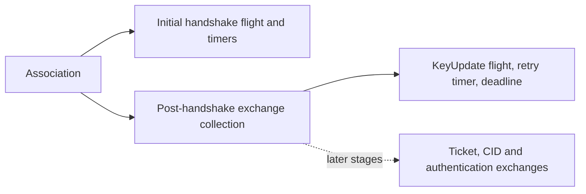

# Independent post-handshake recovery owners

> **Kind:** report · **Status:** snapshot 2026-11-16 · **Seal:** none · **Owns:** — · **Stands on:** [extension plan](../../../plan/pending/dtls-extensions.md)

This is C2, `dtls: refactor: share post-handshake exchange recovery`. RFC 9147 §5.8.4 requires independently recoverable post-handshake categories. The parent association stores KeyUpdate's flight, timers and retry interval directly. Group those values in an association-owned exchange collection, keeping KeyUpdate's message types, timer names, sampling points, callbacks and epoch transitions unchanged. Later commits add consumers; this refactor does not negotiate a new capability.



The initial handshake remains separate. Cancelling one post-handshake owner's timers cannot cancel another owner's deadline. Association teardown cancels all owners before they are destroyed. Record-to-flight identity is still checked before output handoff and ACK retirement; no generation counter or new event is introduced.

| Case | Setup, stimulus and assertion | Parent comparison and limits |
| --- | --- | --- |
| [DtlsPostHandshakeExchange_1.test](../../module/DtlsPostHandshakeExchange_1.test) | One module creates two exchange values with separate flights. ACK record 7 only in the first, cancel/destroy it at 0.5 s, observe the second's retry at 2 s and unchanged deadline at 4 s, then destroy the second before that deadline. No cancelled timer may arrive. Seed 0; 6 s limit. | The parent lacks the helper, so this case is unavailable there rather than a measured wire failure. It establishes ownership and timer isolation, not a ticket/CID exchange. |
| [Rfc9147KeyUpdate.test](Rfc9147KeyUpdate.test) | Existing two-host production fixture suppresses an update ACK. Retransmission preserves the logical update with a fresh record number, holds app data until ACK, then delivers under the new epoch once. | Expected to pass on both trees. A regression would lose recovery or advance epochs incorrectly. |
| [Rfc9147SimultaneousUpdates.test](Rfc9147SimultaneousUpdates.test) | Existing peers independently request updates, including crossed requests and deferred replies. Require ACK-gated progress, ordinary delivery and no response loop. | Expected to pass on both trees; covers the real collection's KeyUpdate consumer. |
| [Rfc9147UpdatePeerIsolation.test](Rfc9147UpdatePeerIsolation.test) | Existing shared server has one stalled update while another peer exchanges data. Required observations prove unrelated progress. | Expected to pass on both trees; no claim about the unimplemented extension categories. |
| [Rfc9147UpdateRequestGuard.test](Rfc9147UpdateRequestGuard.test) | Positive input cost separates peer-update admission from processing; ACK and old duplicates must not prematurely clear the requested-update guard. | Existing preservation control, expected to pass on both trees. |
| [Rfc9147PeerRequestActiveProtection.test](Rfc9147PeerRequestActiveProtection.test) | Admit a peer request during active app protection and require its response before app output, without duplicate app service. | Existing preservation control for shared processor ordering. |

The existing `DtlsRecoveryLifecycle_1`, `DtlsRestartLifecycle_1` and `DtlsSenderState_1` module cases additionally pass. They check engine-owned timer cleanup, repeated restart and sender limits respectively; their production setup remains unchanged.

New and existing cases must run against a fresh debug library:

```sh
opp_run_module_tests --load . -p inet -m debug -f 'DtlsPostHandshakeExchange_1\.test$'
opp_run_protocol_tests --load . -p inet -m debug -w '^tests/protocol/dtls$' -f 'Rfc9147(KeyUpdate|SimultaneousUpdates|UpdatePeerIsolation)\.test$'
```

Execution status and the complete selectors are recorded in the [extension record](../../../doc/project/evidence/model/dtls/extensions.md): a fresh debug build, four module cases and five protocol cases pass. No exact-parent runtime comparison, release-mode execution or diagram rendering has been performed.
