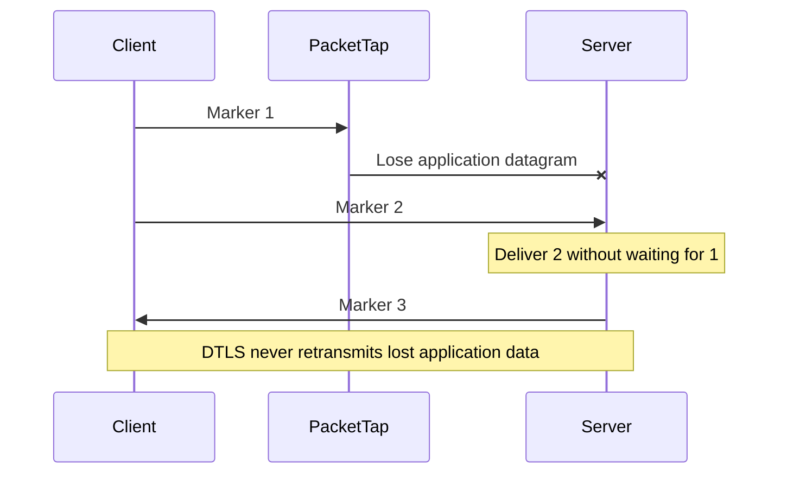
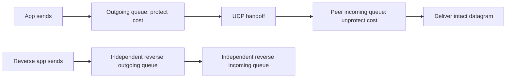

# Protected application datagrams

> **Kind:** report · **Status:** snapshot 2026-11-16 · **Seal:** none · **Owns:** — · **Stands on:** [dtls.md](../../../plan/pending/dtls.md)

This is the reviewer document for C5, `dtls: add: deliver protected datagrams with epoch and replay checks`. The protection model follows INET IPsec: an EncryptedChunk retains represented content and a separate modeled 16-byte tag contributes size. No real encryption, MAC verification or cryptographic interoperability is claimed.

## Delivery and replay



| Case | Stimulus and required evidence |
| --- | --- |
| [Rfc9147ApplicationDatagrams.test](Rfc9147ApplicationDatagrams.test) | Lose one datagram, then exchange markers in both directions. Require intact boundaries, no application retry, one empty 22-byte record, and local errors for an unknown handle, one byte beyond the 1178-byte payload limit and a one-bit payload. Valid data still delivers after those rejections. |
| [Rfc9147ApplicationReordering.test](Rfc9147ApplicationReordering.test) | Delay marker 1 so marker 2 arrives first; require delivery order 2, 1. |
| [Rfc9147QueuedApplication.test](Rfc9147QueuedApplication.test) | Submit a datagram while ClientHello is in flight; require one delivery after server establishment. |
| [Rfc9147HeldFinished.test](Rfc9147HeldFinished.test) | Delay every client Finished copy while epoch-three data overtakes it. Require discard without a later buffered flush. After Finished, an identical numbered test-tap copy must deliver, proving no premature replay commit; a new marker then delivers normally. |
| [Rfc9147Ipv6.test](Rfc9147Ipv6.test) | After a five-second IPv6 address-configuration warmup, repeat establishment and protected application delivery. |
| [Rfc9147SmallDatagramLimit.test](Rfc9147SmallDatagramLimit.test) | A configured 256-byte budget admits a 234-byte payload plus 22 bytes overhead; reject 235 bytes. |
| [Rfc9147RecordSizeLimits.test](Rfc9147RecordSizeLimits.test) | With a 20,000-byte UDP budget and normal IPv4 fragmentation over Ethernet, deliver 16,384 bytes and locally reject 16,385. Silently discard received ciphertext length 16,641, then deliver a valid record bearing the invalid record's uncommitted future number. |
| [Rfc9147LargeRecordHandshake.test](Rfc9147LargeRecordHandshake.test) | A large certificate and 20,000-byte UDP budget still fragment at 16,372 body bytes plus the 12-byte handshake envelope. All plaintext/protected record lengths and ACK entry counts remain bounded; the logical message reassembles once. |
| [Rfc9147InnerPadding.test](Rfc9147InnerPadding.test) | Accept a one-byte payload padded to inner length 16,385 while preserving the separate tag. Discard all-zero/no-type and inner length 16,386 records; valid records with their future numbers still deliver. |
| [Rfc9147ReplayWindow.test](Rfc9147ReplayWindow.test) | Duplicate one record immediately and after seventy newer records. Require all distinct valid markers once, rejecting the duplicate and older-than-window replay. |
| [Rfc9147ReplayWindow8.test](Rfc9147ReplayWindow8.test) | Repeat with an independently configured eight-record window and ten newer records. |
| [Rfc9147ShortSequence.test](Rfc9147ShortSequence.test) | Rewrite a valid received unified header to its one-byte sequence form; require intact delivery. |
| [Rfc9147ShortSequenceWrap.test](Rfc9147ShortSequenceWrap.test) | Send 260 consecutive records with one-byte fields, crossing one low-field wrap. Every marker must arrive once and in arrival order. |
| [Rfc9147ImplicitLength.test](Rfc9147ImplicitLength.test) | Omit the final record's explicit length and use the UDP boundary; require intact delivery. |

Reconstruction is tested where the gap is below half the transmitted number space. The bounded wrap case has consecutive numbers, not a campaign spanning the excluded alias ambiguity. The C2 unit example where expected number 65537 and low field 1 reconstruct to 65537 also explains the limit: headers from original records 1 and 65537 are indistinguishable here without authentication. This suite makes no forged-MAC rejection claim.

## Processing costs and capacity



| Case | Stimulus and required evidence |
| --- | --- |
| [Rfc9147RecordOverhead.test](Rfc9147RecordOverhead.test) | Three 32-byte payloads produce 54-byte records: 5 header + 32 payload + 1 inner type + 16 tag. First departure is after 2 ms, then 2 ms spacing. Nonzero handshake costs must not be charged to app records. |
| [Rfc9147FullDuplexCosts.test](Rfc9147FullDuplexCosts.test) | Both peers burst two records with 5 ms protection and 3 ms unprotection. Each direction departs at 5/10 ms independently; receive callbacks follow those costs and link delay, without also charging configured handshake costs. Timing tolerance is 100 microseconds for Ethernet serialization. |
| [Rfc9147PendingQueueLimit.test](Rfc9147PendingQueueLimit.test) | A pre-establishment 32-byte send fills the pending limit. Both another byte and an empty send must fail; empty pending datagrams consume at least one budget byte. Only admitted content later delivers. |
| [Rfc9147ProcessingQueueLimit.test](Rfc9147ProcessingQueueLimit.test) | With a 1200-byte queue and a separate 1201-byte UDP budget, an empty queue rejects a 1201-byte record. It admits exactly 1200 bytes, including the in-service charge, and rejects another record while occupied. A later admitted record has the consecutive sequence number, proving rejection consumes no sending counter; only admitted markers deliver. |
| [Rfc9147InputQueueLimit.test](Rfc9147InputQueueLimit.test) | With incoming capacity 1199 bytes and nonzero cost, drop a 1200-byte record, admit exactly 1199 bytes and drop another record while occupied. Require resource-limit reason 4 and preserve the association. |

The 1178-byte payload capacity and the alternate 234-byte capacity independently exercise exact record-size boundaries. Output/capacity assertions use actual DTLS handoff lengths, rather than a helper's predicted packet size. C3's dedicated ClientHello test checks handshake-cost sampling separately; the application cost case detects accidental extra handshake charging.

## Invalid input

| Case | Stimulus and required evidence |
| --- | --- |
| [Rfc9147InvalidRecord.test](Rfc9147InvalidRecord.test) | Change a real protected application's epoch bits to unsupported epoch 1. Require a drop, then later valid delivery without destroying the association. |
| [Rfc9147MalformedInner.test](Rfc9147MalformedInner.test) | A duplicate uses a future unused record number but inner type 255. Require a drop; later valid traffic reaching that number must deliver, proving invalid input did not commit replay state. |
| [Rfc9147ModeledCorruption.test](Rfc9147ModeledCorruption.test) | Mark one real frame erroneous, then send valid data. Only the valid marker delivers. Lower layers may drop the erroneous frame; this does not test a forged MAC. |
| [Rfc9147InvalidRecordTimer.test](Rfc9147InvalidRecordTimer.test) | During a blackholed handshake, inject malformed input halfway through the initial timeout. The original retry schedule remains unchanged; deadline cleanup leaves no later retry. |

Typed tap predicates identify actual represented record content. Length-changing mutations repair DTLS, UDP, IPv4 and enclosing EthernetSignal lengths. A positive original handoff or incoming packet precedes each invalid-input absence assertion.

## Execution

After a matching debug build, select these twenty-three files explicitly or run the full DTLS suite:

```sh
source .envrc
opp_run_protocol_tests --load . -p inet -m debug --no-build --no-concurrent -w '^tests/protocol/dtls$' -f 'Rfc9147(ApplicationDatagrams|ApplicationReordering|QueuedApplication|HeldFinished|Ipv6|SmallDatagramLimit|RecordSizeLimits|LargeRecordHandshake|InnerPadding|ReplayWindow|ReplayWindow8|ShortSequence|ShortSequenceWrap|ImplicitLength|RecordOverhead|FullDuplexCosts|PendingQueueLimit|ProcessingQueueLimit|InputQueueLimit|InvalidRecord|MalformedInner|ModeledCorruption|InvalidRecordTimer)\.test$'
```

Before C5 changes, the frozen C4 capture passed all original twenty cases with seed 0 and debug mode, in groups of seven, seven and six. Exact parent results are `audit/dtls/protocol-c5-parent-batch0.log` through `batch2.log`, with raw output under `audit/dtls/c5-parent/`. This predates the three new size/padding cases and the non-byte admission/consecutive-counter extensions, so it does not prove those additions.

The first twenty-three-case diagnostic passed 21 cases; RecordSizeLimits and LargeRecordHandshake stopped in EthernetEncapsulation because their fixture raised NIC MTU above the encapsulator's fixed 1500-byte payload limit. This was a fixture configuration error, not a DTLS failure. Restoring normal Ethernet MTU lets IPv4 fragment and reassemble the large UDP records. Original diagnostic logs are `audit/dtls/protocol-c5-reviewed-batch0.log` through `batch3.log`, with raw output under `audit/dtls/c5-reviewed/`.

The final matching immutable-payload capture passed **23/23 cases**, including all three new size/padding cases and both extended admission cases. The debug build is `audit/dtls/build-c5-immutable-payload.log`; the exact source manifest is `audit/dtls/source-c5-immutable-payload.sha256`. Four bounded groups of five, seven, seven and four used seed 0 and a 60-second process-group timeout; none timed out. Exact selections/results are `audit/dtls/protocol-c5-immutable-final-batch0.log` through `batch3.log`; all per-case output and error files are preserved under `audit/dtls/c5-immutable-final/`.

The same binary then passed **38/38 C3 and 38/38 C4 regression cases**, giving **99/99 passing protocol cases** across C3–C5. Regression groups selected at most eight cases with the same seed, mode and timeout. Exact logs are `audit/dtls/protocol-c5-regression-c3-batch0.log` through `batch4.log` and `audit/dtls/protocol-c5-regression-c4-batch0.log` through `batch4.log`; raw cases are under `audit/dtls/c5-regression/`. Unit/module tests complement these wire exchanges with ownership, exact payload-pointer/region-tag preservation and queue-lifetime checks. Mermaid rendering remains unverified.
