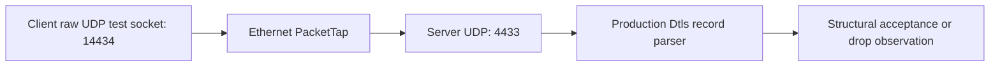

# DTLS record framing and the first production entry point

> **Kind:** report · **Status:** snapshot 2026-11-16 · **Seal:** none · **Owns:** — · **Stands on:** [dtls.md](../../../plan/pending/dtls.md)

This is the reviewer document for C2, `dtls: add: record types and the UDP-backed engine contract`. Its protocol case is [Rfc9147RecordParsing.test](Rfc9147RecordParsing.test). The implementation adds the UDP-backed `Dtls` engine and its record parser; the parent has no DTLS module, so its absence is a setup gap, not an observed protocol failure. RFC 9147 sections 4, 4.1, 4.3 and 4.5.2 define the record boundaries and invalid-record behavior tested here.

## Setup and stimulus

Two StandardHosts share an Ethernet link with the existing PacketTap between them. Both use declared UDP checksums and Ethernet FCS, static neighbor resolution and seed 0. The server binds UDP port 4433 and registers the DTLS listener. The client does not open an association; its independent UDP test socket on port 14434 sends crafted records through the ordinary UDP/IP/Ethernet path. The test helper does not call the record parser directly.



The first datagram contains a plaintext header claiming 20 payload bytes but carries no payload. Its positive stimulus observation is the client's UDP send. The server must report malformed-record reason 1. A separate two-byte plaintext-header prefix requires the same malformed outcome. A correctly sized unified record with epoch bits 1 follows; with no matching association/protection state it must report unknown-epoch reason 2.

The fourth datagram concatenates two complete empty ACK records followed by a malformed one-byte tail. Two epoch-zero `recordAccepted` observations prove that framing reaches both records in the same UDP payload; one malformed drop terminates only its unparseable remainder. A fifth, separate, valid ACK datagram must then be structurally accepted. This proves that the malformed tail does not poison the next UDP datagram. No ACK response is expected for an unbound ACK, and no application data or established callback may result.

## Assertions and limits

`recordAccepted` means structural framing acceptance; it does not mean authentication, handshake progress or application delivery. Drop-reason integers are model observation codes, not on-wire alert numbers. The program checks the named parser outcomes and then verifies zero server establishments and no delivered application payloads. It uses positive wire transmission before the absence checks so a disconnected fixture cannot pass vacuously.

The test does not establish a handshake, exercise replay-window state, authenticate protected content, or prove that a ciphertext can be exported as real bytes. Separate unit tests in C2 cover represented header serialization and truncated-number reconstruction. Module tests cover queue timing and lifecycle ownership. Those helper/module checks complement this production entry-path test.

## Execution

From the checkout root, after a fresh debug INET library:

```sh
source .envrc
opp_run_protocol_tests --load . -p inet -m debug --no-build -w '^tests/protocol/dtls$' -f 'Rfc9147RecordParsing\.test$'
```

Execution on 2026-11-16: **PASS**, debug mode, seed 0, using the isolated C2 foundation and a fresh matching `libINET_dbg.so`. The test compiled and ran through ordinary UDP delivery, rejected the truncated header and impossible payload length, accepted both concatenated ACKs, discarded their malformed tail and accepted the following datagram. The final focused run took 14.169 seconds including its generated test build. Raw runner output is retained as `audit/dtls/c2-isolated/protocol-c2-final.log` in the implementation checkout, with generated simulation output preserved alongside it. Three serializer/state unit cases and two queue/lifecycle module cases also pass on this foundation. These ignored artifacts are local evidence, not committed fixtures. No fingerprint baseline was changed. Mermaid rendering remains unverified.
