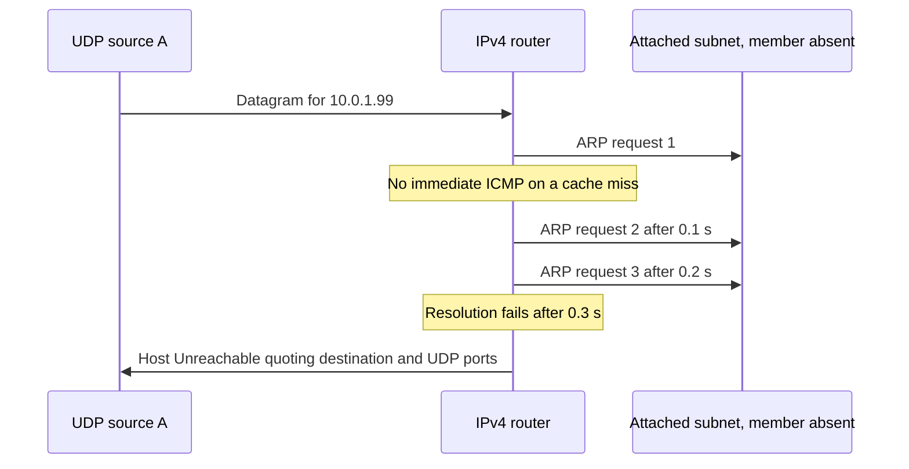

# Forwarded datagrams after ARP exhaustion

C8a supplies the router-side error needed when an advertised subnet member does not exist. The source sends real traffic through an IPv4 router toward an unassigned address on the router's second Ethernet subnet. Native ARP sends three requests, at a configured 0.1-second retry interval. The test does not manufacture an ARP notification or an ICMP response.

The local-origin control deliberately remains silent. RFC 1122's host policy is not changed merely to provide RFC 1812 router behavior and RFC 3561 section 7's missing-member response. The existing ARP `Rfc1122NoDestinationUnreachable.test` remains a separate compatibility control.



All `ArpFailureUnreachable<Case>.test` cases use General/run 0/seed 0, fixed addresses, native `Arp` and Ethernet. They observe the actual `arpRequestSent` signal for the absent destination, then native router LOCALOUT and the source socket indication. The source checks type 3/code 1, destination 10.0.1.99 and ports 31000/32000. No indication may precede the three requests and the full retry deadline.

`Transit` requires one forwarded original, one failure drop and one matching Host Unreachable. `MultiplePackets` queues three real forwarded originals behind the same resolution attempt; the request count stays three while each eligible original gets one report and one disposal. `Local` sends to unassigned 10.0.0.99 on the source's own subnet, observes three real ARP requests, disposal and no ICMP report. `SuppressedError` forwards a real ICMP error toward the absent member and requires error-about-error suppression, including no generated error on the router's output path. `StopPending` shuts down the whole router after the first request and requires silent disposal, no later retry, no resolution-failure report and no source error.

A test-only IPv4 input adapter replaces each received original with a counted `Packet` copy, then calls the unchanged native input handler. It changes no routing, ARP, error or queue decision. Constructor/destructor counts prove the router-owned original is live before the resolution deadline and disposed exactly once afterwards; local-origin packets use the same counted class directly. The assertions also count drops and source errors, so returning the wrong ICMP type or quoting a different member cannot satisfy the fixture.

The parent silently clears the router's ARP-pending queue. Its source-grounded expected failure is the missing Host Unreachable in `Transit` and `MultiplePackets`; the local, suppression and shutdown cases are controls. No parent runtime comparison has yet been executed. The patch must detach pending packets before invoking the owner error path, which consumes the original, and must preserve suppression and local-origin policy.

On 2026-11-14, after the fresh debug INET build recorded in `/tmp/aodv-remaining-debug-build-8.log`, the following command ran from `/home/miguel/workspace/inet-aodv` with General/run 0/seed 0. The INET debug library SHA-256 was `94959d33c3a6a4b7457ce1dde67c073b8ca5c806e155b1df1c5e300837a58d04` before and after the full 20-case C2/C8a verification batch:

```sh
flock /tmp/inet-aodv-test-runner.lock opp_run_protocol_tests --load . -p inet -m debug --no-build --no-concurrent -w '^tests/protocol/(ipv4|arp)$' -f '(ArpFailureUnreachable[A-Za-z0-9_]+|Rfc1122NoDestinationUnreachable)\.test$'
```

All five new cases and the existing host-silent control passed; command exit status was 0. Execution and artifact copying held the same checkout-wide lock. Raw runner output is `audit/aodv-remaining-features/netfilter-debug8-final/c8a-protocol.log`; per-case stdout, stderr, INI and NED files are preserved in that directory's `artifacts/{ipv4,arp}/`. Its `verification.json` records the exact commands, working directory, UTC start time, source HEAD, mode, seed, exit codes, artifact counts and library hashes. These ignored workspace artifacts are local execution evidence rather than committed test inputs. The deterministic assertions establish the bounded forwarding/host distinction and native ARP timing above, not arbitrary link-failure behavior or an executed parent comparison.

The diagram matches the exercised sequence. Mermaid rendering passed in the series-wide [implementation record](../../../doc/project/evidence/model/aodv/remaining-features-results.md).
