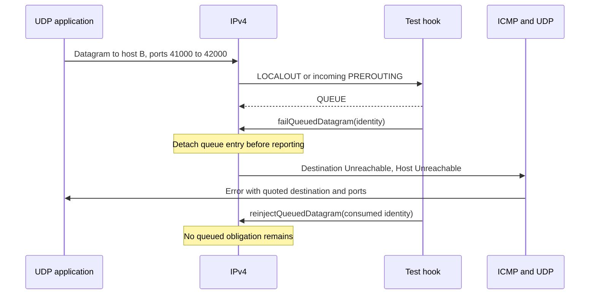

# Queued IPv4 failure reporting

These C2 tests exercise `INetfilter::failQueuedDatagram()` through a real IPv4 hook and native ICMP/UDP delivery. An application sends one datagram, a hook returns QUEUE, and a later application event calls the public failure operation with the borrowed pointer identity. The application never takes the queued packet from IP.



All cases are separate `.test` files named `QueuedDatagramFailure<Case>.test`, with General/run 0/seed 0 and fixed Ethernet links. `LocalUnspecified` and `LocalBound` leave the source unspecified or explicitly bind the source address. Both require one socket error with ICMP type 3/code 1 and the original destination and ports. A test-only `Packet` destructor count establishes that the local original is consumed exactly once. No queued original may reach the forwarding/postrouting hook, and reinjection of its consumed identity must be inert.

`UnknownPointer` first passes an independently owned live packet that was never queued. It must stay owned by the caller; the real queued packet must still produce its error. `RepeatedFailure` calls failure twice for the same consumed identity, requiring one disposal and one error. Neither test dereferences the consumed identity.

`Transit` queues the application's datagram at a real router's PREROUTING hook. The error must travel back through Ethernet/IP to the source socket with its original member destination. `SuppressedIcmp` sends an actual ICMP error through the source IP path and queues it at the router. Failure must not produce an error about that received ICMP error. These incoming-path cases establish detachment and native error/suppression behavior; their packet identities can change through link-layer duplication, so their evidence is not a destructor count of the received router packet.

The companion module tests are `tests/module/QueuedDatagramFailureLifecycle.test` and `tests/module/NextHopQueuedFailure.test`. The lifecycle case fails one local datagram, then shuts down the whole source node with another datagram queued. It accepts either synchronous completion or the real `IDoneCallback` completion path before checking disposal. Shutdown must dispose silently, and a later stale-identity failure/reinjection call must be inert. The next-hop case queues a real locally originated next-hop datagram and requires silent disposal because that network protocol has no IP error protocol.

The parent lacks the API, so this fixture cannot compile unchanged there. That is a feature dependency, not a runtime parent failure. The implementation difference is that the new operation detaches the queued record before calling the existing native ICMP path; the existing deletion-only operation remains available and unchanged.

On 2026-11-14, the following commands ran from `/home/miguel/workspace/inet-aodv` after the fresh matching debug build recorded in `/tmp/aodv-remaining-debug-build-8.log` and shared support build in `/tmp/aodv-protocol-support-build.log`. Each fixture uses General/run 0/seed 0. The INET debug library SHA-256 was `94959d33c3a6a4b7457ce1dde67c073b8ca5c806e155b1df1c5e300837a58d04` before and after the full 20-case C2/C8a verification batch:

```sh
flock /tmp/inet-aodv-test-runner.lock opp_run_module_tests --load . -p inet -m debug --no-build --no-concurrent -f '(QueuedDatagramFailureLifecycle|NextHopQueuedFailure)\.test$'
flock /tmp/inet-aodv-test-runner.lock opp_run_protocol_tests --load . -p inet -m debug --no-build --no-concurrent -w '^tests/protocol/(ipv4|ipv6)$' -f 'QueuedDatagramFailure[A-Za-z0-9_]+\.test$'
```

Both module cases and all 12 protocol cases (six IPv4 and six IPv6) passed; both commands exited 0. The final commands and artifact copies were serialized under the same checkout-wide lock so a filtered invocation could not delete another invocation's shared work directory. Raw output is in `audit/aodv-remaining-features/netfilter-debug8-final/{c2-module,c2-protocol}.log`. Per-case stdout, stderr, INI and NED files are preserved in that directory's `artifacts/{module,ipv4,ipv6}/` subdirectories. Its `verification.json` records the exact commands, working directory, UTC start time, source HEAD, mode, seed, exit codes, artifact counts and library hashes. These ignored workspace artifacts are local execution evidence rather than committed test inputs.

The diagram matches the exercised sequence. Mermaid rendering passed in the series-wide [implementation record](../../../doc/project/evidence/model/aodv/remaining-features-results.md).
