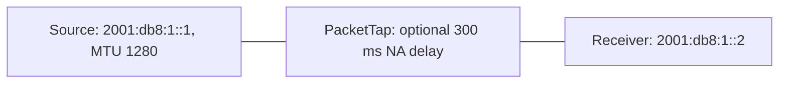

# IPv6 requests to suppress source fragmentation

This local API prerequisite lets datagram probe users request a packet that cannot be fragmented by its source. `Ipv6::fragmentAndSend()` reads the existing `FragmentationReq.dontFragment` tag after routing and neighbor resolution. If a locally generated packet exceeds the selected interface's MTU and the tag is true, IPv6 emits `packetDropped` with reason `PACKET_TOO_BIG`, increments its drop counter and deletes the packet. The fitting-packet branch precedes this check. Forwarded packets retain their existing ICMPv6 Packet Too Big path. Absent or false tags retain source fragmentation. No new tag, UDP API or IPv6 wire requirement is introduced.

## Topology and configuration

The two new cases use `TapPairNetwork`: two StandardHosts, IPv6 only, with PacketTap between two 1 ms Ethernet half-links at 100 Mbps. `Ipv6NetworkConfigurator` assigns 2001:db8:1::1 and ::2 on one /64 and configures on-link routes. Each host's `Ipv6NodeConfigurator` explicitly references it. DAD for the static addresses is disabled. Normal neighbor discovery still resolves the peer's MAC address. The source interface has MTU 1280 bytes. Checksums and FCS are declared, seed is 0, and the simulation limit is two seconds.

Three real `UdpBasicApp` instances send one packet each through UDP and IPv6, and three `UdpSink` instances listen at the peer:

| Send time | UDP destination | Application bytes | Tag | Required observation |
| --- | --- | --- | --- | --- |
| 0.2 s | 5001 | 1452 | `dontFragment = true` | The 1500-byte IPv6 datagram drops locally; no frame or UDP delivery for it. |
| 0.3 s | 5000 | 32 | `dontFragment = true` | One unfragmented packet and a 40-byte UDP datagram arrive. |
| 0.4 s | 5002 | 1452 | Absent | Two source fragments, one identification, offsets 0/1232 and M flags true/false; the receiver reassembles and delivers 1460 UDP bytes. |

`Ipv6DontFragmentRequest.test` uses normal neighbor resolution. Its forbidden-packet drop must occur before 0.3 s. `Ipv6DontFragmentRequestDelayed.test` delays the first real Neighbor Advertisement from the receiver by 300 ms, queuing the first packet and subsequent output during resolution. Its drop must occur at or after 0.5 s. Both require exactly one drop, exactly two source fragments belonging only to the untagged packet, one small source packet and receiver delivery only to ports 5000/5002. The observers run through 1.5 s, so absence of forbidden output/delivery is bounded by an explicit finite window.

`Rfc8200SourceFragmentation.test` is the existing routed control. It now explicitly sets the application's `dontFragment` option false and continues to require source fragmentation, unchanged forwarding of both fragments, and reassembled UDP delivery. The application's false option emits no tag.

## Parent comparison and limits

The new fixtures run on parent `7bbb8784c2` before the source change. Both reach the final runtime assertion and fail because the parent emits no requested local drop. Raw logs show two fragmentation operations and delivery to all three UDP ports, including forbidden port 5001. The delayed case additionally records the actual 300 ms Neighbor Advertisement delay. These are behavior failures, separate from an earlier NED-package-exclusion setup correction. The existing source-fragmentation control passes on the parent. The same fixture bytes are used against the changed library; hashes and raw logs are recorded under `audit/dtls-extensions/`.

One trailing-space-only blank line was trimmed after the causal runs; the recorded hashes describe the compared versions. Executed child commands/results belong to the [DTLS extension execution ledger](../../../doc/project/evidence/model/dtls/extensions.md). This evidence checks local API behavior through production queues and source fragmentation. It does not demonstrate DTLS path-MTU discovery, arbitrary extension-header fragmentation, or release-mode behavior. Mermaid rendering is unverified.
